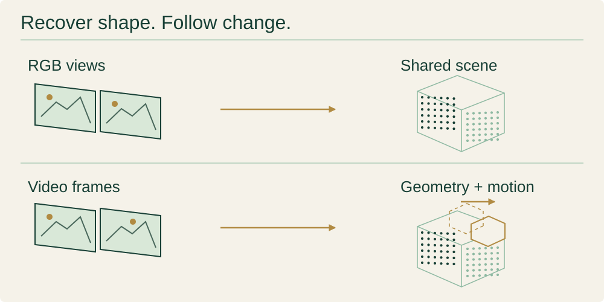
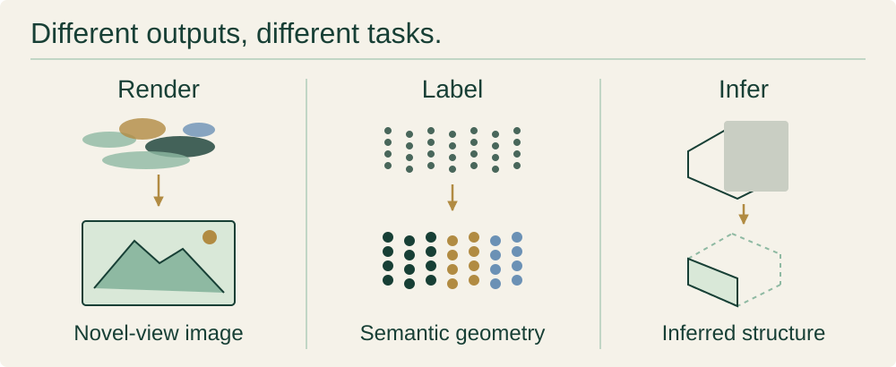
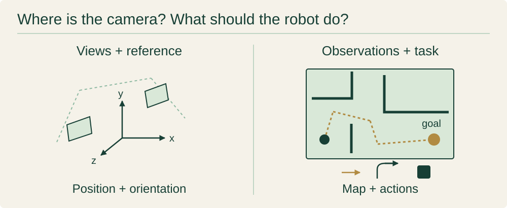

# DUSt3R Paper Collection

<div align="center">

**From images to geometry. A reading map for feed-forward 3D vision.**

Source-linked paper notes, organized by the problem each method solves.<br>
Start with the inputs and outputs, then follow the method and its evidence.

[](docs/papers-list.md)

</div>


<div align="center">

**[Browse all papers →](docs/papers-list.md)** · **[Start reading](#start-reading)** · **[Explore by task](#explore-by-question)**

[Selected additions](#selected-additions) · [Verification](#verification) · [Change log (KO)](log.md)

</div>

> A source-linked collection of **337 papers** on DUSt3R and related feed-forward 3D research.
> This homepage is in English. Detailed notes include Korean explanations; **Notes (KO)** identifies those links.
> Document counts are not counts of fully verified papers. Read each result with its source, protocol and limitations.

## Start reading

Compare the same question across four representative methods: **what goes in, what comes out, and what connects them?**
This is a reading guide, not a performance ranking or a claim of direct lineage.

| Paper      | Input → Output                       | Key idea                                     | Links                                                                                                                                    |
| ---------- | ------------------------------------ | -------------------------------------------- | ---------------------------------------------------------------------------------------------------------------------------------------- |
| **DUSt3R** | Image pair → pointmaps               | Predict both views in a shared frame.        | [Notes (KO)](docs/foundation/dust3r.md) · [Paper](https://arxiv.org/abs/2312.14132) · [Code](https://github.com/naver/dust3r)            |
| **MASt3R** | Image pair → geometry + matches      | Add local descriptors for matching.          | [Notes (KO)](docs/foundation/mast3r.md) · [Paper](https://arxiv.org/abs/2406.09756) · [Code](https://github.com/naver/mast3r)            |
| **VGGT**   | Image set → cameras + dense geometry | Alternate attention within and across views. | [Notes (KO)](docs/reconstruction/vggt.md) · [Paper](https://arxiv.org/abs/2503.11651) · [Code](https://github.com/facebookresearch/vggt) |
| **MUSt3R** | Images + memory → shared pointmaps   | Reuse features stored at decoder layers.     | [Notes (KO)](docs/reconstruction/must3r.md) · [Paper](https://arxiv.org/abs/2503.01661) · [Code](https://github.com/naver/must3r)        |

<details>
<summary>Images to 3D: the common vocabulary</summary>

## Images to 3D


A **pointmap** stores a 3D coordinate for each image pixel. Depth, camera parameters and confidence are related outputs, but their availability depends on the method.
Separate input calibration, training supervision and inference-time optimization when comparing papers.
For example, DUSt3R predicts a pair of pointmaps; its multi-image pipeline adds global alignment optimization.

</details>

## Explore by question

### Recover geometry

**Learn a representation, reconstruct a scene, or follow it through time.**



| Task / main folder                                            | Input → typical output                  | Reading tags / example                                                             |
| ------------------------------------------------------------- | --------------------------------------- | ---------------------------------------------------------------------------------- |
| Learn reusable geometry · [Foundation](docs/foundation/)      | Views → geometric features or pointmaps | `cross-view` · `matching` · [DUSt3R notes (KO)](docs/foundation/dust3r.md)         |
| Recover static shape · [Reconstruction](docs/reconstruction/) | Views → aligned scene geometry          | `streaming` · `mixed cameras` · [Slot3R notes (KO)](docs/reconstruction/slot3r.md) |
| Recover changing scenes · [Dynamic](docs/dynamic/)            | Frames → geometry over time             | `motion` · `persistent state` · [CUT3R notes (KO)](docs/dynamic/cut3r.md)          |

### Render and interpret

**Predict a new image, attach meaning to geometry, or infer what is hidden.**



| Task / main folder                                                    | Input → typical output                           | Reading tags / example                                                      |
| --------------------------------------------------------------------- | ------------------------------------------------ | --------------------------------------------------------------------------- |
| Synthesize new views · [Gaussian Splatting](docs/gaussian-splatting/) | Views → Gaussians → rendered image               | `novel view` · [Splatt3R notes (KO)](docs/gaussian-splatting/splatt3r.md)   |
| Label the scene · [Understanding](docs/understanding/)                | Views / geometry → labels, objects or properties | `semantic geometry` · [IGGT notes (KO)](docs/understanding/iggt.md)         |
| Infer unseen structure · [Reasoning](docs/reasoning/)                 | Partial observations → inferred geometry         | `amodal` · `completion` · [Amodal3R notes (KO)](docs/reasoning/amodal3r.md) |

### Localize and act

**Estimate where the camera is, then use geometry for mapping or decisions.**



| Task / main folder                                      | Input → typical output                                | Reading tags / example                                                          |
| ------------------------------------------------------- | ----------------------------------------------------- | ------------------------------------------------------------------------------- |
| Estimate pose · [Pose Estimation](docs/pose/)           | Images / references → camera or object pose           | `localization` · [FFVO notes (KO)](docs/pose/ffvo.md)                           |
| Map and interact · [Robotics](docs/robotics/)           | Observations + task → map, calibration or actions     | `SLAM` · `navigation` · [LG-VLN notes (KO)](docs/robotics/lg-vln.md)            |
| Adapt to specialized imagery · [Medical](docs/medical/) | Medical imagery → task-specific geometry              | `endoscopy` · [Endo3R notes (KO)](docs/medical/endo3r.md)                       |
| Test what works · [Surveys & Analysis](docs/surveys/)   | Models + protocols → comparisons and failure analysis | `reliability` · [Confidence Audit notes (KO)](docs/surveys/confidence-audit.md) |

**Folders and tags serve different purposes.** Each paper has one primary filing location in the complete index.
The task groups above are reading routes; the tags are cross-cutting cues, not extra folders or duplicate counts.
For example, `SLAM` spans reconstruction, pose and robotics, while `semantic geometry` spans understanding and reasoning.
Medical is an application-domain folder; its papers can also address motion or reconstruction.
The diagrams show task families, not architectures shared by every paper. [Figure provenance](assets/README.md).

## Selected additions

**Source-review batch: 2026-10-15** — selected entry points, not publication-date rankings.
See the [candidate decisions (KO)](candidates/review-2026-10-15.md) and [change log (KO)](log.md) for the full scope.

| Paper                                                | Input → Output                                      | What to inspect                                                     |
| ---------------------------------------------------- | --------------------------------------------------- | ------------------------------------------------------------------- |
| [Slot3R · Notes (KO)](docs/reconstruction/slot3r.md) | Frames → streaming geometry                         | How state carries information between frames.                       |
| [GeoCond · Notes (KO)](docs/foundation/geocond.md)   | Images + geometric conditions → adapted predictions | Which conditions the model accepts and how reliability is tested.   |
| [MEOW · Notes (KO)](docs/reconstruction/meow.md)     | Mixed-camera views → scene geometry                 | How different camera models enter the reconstruction.               |
| [LG-VLN · Notes (KO)](docs/robotics/lg-vln.md)       | RGB + instruction + camera height → map and actions | Correspondence filtering, scale initialization and pose evaluation. |

<details>
<summary>All primary folders and generated document counts</summary>

## Research categories

These are the existing filing locations. No papers are moved or counted twice by the reading routes above.
Each link opens a category index; detailed notes may contain Korean.

### 🔬 [Foundation Models](docs/foundation/) (30 papers)

Reusable geometric representations, matching and backbone methods.

### 🏗️ [3D Reconstruction](docs/reconstruction/) (128 papers)

Scene geometry, alignment, streaming, mixed cameras and reconstruction systems.

### 🎬 [Dynamic Scenes](docs/dynamic/) (50 papers)

Geometry and motion in changing scenes.

### ✨ [Gaussian Splatting](docs/gaussian-splatting/) (51 papers)

Explicit scene representations and novel-view rendering.

### 🧠 [Scene Understanding](docs/understanding/) (26 papers)

Semantic labels, objects and features attached to geometry.

### 🔍 [Scene Reasoning](docs/reasoning/) (7 papers)

Hidden structure, completion and spatial inference.

### 🤖 [Robotics](docs/robotics/) (22 papers)

Calibration, mapping, navigation and robot-facing applications.

### 📚 [Surveys & Analysis](docs/surveys/) (8 papers)

Evaluation protocols, reliability, comparisons and failure analysis.

### 📍 [Pose Estimation](docs/pose/) (12 papers) · 🏥 [Medical](docs/medical/) (3 papers)

Camera/object localization, and geometry for specialized medical imagery.

</details>

<details>
<summary>Publication-year distribution: CONFIRMED venues only</summary>

## Research landscape

Only the venue years marked **CONFIRMED** in the current paper Overviews are counted.
LIKELY, UNKNOWN and arXiv submission years are excluded. This is not a fresh publication audit of every document.

<!-- GENERATED:histogram -->

```text
2022 █ 1 paper
2023 █ 1 paper
2024 ██████ 4 papers
2025 ████████████████████████████████████████████████████████████ 43 papers
2026 ████████████████████████████████████████████████████████████████ 46 papers
```

<!-- /GENERATED -->

Preprints and papers with unconfirmed venues remain part of the collection.

</details>

## Reading results responsibly

Keep each number beside its source table, dataset, camera inputs, units and alignment protocol.
The same metric name does not make results comparable when GT poses, scale treatment or completed sequences differ.
Start with [Surveys & Analysis](docs/surveys/) for comparisons under a shared protocol.

## Verification

Metadata and results in this collection are checked by scripts in [`tools/`](tools/):

| Check                     | What it does                                                                          |
| ------------------------- | ------------------------------------------------------------------------------------- |
| `verify_metadata.py`      | Venue, authors, arXiv ID against arXiv + DBLP + Semantic Scholar + Crossref           |
| `verify_benchmarks.py`    | Selected numeric tokens in tables against source PDF text; labels need source review  |
| `verify_index_numbers.py` | Checks README numeric claims against paper documents                                  |
| `check_structure.py`      | Seven-section structure and Overview field schema                                     |
| `update_stats.py`         | Document/category counts and the confirmed-venue histogram — generated from documents |

Each paper's Overview carries a `Verification` field:

- **CONFIRMED** — venue proven by DBLP, a publisher DOI, OpenReview, CVF openaccess, or an
  author-maintained badge
- **LIKELY** — a publication candidate or author claim needs corroboration and identity checks
- **PREPRINT** — stored metadata checks found no publication record; indexing delays remain possible
- **UNKNOWN** — publication venue remains unverified, even if the arXiv paper is available.
  The venue says `arXiv preprint`, and the Verification field or a Note states what is missing.

### What verification does not cover

Stated plainly, because a checkmark that overstates itself is worse than none:

- **Benchmark verification does not run in CI.** Source PDFs are gitignored, so it is a
  local gate. CI checks structure, counts, links, and formatting only.
- **Default benchmark checks extract decimals.** `--int` also checks selected integer
  tokens, but cannot establish that the labels, units, or protocols are correct.
  A matching value elsewhere in the PDF can still conceal a wrong table.
- **Coverage is aggregate.** A paper can score above threshold while containing one wholly
  fabricated table. Seven papers were caught this way, after passing an earlier sweep.
- **Prose is weaker than tables.** Derived claims in body text get less scrutiny than the
  tables they cite.

[`log.md`](log.md) records what was found and fixed, including the failure modes above.

## 🤝 Contributing

New papers are welcome. The bar is source-traceability, not volume:

1. Copy [`docs/paper-template.md`](docs/paper-template.md) into the right category.
2. Put the arXiv URL in `Links`. Run `python3 tools/verify_metadata.py --only <slug> --out raw/metadata_<slug>.json`.
   Keep the source verdict. If it is `PREPRINT?` because a source failed, use `UNKNOWN`
   in the document and state the missing evidence. Do not infer a conference from a title.
3. Write the body. **Every number must exist in the source paper.** If the paper reports a
   result only as a plot, say so rather than reading values off the figure.
4. Run `python3 tools/build_papers_list.py`, `python3 tools/update_stats.py`, and
   `python3 tools/build_fact_cards.py`. Reconcile candidate status with
   `python3 tools/reconcile_candidates.py --write`.
5. Format Markdown, run `python3 tools/verify_all.py` (offline checks by default), and
   validate changed numerical tables with `verify_benchmarks.py --only <slugs> --int`.
   Read the source tables as well: matching numeric tokens cannot verify their labels.
6. Add the scope, source versions, results, and remaining limitations to `log.md`.

Corrections to existing papers are especially welcome — if you find a number that does not
match its source, that is a bug worth filing.

## 📄 Citation

```bibtex
@misc{dust3r_paper_collection,
  title  = {DUSt3R Paper Collection: Source-linked Notes on Feed-Forward 3D Reconstruction},
  author = {minoTrey},
  year   = {2026},
  url    = {https://github.com/minoTrey/DUSt3R-Paper-Collection}
}
```

Please cite the individual papers, not this collection, for any result you use.

## 🙏 Acknowledgments

To the authors of all 337 papers, and to NAVER LABS Europe for DUSt3R and MASt3R, which
started this.

License status needs maintainer confirmation: this repository's earlier README referred
to MIT, but no `LICENSE` file is tracked, while `package.json` declares ISC.
This curation does not choose or change license terms. Paper content belongs to its respective authors.
