# DUSt3R Paper Collection

Source-linked paper notes on DUSt3R and related feed-forward 3D research. Start with a research topic, then compare each method's inputs, outputs and evidence.

<div id="research-categories"></div>

## Browse by category

| Visual                                                                                                                                                                                                                                                                        | Category and research focus                                                                                                              |
| ----------------------------------------------------------------------------------------------------------------------------------------------------------------------------------------------------------------------------------------------------------------------------- | ---------------------------------------------------------------------------------------------------------------------------------------- |
| [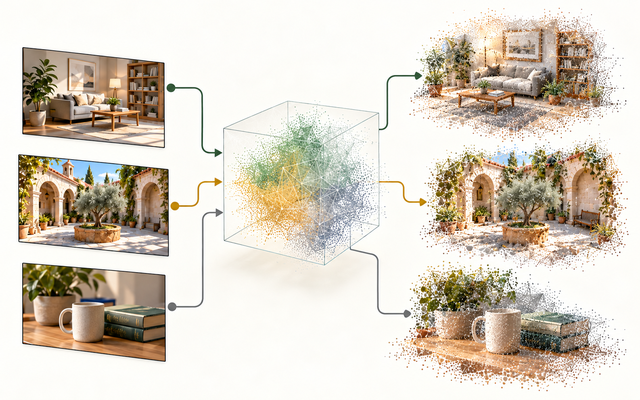](docs/foundation)                  | [Foundation Models](docs/foundation) (5 papers)<br>Core starting models: CroCo, CroCo v2, DUSt3R, MASt3R and VGGT.                       |
| [](docs/extensions)                                  | [Model Extensions](docs/extensions) (50 papers)<br>Efficiency/compression, adaptation/reliability and further pretraining.               |
| [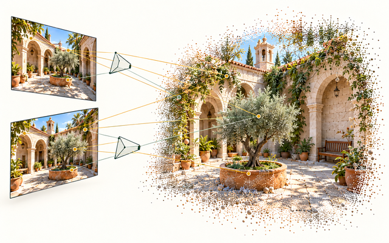](docs/reconstruction)                                     | [3D Reconstruction](docs/reconstruction) (110 papers)<br>Scene geometry, alignment, streaming, mixed cameras and reconstruction systems. |
| [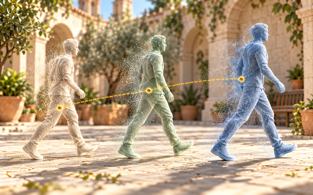](docs/dynamic)                                                 | [Dynamic Scenes](docs/dynamic) (46 papers)<br>Geometry and motion in changing scenes.                                                    |
| [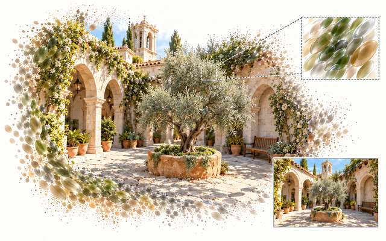](docs/gaussian-splatting)      | [Gaussian Splatting](docs/gaussian-splatting) (61 papers)<br>Explicit scene representations and novel-view rendering.                    |
| [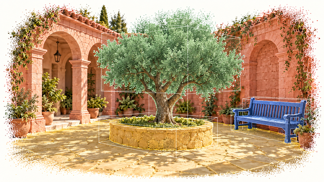](docs/understanding)                              | [Scene Understanding](docs/understanding) (26 papers)<br>Semantic labels, objects and features attached to geometry.                     |
| [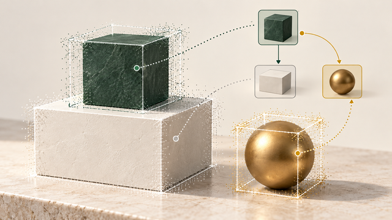](docs/reasoning) | [Scene Reasoning](docs/reasoning) (7 papers)<br>Hidden structure, completion and spatial inference.                                      |
| [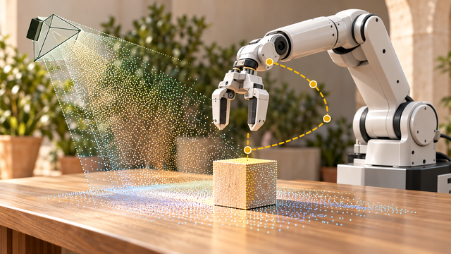](docs/robotics)                            | [Robotics](docs/robotics) (7 papers)<br>Robot policy/action, calibration, collaboration and onboard constraints.                         |
| [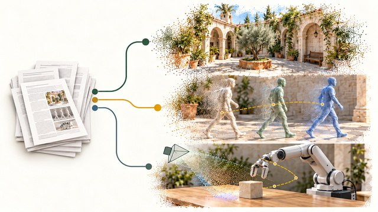](docs/surveys)                           | [Surveys, Benchmarks & Analysis](docs/surveys) (9 papers)<br>Evaluation protocols, reliability, comparisons and failure analysis.        |
| [](docs/pose)                                                                   | [Pose Estimation](docs/pose) (12 papers)<br>Camera and object localization in a reference frame.                                         |
| [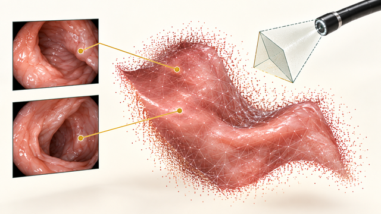](docs/medical)                                           | [Medical](docs/medical) (4 papers)<br>Task-specific geometry for specialized medical imagery.                                            |

[](docs/papers-list.md)

**[Browse all papers →](docs/papers-list.md)** · [Selected additions](#selected-additions) · [Start reading](#start-reading) · [Change log (KO)](log.md)

Paper notes are primarily English. Some legacy passages remain in Korean; see the [language audit](raw/language_correction_2026-10-15.json).

## Selected additions

**Source-review batch: 2026-10-15** — selected entry points, not publication-date rankings.
See the [candidate decisions (KO)](candidates/review-2026-10-15.md) and [change log (KO)](log.md) for the full scope.

| Paper                                         | Input → Output                                      | What to inspect                                                     |
| --------------------------------------------- | --------------------------------------------------- | ------------------------------------------------------------------- |
| [Slot3R · Notes](docs/extensions/slot3r.md)   | Frames → streaming geometry                         | How state carries information between frames.                       |
| [GeoCond · Notes](docs/extensions/geocond.md) | Images + geometric conditions → adapted predictions | Which conditions the model accepts and how reliability is tested.   |
| [MEOW · Notes](docs/reconstruction/meow.md)   | Mixed-camera views → scene geometry                 | How different camera models enter the reconstruction.               |
| [LG-VLN · Notes](docs/robotics/lg-vln.md)     | RGB + instruction + camera height → map and actions | Correspondence filtering, scale initialization and pose evaluation. |

## Start reading

Compare the same question across four representative methods: **what goes in, what comes out, and what connects them?**
This is a reading guide, not a performance ranking or a claim of direct lineage.

| Paper      | Input → Output                       | Key idea                                     | Links                                                                                                                           |
| ---------- | ------------------------------------ | -------------------------------------------- | ------------------------------------------------------------------------------------------------------------------------------- |
| **DUSt3R** | Image pair → pointmaps               | Predict both views in a shared frame.        | [Notes](docs/foundation/dust3r.md) · [Paper](https://arxiv.org/abs/2312.14132) · [Code](https://github.com/naver/dust3r)        |
| **MASt3R** | Image pair → geometry + matches      | Add local descriptors for matching.          | [Notes](docs/foundation/mast3r.md) · [Paper](https://arxiv.org/abs/2406.09756) · [Code](https://github.com/naver/mast3r)        |
| **VGGT**   | Image set → cameras + dense geometry | Alternate attention within and across views. | [Notes](docs/foundation/vggt.md) · [Paper](https://arxiv.org/abs/2503.11651) · [Code](https://github.com/facebookresearch/vggt) |
| **MUSt3R** | Images + memory → shared pointmaps   | Reuse features stored at decoder layers.     | [Notes](docs/reconstruction/must3r.md) · [Paper](https://arxiv.org/abs/2503.01661) · [Code](https://github.com/naver/must3r)    |

## Visual guide

[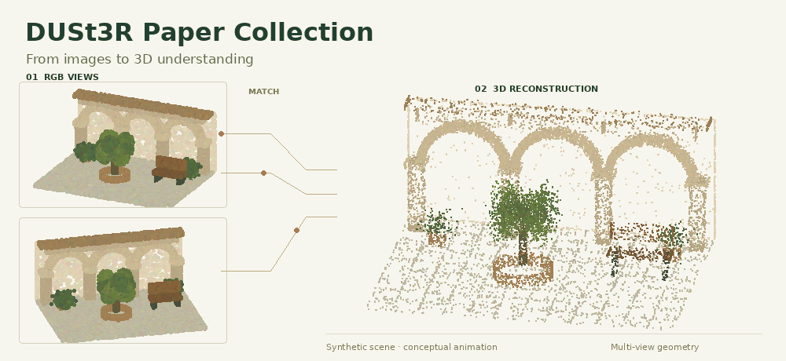](assets/dust3r-animated-hero-poster.png)

[Static version (PNG)](assets/dust3r-animated-hero-poster.png)

Conceptual animation of a synthetic 3D scene; not a paper result.

<details>
<summary>Images to 3D: the common vocabulary</summary>

## Images to 3D

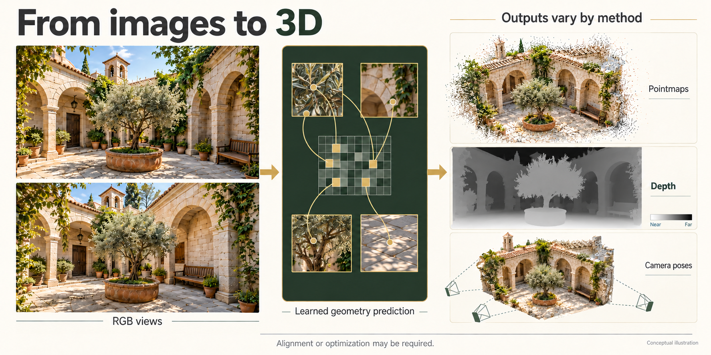

A **pointmap** stores a 3D coordinate for each image pixel. Depth, camera parameters and confidence are related outputs, but their availability depends on the method.
Separate input calibration, training supervision and inference-time optimization when comparing papers.
For example, DUSt3R predicts a pair of pointmaps; its multi-image pipeline adds global alignment optimization.

</details>

## Explore by question

### Recover geometry

**Learn a representation, reconstruct a scene, or follow it through time.**

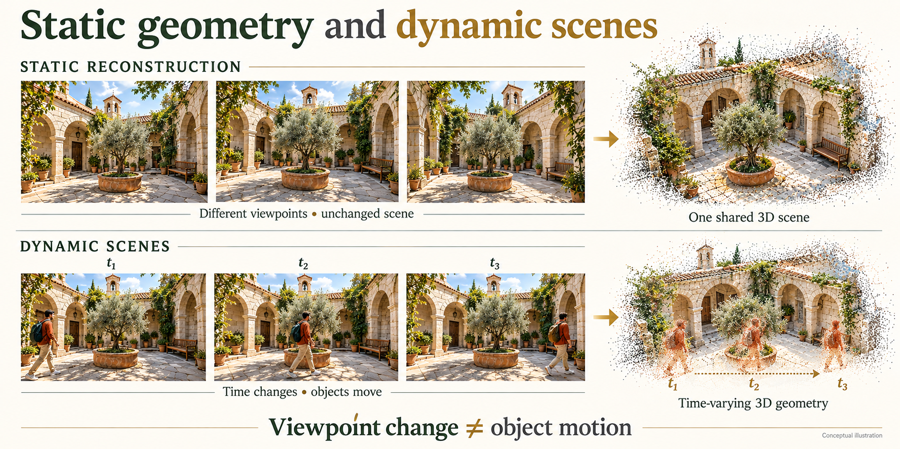

### Render and interpret

**Predict a new image, attach meaning to geometry, or infer what is hidden.**


### Localize and act

**Estimate where the camera is, then use geometry for mapping or decisions.**


**Folders and tags serve different purposes.** Each paper has one primary filing location in the complete index.
The category table above lists filing locations; tags are cross-cutting cues, not extra folders or duplicate counts.
Full SfM and joint map-and-trajectory SLAM are filed under Reconstruction; general pose, registration, localization and VO under Pose. Robotics requires policy/action, robot calibration, collaboration or onboard constraints as a central contribution. Reusable acceleration, compression, adaptation, reliability and pretraining interventions belong under Model Extensions. See the [classification policy and boundary cases](guides/classification-policy.md).
Medical is an application-domain folder; its papers can also address motion or reconstruction.
The diagrams show task families, not architectures shared by every paper. [Figure provenance](assets/README.md).

<details>
<summary>Publication-year distribution: CONFIRMED venues only</summary>

## Research landscape

Only the venue years marked **CONFIRMED** in the current paper Overviews are counted.
LIKELY, UNKNOWN and arXiv submission years are excluded. This is not a fresh publication audit of every document.

<!-- GENERATED:histogram -->

```text
2022 █ 1 paper
2023 █ 1 paper
2024 ██████ 4 papers
2025 ████████████████████████████████████████████████████████████ 43 papers
2026 ████████████████████████████████████████████████████████████████ 46 papers
```

<!-- /GENERATED -->

Preprints and papers with unconfirmed venues remain part of the collection.

</details>

## 🤝 Contributing

New papers are welcome. The bar is source-traceability, not volume:

1. Copy [`docs/paper-template.md`](docs/paper-template.md) into the right category.
2. Put the arXiv URL in `Links`. Run `python3 tools/verify_metadata.py --only <slug> --out raw/metadata_<slug>.json`.
   Keep the source verdict. If it is `PREPRINT?` because a source failed, use `UNKNOWN`
   in the document and state the missing evidence. Do not infer a conference from a title.
3. Write the paper note in **English**, preserving the seven-section format. Keep existing legacy-language exceptions unless explicitly revising them.
   **Every number must exist in the source paper.** If the paper reports a
   result only as a plot, say so rather than reading values off the figure.
4. Run `python3 tools/build_papers_list.py`, `python3 tools/update_stats.py`, and
   `python3 tools/build_fact_cards.py`. Reconcile candidate status with
   `python3 tools/reconcile_candidates.py --write`.
5. Format Markdown, run `python3 tools/verify_all.py` (offline checks by default), and
   validate changed numerical tables with `verify_benchmarks.py --only <slugs> --int`.
   Read the source tables as well: matching numeric tokens cannot verify their labels.
6. Add the scope, source versions, results, and remaining limitations to `log.md`.

Corrections to existing papers are especially welcome — if you find a number that does not
match its source, that is a bug worth filing.

## 📄 Citation

```bibtex
@misc{dust3r_paper_collection,
  title  = {DUSt3R Paper Collection: Source-linked Notes on Feed-Forward 3D Reconstruction},
  author = {minoTrey},
  year   = {2026},
  url    = {https://github.com/minoTrey/DUSt3R-Paper-Collection}
}
```

Please cite the individual papers, not this collection, for any result you use.

## 🙏 Acknowledgments

To the authors of all 337 papers, and to NAVER LABS Europe for DUSt3R and MASt3R, which
started this.

License status needs maintainer confirmation: this repository's earlier README referred
to MIT, but no `LICENSE` file is tracked, while `package.json` declares ISC.
This curation does not choose or change license terms. Paper content belongs to its respective authors.

<div id="reading-results-responsibly"></div>
<div id="verification"></div>
<div id="what-verification-does-not-cover"></div>

## Reading and verification

[Reading results responsibly](guides/reading-and-verification.md#reading-results-responsibly) · [Verification and limitations](guides/reading-and-verification.md#verification)
