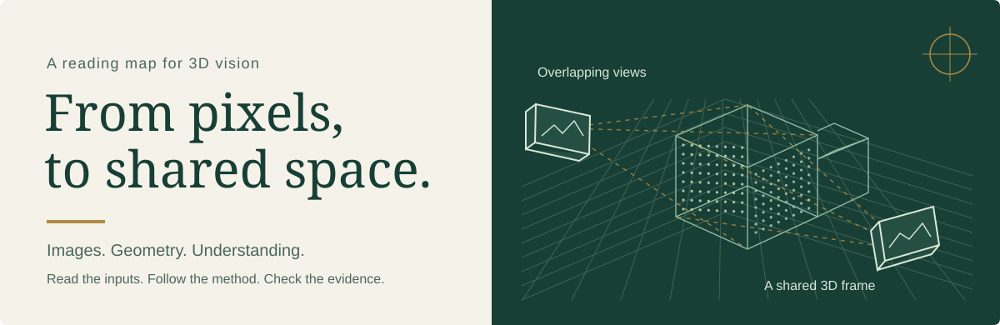
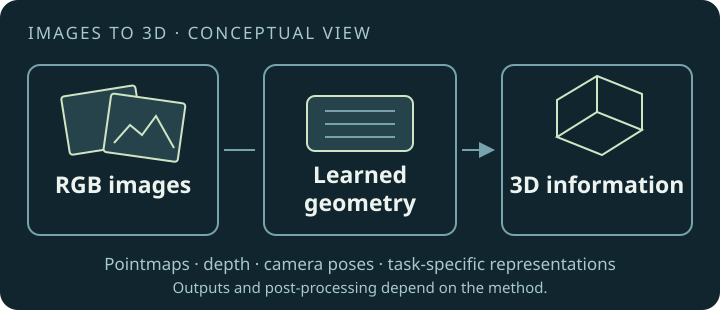

# DUSt3R Paper Collection

<div align="center">

**이미지에서 3D로, 논문을 이해하는 읽기 지도.**

DUSt3R에서 시작해 feed-forward 3D 연구로 이어지는 한국어 논문 노트.<br>
입력과 출력, 해결할 문제, 핵심 방법을 같은 형식으로 읽습니다.

[](docs/papers-list.md)

</div>



<div align="center">

**[전체 논문 찾아보기 →](docs/papers-list.md)**　 · 　**[대표 논문부터 읽기](#start-reading)**　 · 　**[질문으로 분야 찾기](#explore-by-question)**

[최근 추가](#selected-additions) · [검증 범위](#verification) · [변경 기록](log.md)

</div>

> A source-linked collection of **337 papers** on DUSt3R and related feed-forward 3D research.
> 문서 수는 원문 검증 완료 수와 다릅니다. 수치는 각 요약의 출처·실험 조건·한계와 함께 읽어 주세요.

## Start reading

**같은 이미지, 다른 질문.** 먼저 대표 논문의 입력·출력을 비교한 뒤 관심 분야로 이동하세요.
아래 배치는 읽기 안내이며, 성능 순위나 직접적인 계보를 뜻하지 않습니다.

| Pointmaps · 두 이미지의 공통 공간                                                                                                                                                                                                                     | Matching · 같은 지점을 찾는 특징                                                                                                                                                                                                                |
| :---------------------------------------------------------------------------------------------------------------------------------------------------------------------------------------------------------------------------------------------------- | :---------------------------------------------------------------------------------------------------------------------------------------------------------------------------------------------------------------------------------------------- |
| **[DUSt3R](docs/foundation/dust3r.md)**<br>두 RGB 이미지에서 픽셀별 3D 좌표와 confidence를 예측합니다.<br><br>[한국어 요약](docs/foundation/dust3r.md) · [논문](https://arxiv.org/abs/2312.14132) · [코드](https://github.com/naver/dust3r)           | **[MASt3R](docs/foundation/mast3r.md)**<br>Pointmap에 local descriptor를 더해 이미지 대응점을 찾습니다.<br><br>[한국어 요약](docs/foundation/mast3r.md) · [논문](https://arxiv.org/abs/2406.09756) · [코드](https://github.com/naver/mast3r)    |
| **Multi-view · 여러 시점의 공동 예측**                                                                                                                                                                                                                | **Memory · 과거 시점의 특징 재사용**                                                                                                                                                                                                            |
| **[VGGT](docs/reconstruction/vggt.md)**<br>여러 이미지를 함께 보고 카메라·깊이·pointmap을 예측합니다.<br><br>[한국어 요약](docs/reconstruction/vggt.md) · [논문](https://arxiv.org/abs/2503.11651) · [코드](https://github.com/facebookresearch/vggt) | **[MUSt3R](docs/reconstruction/must3r.md)**<br>층별 메모리를 읽어 공통 좌표계의 pointmap을 예측합니다.<br><br>[한국어 요약](docs/reconstruction/must3r.md) · [논문](https://arxiv.org/abs/2503.01661) · [코드](https://github.com/naver/must3r) |

<details>
<summary>Images to 3D · 입력에서 출력까지 한눈에 보기</summary>

## Images to 3D



이 그림은 개요도입니다. 실제 이미지 수, pointmap·depth·camera pose 등의 출력과 후처리는 논문마다 다릅니다.
[DUSt3R](docs/foundation/dust3r.md)는 두 이미지의 pointmap을 예측하며, 여러 이미지 재구성에는 별도 global alignment 최적화를 사용합니다.
입력 calibration, 학습 supervision, 추론 뒤 최적화를 구분해서 읽으면 방법의 차이가 보입니다.

</details>

## Explore by question

| 궁금한 점                                | 분야                                                                | 읽기 예시                                                                                            |
| ---------------------------------------- | ------------------------------------------------------------------- | ---------------------------------------------------------------------------------------------------- |
| 이미지를 3D로 바꾸는 표현은?             | [Foundation](docs/foundation/)                                      | [CroCo](docs/foundation/croco.md), [DUSt3R](docs/foundation/dust3r.md)                               |
| 긴 영상과 큰 장면을 어떻게 다룰까?       | [Reconstruction](docs/reconstruction/)                              | [TTT3R](docs/reconstruction/ttt3r.md), [Slot3R](docs/reconstruction/slot3r.md)                       |
| 움직이는 장면도 복원할 수 있을까?        | [Dynamic](docs/dynamic/)                                            | [MonST3R](docs/dynamic/monst3r.md), [CUT3R](docs/dynamic/cut3r.md)                                   |
| 새로운 시점의 이미지는 어떻게 만들까?    | [Gaussian Splatting](docs/gaussian-splatting/)                      | [Splatt3R](docs/gaussian-splatting/splatt3r.md)                                                      |
| 기하와 의미를 함께 알 수 있을까?         | [Understanding](docs/understanding/) · [Reasoning](docs/reasoning/) | [IGGT](docs/understanding/iggt.md), [Amodal3R](docs/reasoning/amodal3r.md)                           |
| 추적·지도·보정에 어떻게 연결할까?        | [Robotics](docs/robotics/) · [Pose](docs/pose/)                     | [UniSim-SLAM](docs/robotics/unisim-slam.md), [FFVO](docs/pose/ffvo.md)                               |
| 모델은 언제 틀리고 무엇을 비교해야 할까? | [Surveys & Analysis](docs/surveys/)                                 | [Confidence Audit](docs/surveys/confidence-audit.md), [Wide Views](docs/surveys/wider-views-fail.md) |
| 의료 영상의 조건은 무엇이 다를까?        | [Medical](docs/medical/)                                            | [Endo3R](docs/medical/endo3r.md)                                                                     |

## Selected additions

**2026-10-15 정비 묶음**

이번 원문 대조 묶음에서 고른 문서입니다. 전체 변경 범위와 후보별 포함·제외 근거는 [후보 검토표](candidates/review-2026-10-15.md),
수정 이력은 [log](log.md)에서 확인할 수 있습니다. 아래 날짜는 컬렉션 정비일입니다.

| 최근 정비한 요약                                                       | 읽을 때 볼 지점                                                   |
| ---------------------------------------------------------------------- | ----------------------------------------------------------------- |
| **[Slot3R](docs/reconstruction/slot3r.md)** · Streaming reconstruction | 영상의 과거 정보를 어떤 상태로 저장하고 다음 프레임에 전달하는가? |
| **[GeoCond](docs/foundation/geocond.md)** · Geometry conditioning      | 기하 정보를 조건으로 줄 때 입력과 예측 대상이 어떻게 달라지는가?  |
| **[UniSim-SLAM](docs/robotics/unisim-slam.md)** · Geometry + SLAM      | 학습한 기하를 추적·정렬·지도 최적화에 어떻게 연결하는가?          |
| **[MEOW](docs/reconstruction/meow.md)** · Mixed cameras                | 서로 다른 카메라 모델을 하나의 복원 과정에서 어떻게 다루는가?     |

<details>
<summary>전체 분야와 문서 수 보기</summary>

## Research categories

분류는 탐색을 위한 기본 위치입니다. 한 논문은 여러 연구 질문과 연결될 수 있습니다.
각 분야 링크에서 전체 목록을 볼 수 있습니다.

### 🔬 [Foundation Models](docs/foundation/) (30 papers)

Cross-view learning, pointmap regression, matching, and shared geometry representations.

### 🏗️ [3D Reconstruction](docs/reconstruction/) (128 papers)

Static geometry, mixed cameras, large scenes, streaming memory, alignment, and SLAM.

### 🎬 [Dynamic Scenes](docs/dynamic/) (50 papers)

Geometry and motion when objects or the camera move.

### ✨ [Gaussian Splatting](docs/gaussian-splatting/) (51 papers)

Learned geometry connected to explicit scene representations and novel-view rendering.

### 🧠 [Scene Understanding](docs/understanding/) (26 papers)

Geometry connected to segmentation, objects, and semantic features.

### 🔍 [Scene Reasoning](docs/reasoning/) (7 papers)

Occluded structure, amodal geometry, and spatial reasoning.

### 🤖 [Robotics](docs/robotics/) (22 papers)

Calibration, odometry, mapping, and robotic applications of geometry models.

### 📚 [Surveys & Analysis](docs/surveys/) (8 papers)

Evaluation protocols, reliability, failure analysis, and surveys.

### 📍 [Pose Estimation](docs/pose/) (12 papers) · 🏥 [Medical](docs/medical/) (3 papers)

Camera localization and geometry methods for medical imagery.

</details>

<details>
<summary>출판 연도 분포 · CONFIRMED venue만 집계</summary>

## Research landscape

각 문서의 현재 Overview에서 **CONFIRMED venue의 연도만** 집계합니다.
LIKELY·UNKNOWN·arXiv 제출 연도는 제외하며, 모든 문서의 출판 정보를 이번에 다시 검증했다는 뜻은 아닙니다.

<!-- GENERATED:histogram -->

```text
2022 █ 1 paper
2023 █ 1 paper
2024 ██████ 4 papers
2025 ████████████████████████████████████████████████████████████ 43 papers
2026 ████████████████████████████████████████████████████████████████ 46 papers
```

<!-- /GENERATED -->

Preprint와 venue 미확인 문서도 컬렉션에 포함됩니다.

</details>

## Reading results responsibly

수치는 각 논문 문서에서 원문 표·데이터셋·camera 조건·정렬 방식과 함께 읽으세요.
GT pose 사용 여부, metric scale과 정렬 scale, 완료 시퀀스 수가 다르면 같은 지표 이름도 직접 비교할 수 없습니다.
여러 모델을 하나의 protocol로 비교하려면 [평가·분석 논문](docs/surveys/)에서 시작하세요.

## Verification

Metadata and results in this collection are checked by scripts in [`tools/`](tools/):

| Check                     | What it does                                                                          |
| ------------------------- | ------------------------------------------------------------------------------------- |
| `verify_metadata.py`      | Venue, authors, arXiv ID against arXiv + DBLP + Semantic Scholar + Crossref           |
| `verify_benchmarks.py`    | Selected numeric tokens in tables against source PDF text; labels need source review  |
| `verify_index_numbers.py` | Every number in this README traced back to a paper document                           |
| `check_structure.py`      | Seven-section structure and Overview field schema                                     |
| `update_stats.py`         | Document/category counts and the confirmed-venue histogram — generated from documents |

Each paper's Overview carries a `Verification` field:

- **CONFIRMED** — venue proven by DBLP, a publisher DOI, OpenReview, CVF openaccess, or an
  author-maintained badge
- **LIKELY** — an author claim exists but no independent corroboration
- **PREPRINT** — stored metadata checks found no publication record; indexing delays remain possible
- **UNKNOWN** — publication venue remains unverified, even if the arXiv paper is available.
  The venue says `arXiv preprint`, and the Verification field or a Note states what is missing.

### What verification does not cover

Stated plainly, because a checkmark that overstates itself is worse than none:

- **Benchmark verification does not run in CI.** Source PDFs are gitignored, so it is a
  local gate. CI checks structure, counts, links, and formatting only.
- **Default benchmark checks extract decimals.** `--int` also checks selected integer
  tokens, but cannot establish that the labels, units, or protocols are correct.
  A matching value elsewhere in the PDF can still conceal a wrong table.
- **Coverage is aggregate.** A paper can score above threshold while containing one wholly
  fabricated table. Seven papers were caught this way, after passing an earlier sweep.
- **Prose is weaker than tables.** Derived claims in body text get less scrutiny than the
  tables they cite.

[`log.md`](log.md) records what was found and fixed, including the failure modes above.

## 🤝 Contributing

New papers are welcome. The bar is source-traceability, not volume:

1. Copy [`docs/paper-template.md`](docs/paper-template.md) into the right category.
2. Put the arXiv URL in `Links`. Run `python3 tools/verify_metadata.py --only <slug> --out raw/metadata_<slug>.json`.
   Keep the source verdict. If it is `PREPRINT?` because a source failed, use `UNKNOWN`
   in the document and state the missing evidence. Do not infer a conference from a title.
3. Write the body. **Every number must exist in the source paper.** If the paper reports a
   result only as a plot, say so rather than reading values off the figure.
4. Run `python3 tools/build_papers_list.py`, `python3 tools/update_stats.py`, and
   `python3 tools/build_fact_cards.py`. Reconcile candidate status with
   `python3 tools/reconcile_candidates.py --write`.
5. Format Markdown, run `python3 tools/verify_all.py` (offline checks by default), and
   validate changed numerical tables with `verify_benchmarks.py --only <slugs> --int`.
   Read the source tables as well: matching numeric tokens cannot verify their labels.
6. Add the scope, source versions, results, and remaining limitations to `log.md`.

Corrections to existing papers are especially welcome — if you find a number that does not
match its source, that is a bug worth filing.

## 📄 Citation

```bibtex
@misc{dust3r_paper_collection,
  title  = {DUSt3R Paper Collection: Source-linked Notes on Feed-Forward 3D Reconstruction},
  author = {minoTrey},
  year   = {2026},
  url    = {https://github.com/minoTrey/DUSt3R-Paper-Collection}
}
```

Please cite the individual papers, not this collection, for any result you use.

## 🙏 Acknowledgments

To the authors of all 337 papers, and to NAVER LABS Europe for DUSt3R and MASt3R, which
started this.

License status needs maintainer confirmation: this repository's earlier README referred
to MIT, but no `LICENSE` file is tracked, while `package.json` declares ISC.
This curation does not choose or change license terms. Paper content belongs to its respective authors.
