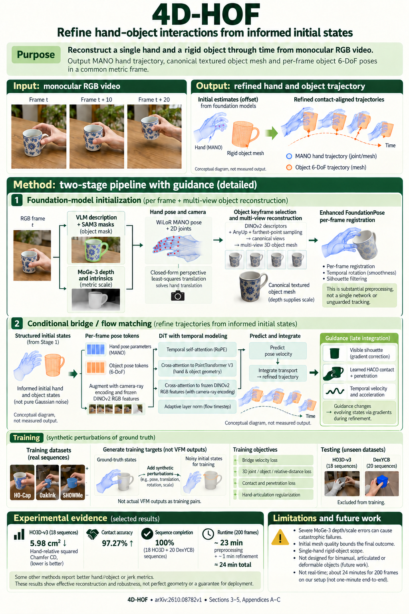

# 4D-HOF: Hand-Object Flow Matching for Feed-Forward 4D Interaction Reconstruction (arXiv 2026)

<!-- PAPER-CARD:en -->

[Original paper](https://arxiv.org/abs/2610.08782v1) · [Full-size English card](../../assets/paper-cards/en/dynamic/4d-hof.png)
<!-- /PAPER-CARD -->

## 📋 Overview

- **Authors**: Shiqi Li, Sean Cho, Yijie Li, Fengzhi Guo, Bowen Wen, Cheng Zhang
- **Institution**: Texas A&M University, NVIDIA
- **Venue**: arXiv preprint (2026-10)
- **Links**: [Paper](https://arxiv.org/abs/2610.08782)
- **Verification**: UNKNOWN (2026-10-15; source 2610.08782v1 content reviewed; publication venue not independently confirmed)
- **TL;DR**: Conditional flow refines coarse hand–object states from foundation models, applying physical and 2D guidance during generation.

## 🎯 Key Contributions

1. Start transport from structured HOI estimates rather than pure noise.
2. Learn a conditional temporal flow from point-cloud and image features.
3. Guide inference with contact, penetration and observation evidence.

## 🔧 Technical Details

### Input, Output, and Problem

- **Input**: Monocular RGB video of a hand interacting with an unseen object.
- **Output**: Time-varying MANO hand parameters, object mesh poses and 4D interaction.
- **Problem**: Individually plausible hand and object estimates can have inconsistent relative translation and contact.

### Method

1. Estimate depth, cameras and masks with MoGe-3, SAM3 and related models.
2. Initialize HOI states with WiLoR hands, generated objects and FoundationPose.
3. Learn conditional bridge velocities with PTv3 point features, DINOv2 image features and a temporal DiT.
4. Apply physical and image-space guidance to intermediate flow states.

Learn perturbed-state→GT transport on HO-Cap, OakInk, SHOWMe and related data. This directly uses monocular geometry models for initialization; it does not modify the DUSt3R backbone.

## 📊 Results

**Source**: [Source PDF](https://arxiv.org/pdf/2610.08782v1), Table 1, PDF p.7.

HO3D-v3, selected 18 sequences, AGILE protocol. MPJPE is in mm, hand-relative CD in cm², and contact accuracy in percent.

| Method | Hand-relative CD (cm²) ↓ | Contact accuracy (%) ↑ | Hand MPJPE (mm) ↓ |
| ------ | ------------------------ | ---------------------- | ----------------- |
| AGILE  | 15.81                    | Not reported           | 3.92              |
| 4D-HOF | 5.98                     | 97.27                  | 4.40              |

Hand MPJPE is worse than AGILE. The comparison uses published AGILE results because its code is unavailable; object shape is a separate metric evaluated after ICP alignment.

## 💡 Insights & Impact

Refining interaction from a strong initialization narrows transport compared with generation from random states.

- Errors and costs of object generation, masks and depth estimation remain.
- Include guidance gradients and all pretrained models in runtime, not just a single geometry network.

## 🔗 Related Work

- [EgoFound3R](egofound3r.md): another method jointly predicting hand geometry and interaction.
- [DUSt3R](../foundation/dust3r.md): dense geometry background for comparing application scope.

## 📚 Key Takeaways

1. Refine coarse HOI states with a learned flow.
2. Gains mainly concern interaction; not every hand metric is best.
3. Count initialization and guidance in total runtime.
