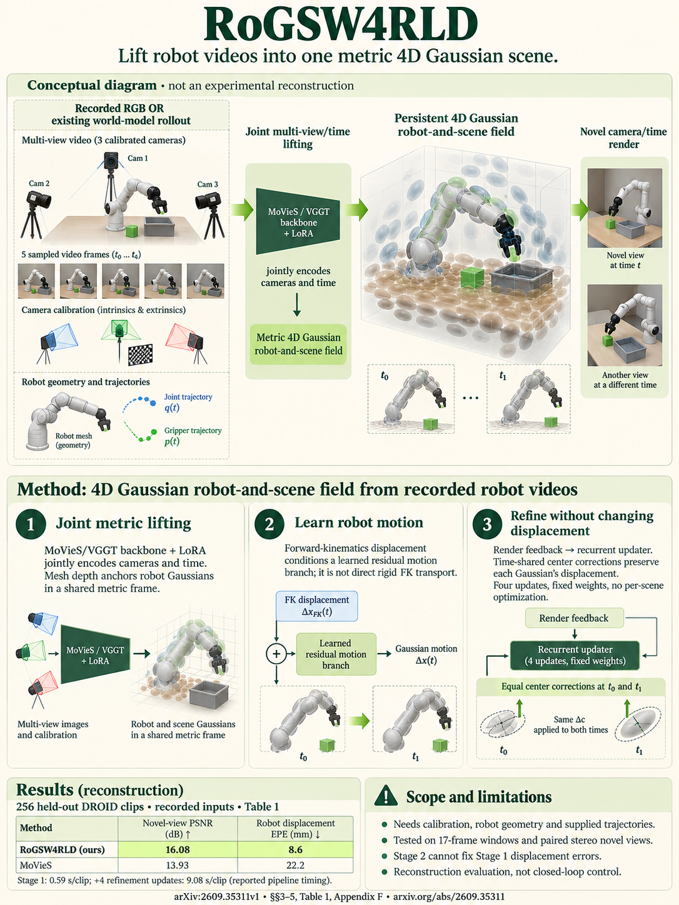

# RoGSW4RLD: Feed-Forward 4D Gaussian Lifting for Robot World Model Rollouts (arXiv 2026)

<!-- PAPER-CARD:en -->

[Original paper](https://arxiv.org/abs/2609.35311v1) · [Full-size English card](../../assets/paper-cards/en/dynamic/rogsw4rld.png)
<!-- /PAPER-CARD -->

## 📋 Overview

- **Authors**: Jin Hyun Kim, Min Young Kim, Soohwan Song, Daekyum Kim
- **Institution**: Korea University, Dongguk University
- **Venue**: arXiv preprint (2026-09)
- **Links**: [Paper](https://arxiv.org/abs/2609.35311)
- **Verification**: UNKNOWN (2026-10-15; source 2609.35311v1 content reviewed; publication venue not independently confirmed)
- **TL;DR**: Jointly lift multi-camera robot rollouts into a metric 4D Gaussian field using calibration, robot meshes and joint states.

## 🎯 Key Contributions

1. Process view and time tokens jointly instead of reconstructing each camera independently.
2. Guide metric geometry and motion with robot meshes and forward kinematics.
3. Add recurrent rendering-feedback refinement with fixed weights.

## 🔧 Technical Details

### Input, Output, and Problem

- **Input**: Synchronized recorded/generated RGB rollouts, calibrated camera trajectories and intrinsics, robot meshes, and joint/gripper states.
- **Output**: A metric 4D Gaussian scene renderable at arbitrary query times and views.
- **Problem**: Reconstructing each video-world-model camera independently produces inconsistent robot motion and scale.

### Method

1. Add camera/time encoding and LoRA to a MoVieS/VGGT-family backbone.
2. Anchor depth at robot-support pixels using the mesh.
3. Feed FK displacements to a motion head to build a shared Gaussian field.
4. Stage 2 recurrently refines position and appearance using rendering feedback and time-shared corrections.

Both stages use fixed inference weights, without per-scene gradient optimization. This lifts existing rollouts into 4D rather than learning new action dynamics as a world model.

## 📊 Results

**Source**: [Source PDF](https://arxiv.org/pdf/2609.35311v1), Table 1, PDF p.8.

Recorded observations: 256 clips. Novel-view PSNR and LPIPS, plus robot-displacement EPE (mm). The rows compare the proposed method's two stages.

| Configuration | Novel PSNR ↑ | Novel LPIPS ↓ | Robot EPE (mm) ↓ | Time (s) ↓ |
| ------------- | ------------ | ------------- | ---------------- | ---------- |
| Stage 1       | 15.52        | 0.363         | 8.6              | 0.59       |
| Stage 1+2     | 16.08        | 0.371         | 8.6              | 9.08       |

Refinement increases PSNR but worsens LPIPS and leaves robot EPE unchanged. Metric results assume calibration, mesh and joint inputs.

## 💡 Insights & Impact

Convert visual rollouts into a representation queryable in space and time, using known robot geometry.

- Depend on synchronization, hand–eye calibration and robot-model accuracy.
- Reconstruction does not guarantee physical truth in generated rollouts.

## 🔗 Related Work

- [VGGT](../foundation/vggt.md): the backbone family underlying MoVieS.
- [Uni4R](uni4r.md): another continuous-time geometry formulation.

## 📚 Key Takeaways

1. Metric lifting assumes known cameras and robot states.
2. It does not predict new world-model rollouts.
3. Preserve refinement's metric and runtime trade-offs.
