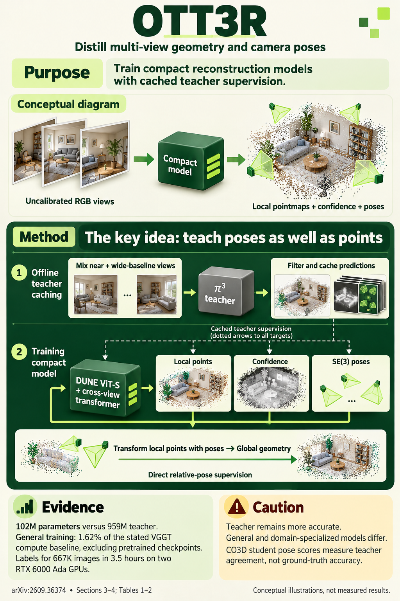

# OTT3R: Multi-View 3D Reconstruction and Fast Dataset Generation at 1% Compute (arXiv 2026)

<!-- PAPER-CARD:en -->

[Original paper](https://arxiv.org/abs/2609.36374v1) · [Full-size English card](../../assets/paper-cards/en/extensions/ott3r.png)
<!-- /PAPER-CARD -->

## 📋 Overview

- **Authors**: Brandon Leblanc, Charalambos Poullis
- **Institution**: Concordia University
- **Venue**: arXiv preprint (2026-09)
- **Links**: [Paper](https://arxiv.org/abs/2609.36374)
- **Verification**: UNKNOWN (2026-10-15; source 2609.36374v1 content reviewed; publication venue not independently confirmed)
- **TL;DR**: Train small multi-view students from cached π3 pointmap/pose pseudo-labels, comparing general-purpose and domain-specialized models.

## 🎯 Key Contributions

1. Move expensive teacher inference into an offline cache.
2. Distill geometry, pose and confidence jointly into a small student.
3. Separate generalization from domain-specialization effects.

## 🔧 Technical Details

### Input, Output, and Problem

- **Input**: An uncalibrated set of RGB images.
- **Output**: Dense pointmaps, camera poses, confidence and a pseudo-label corpus.
- **Problem**: Large 3D models are costly to train and run; smaller models lose substantial pose accuracy on unfamiliar scenes.

### Method

1. Compute and cache source-corpus pointmaps, confidence and SE(3) poses with a π3 teacher once.
2. Train only the student using view groups sampled from the cache.
3. Combine point, normal, pairwise-relative-camera and confidence losses.
4. Train a separate specialized student with target-domain caches.

Supervision comes from the teacher. Separate student costs excluding teacher inference from full cache-generation costs.

## 📊 Results

**Source**: [Source PDF](https://arxiv.org/pdf/2609.36374v1), Table 1, PDF p.10.

7-Scenes, π3 accuracy/completeness protocol (cm), student input 518×224. General is zero-shot; domain is specialized on 7-Scenes.

| Model         | Accuracy (cm) ↓ | Completeness (cm) ↓ | FPS ↑ |
| ------------- | --------------- | ------------------- | ----- |
| π3 teacher    | 1.52            | 2.03                | 40    |
| OTT3R general | 10.16           | 34.84               | 273   |
| OTT3R domain  | 6.16            | 2.84                | 274   |

The general student does not replace the teacher. COLMAP comparisons use larger inputs and only completed scenes; the CO3D student pose table measures teacher agreement, not GT accuracy.

## 💡 Insights & Impact

Practical value depends more on domain specialization and pose generalization than compression ratio alone.

- Teacher errors remain in pseudo-labels.
- Do not present specialized performance as general zero-shot performance.

## 🔗 Related Work

- [π3](../reconstruction/pi3.md): teacher.
- [DUSt3R](../foundation/dust3r.md): pointmap-based reconstruction background.

## 📚 Key Takeaways

1. Amortize teacher computation through caches.
2. Small models are fast but lose substantial OOD geometry quality.
3. Distinguish teacher agreement from GT evaluation.
