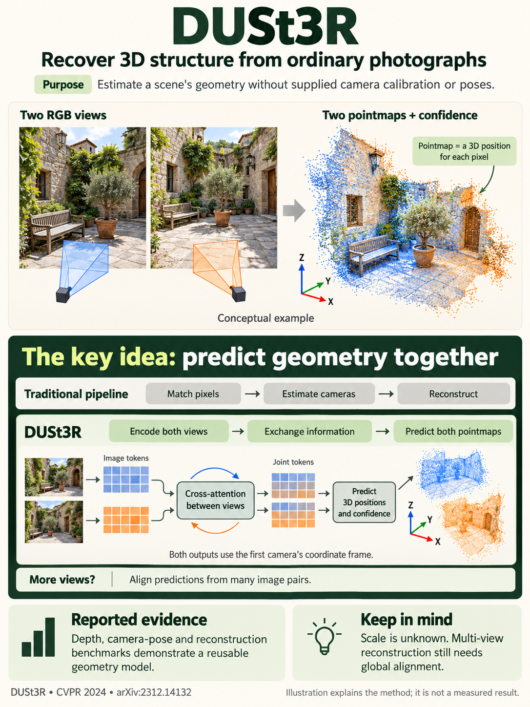

# DUSt3R: Geometric 3D Vision Made Easy (CVPR 2024)

<!-- PAPER-CARD:en -->

[](../../assets/paper-cards/en/foundation/dust3r.png)

[Original paper](https://arxiv.org/abs/2312.14132) · [Full-size English card](../../assets/paper-cards/en/foundation/dust3r.png)
<!-- /PAPER-CARD -->


_Predict both images' pointmaps in the first camera frame; combining multiple pairs requires separate global alignment._

## 📋 Overview

- **Authors**: Shuzhe Wang, Vincent Leroy, Yohann Cabon, Boris Chidlovskii, Jérôme Revaud
- **Institution**: Aalto University, NAVER LABS Europe
- **Venue**: CVPR 2024
- **Links**: [Paper](https://arxiv.org/abs/2312.14132) | [Code](https://github.com/naver/dust3r) | [Project Page](https://dust3r.europe.naverlabs.com/)
- **Verification**: CONFIRMED (venue: cached DBLP verdict 2026-07-20; methods/results PDF re-reviewed 2026-10-15)
- **TL;DR**: Predict per-pixel 3D coordinates and confidence from two uncalibrated RGB images. Full reconstruction from multiple images aligns pairwise predictions through optimization.

## 🎯 Key Contributions

1. **Shared-Frame Pointmaps**: Predict per-pixel 3D coordinates for both images in a shared camera frame.
2. **Uncalibrated Pair Input**: The pairwise network requires neither camera intrinsics nor relative pose as input.
3. **Confidence-Weighted Supervision**: Jointly learn GT 3D-coordinate regression and confidence.
4. **Global Alignment**: Align predictions from different pairs into a shared scene through iterative optimization.

## 🔧 Technical Details

### Input and Output

- **Input**: Two RGB images showing an overlapping scene.
- **Output**: Two pointmaps and confidence maps. A pointmap stores a 3D coordinate for each image pixel.
- **Coordinates**: Both pointmaps use the first camera frame. Absolute scale is generally undetermined.

### Architecture and Training

A shared ViT encoder converts images into tokens. Two decoders exchange information through cross-attention.
Regression heads output both images' pointmaps and confidence (§3.1).

Distinguish CroCo's self-supervised pretraining from DUSt3R's supervised 3D training.
DUSt3R learns from GT pointmaps constructed with depth and camera information (§3.2, Appendix B).
The confidence loss modulates regression errors in difficult regions. This is not self-supervised learning using only confidence-derived pseudo-labels.

### From a Pair to a Scene

```text
Two RGB images → pairwise pointmaps and confidence
Multiple images → selected pair predictions → global-alignment optimization → shared scene
```

§3.3 aligns pairwise rotations, translations and scales with global pointmaps.
Extract focal lengths, poses or pixel correspondences from pointmaps as required by the task.
Describing the entire multi-view pipeline as always a single forward pass or optimization-free is therefore inaccurate.

## 📊 Results

**Source**: [arXiv 2312.14132v3 PDF](https://arxiv.org/pdf/2312.14132v3).
DUSt3R-512 uses a long-edge resolution of 512 and multiple aspect ratios; inputs are not necessarily square.

### DTU Dataset (3D Reconstruction)

Source Table 4, PDF p.9, in mm. DUSt3R reconstructs without GT cameras, whereas the other rows use GT cameras.
This protocol differs from the depth evaluation in Table 3.

| Method         | Type              | Accuracy ↓ | Completeness ↓ | Overall ↓ |
| -------------- | ----------------- | ---------- | -------------- | --------- |
| Gipuma         | Traditional+GT    | 0.283      | 0.873          | 0.578     |
| MVSNet         | Learning+GT       | 0.396      | 0.527          | 0.462     |
| CVP-MVSNet     | Learning+GT       | 0.296      | 0.406          | 0.351     |
| **DUSt3R-512** | **No GT cameras** | **2.677**  | **0.805**      | **1.741** |

_Note: DUSt3R operates without calibration or GT depth, making direct comparison complex._

### Multi-view Pose Estimation (CO3Dv2)

Table 2 right and Table 5: sample 10 random frames and evaluate relative pose after global alignment.

| Metric    | DUSt3R-512 (w/ GA) | Description                   |
| --------- | ------------------ | ----------------------------- |
| RRA@15 ↑  | 96.2%              | Relative Rotation Accuracy    |
| RTA@15 ↑  | 86.8%              | Relative Translation Accuracy |
| mAA(30) ↑ | 76.7%              | Mean Average Accuracy         |

### Visual Localization (7-Scenes)

Table 1 and Appendix Table 6: median translation/rotation errors from the 2D-matching pipeline with GT focal lengths.
These are therefore not pose-regression results obtained without any camera information.

| Scene   | Trans. Error (cm) ↓ | Rot. Error (°) ↓ | Model      |
| ------- | ------------------- | ---------------- | ---------- |
| Chess   | 3                   | 0.97             | DUSt3R-512 |
| Fire    | 3                   | 0.95             | DUSt3R-512 |
| Heads   | 2                   | 1.37             | DUSt3R-512 |
| Office  | 3                   | 1.01             | DUSt3R-512 |
| Pumpkin | 4                   | 1.14             | DUSt3R-512 |
| Kitchen | 4                   | 1.34             | DUSt3R-512 |
| Stairs  | 11                  | 2.84             | DUSt3R-512 |

### Visual Localization (Cambridge Landmarks)

The same 2D-matching pipeline from Table 1 and Appendix Table 6; median errors are reported.

| Scene          | Trans. Error (cm) ↓ | Rot. Error (°) ↓ | Model      |
| -------------- | ------------------- | ---------------- | ---------- |
| St. Facade     | 6                   | 0.26             | DUSt3R-512 |
| Old Hospital   | 17                  | 0.33             | DUSt3R-512 |
| King's College | 11                  | 0.20             | DUSt3R-512 |
| St. Mary's     | 7                   | 0.24             | DUSt3R-512 |
| Great Court    | 38                  | 0.16             | DUSt3R-512 |

### Multi-view Depth Estimation

Table 3, PDF p.9, condition (d). No GT poses or depth ranges are inputs; predictions are median-scale-aligned to GT depth.
Rel and inlier ratio follow the source's percentage notation. The inlier threshold is **1.03**.
ScanNet uses same-domain training data and is parenthesized in the source table.

| Dataset         | Rel. Error (%) ↓ | Inlier τ@1.03 (%) ↑ | Model          |
| --------------- | ---------------- | ------------------- | -------------- |
| KITTI           | 9.11             | 39.49               | DUSt3R-512     |
| ScanNet         | 4.93             | 60.20               | DUSt3R-512     |
| ETH3D           | 2.91             | 76.91               | DUSt3R-512     |
| DTU             | 3.52             | 69.33               | DUSt3R-512     |
| Tanks & Temples | 3.17             | 76.68               | DUSt3R-512     |
| **Average**     | **4.73**         | **64.52**           | **DUSt3R-512** |

### Qualitative Results

Source Figs. 1 and 7 show examples from varied imagery.
Predicting a point cloud from two images does not guarantee complete occluded surfaces or accuracy on every reflective or low-texture scene.

## 💡 Insights & Impact

The central contribution is using learned 3D priors to reduce calibration and correspondence-search demands.
Pairwise network inference, global alignment and localization geometry are separate stages.
Combining their timings and input assumptions can misrepresent practical costs.

MVS with GT cameras and DUSt3R's uncalibrated reconstruction are not evaluated under identical inputs.
Occlusions, out-of-distribution scenes and scale ambiguity remain limitations.
This note removes an untraceable H100 40 ms claim and generic completion-time comparisons.

## 🔗 Related Work

### Direct Extensions

- **Efficiency**: [Fast3R](../reconstruction/fast3r.md), [SLAM3R](../reconstruction/slam3r.md), [Spann3R](../reconstruction/spann3r.md) (speed improvements)
- **Quality**: [MASt3R](mast3r.md), [VGGT](vggt.md), [π³](../reconstruction/pi3.md) (Pi3) (improved accuracy)
- **Scale**: [REGIST3R](../reconstruction/regist3r.md), [ReconX](../reconstruction/reconx.md), [Light3R-SfM](../reconstruction/light3r-sfm.md) (larger scenes)
- **Applications**: [Splatt3R](../gaussian-splatting/splatt3r.md), [Dust-GS](../gaussian-splatting/dust-gs.md) (Gaussian Splatting), [RIG3R](../robotics/rig3r.md) (robotics)

### Research Directions Enabled

1. **Dynamic Reconstruction**: [MonST3R](../dynamic/monst3r.md), [POMATO](../dynamic/pomato.md), [D²USt3R](../dynamic/d2ust3r.md), [Stereo4D](../dynamic/stereo4d.md)
2. **Neural Rendering**: Splatt3R, [PreF3R](../gaussian-splatting/pref3r.md), [InstantSplat](../gaussian-splatting/instantsplat.md)
3. **Scene Understanding**: [PE3R](../understanding/pe3r.md), [MEt3R](../understanding/met3r.md), [LargeSpatialModel](../understanding/largespatialmodel.md)
4. **Robotics**: RIG3R, [GraphSeg](../robotics/graphseg.md), SLAM3R

## 📚 Key Takeaways

1. Inputs are image pairs; direct outputs are two pointmaps and confidence.
2. CroCo pretraining differs from DUSt3R's supervised 3D training.
3. Combining multiple pairs into a full scene requires global alignment.
4. Check calibration inputs, scale alignment and dataset conditions before comparing numbers.
