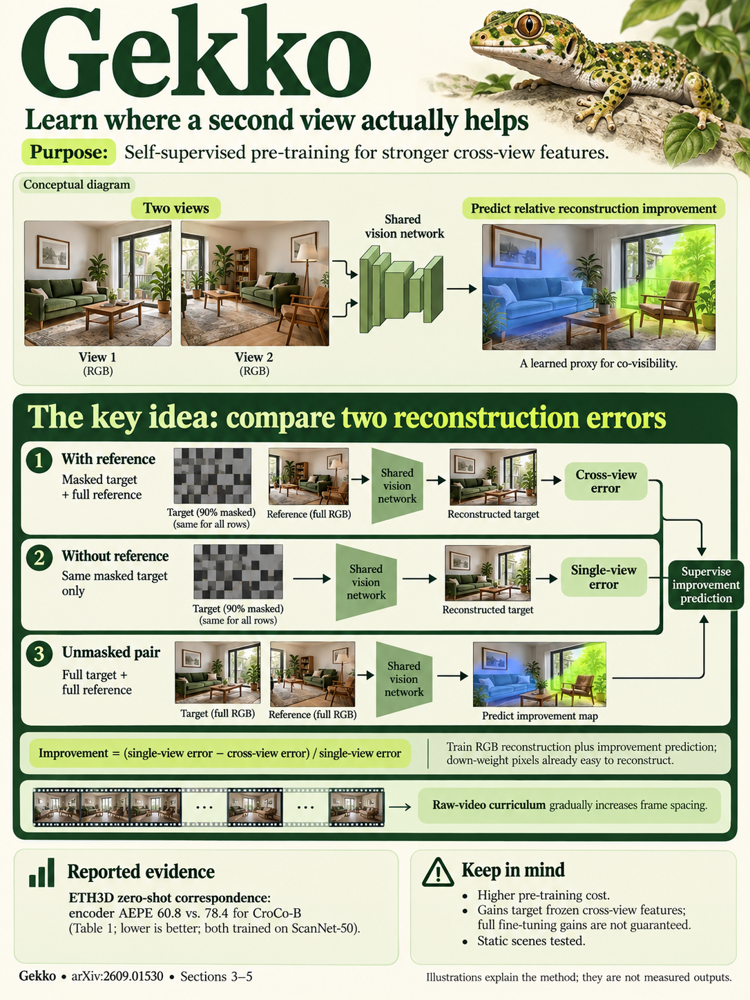

# Revisiting Cross-View Completion: Self-Supervised Pre-Training via Reconstruction Error Comparison (arXiv 2026)

<!-- PAPER-CARD:en -->

[Original paper](https://arxiv.org/abs/2609.01530v1) · [Full-size English card](../../assets/paper-cards/en/foundation/gekko.png)
<!-- /PAPER-CARD -->

## 📋 Overview

- **Authors**: Thibaut Loiseau, Guillaume Bourmaud, Vincent Lepetit
- **Institution**: LIGM, École Nationale des Ponts et Chaussées, IP Paris, Université Gustave Eiffel, CNRS; Université de Bordeaux, Bordeaux INP, IMS
- **Venue**: arXiv preprint (2026-09)
- **Links**: [Paper](https://arxiv.org/abs/2609.01530)
- **Verification**: UNKNOWN (2026-10-15; source 2609.01530v1 content reviewed; publication venue not independently confirmed)
- **TL;DR**: Learn how much a reference view reduces reconstruction error, improving cross-view features and co-visibility representations without 3D GT.

## 🎯 Key Contributions

1. Compare cross-view completion errors with masked-autoencoding errors.
2. Add relative-improvement-map prediction as supervision.
3. Compare with CroCo under the same architecture, data and schedule.

## 🔧 Technical Details

### Input, Output, and Problem

- **Input**: A patch-masked target RGB image and a reference RGB image.
- **Output**: Reconstructed images, relative-improvement maps and downstream geometry features.
- **Problem**: Completion of regions not visible across views degenerates into monocular reconstruction, weakening the binocular signal.

### Method

1. Reconstruct the same masked target with and without the reference.
2. Use the cross-view error reduction relative to MAE error as a pseudo-target.
3. Jointly predict both reconstruction tasks and the improvement map with a shared model.
4. Account for unreliable relative improvements where monocular error is already small.

Pretrain self-supervised from scratch. Supervised downstream pose and pointmap probes are separate from pretraining.

## 📊 Results

**Source**: [Source PDF](https://arxiv.org/pdf/2609.01530v1), Table 1, PDF p.6.

Base model pretrained on ScanNet-50; zero-shot ETH3D correspondence AEPE. Encoder and decoder features are evaluated separately.

| Feature | CroCo-B AEPE ↓ | Gekko-B AEPE ↓ |
| ------- | -------------- | -------------- |
| Encoder | 78.4           | 60.8           |
| Decoder | 101.9          | 80.8           |

The comparison uses CroCo retrained under matched conditions, not a ranking of all public checkpoints. Improvement maps are proxies, not perfect co-visibility GT.

## 💡 Insights & Impact

Differences in reconstruction errors measure whether a reference helps, providing binocular supervision without 3D annotations.

- Small MAE errors in uniform or repetitive regions can destabilize the proxy.
- Pretraining-feature performance differs from full multi-view-system performance.

## 🔗 Related Work

- [CroCo](croco.md): cross-view completion baseline.
- [DUSt3R](dust3r.md): background on converting learned features into geometry.

## 📚 Key Takeaways

1. Learn relative differences between reconstruction errors.
2. Separate pretraining without 3D GT from downstream supervision.
3. Inspect regions where the proxy fails.
