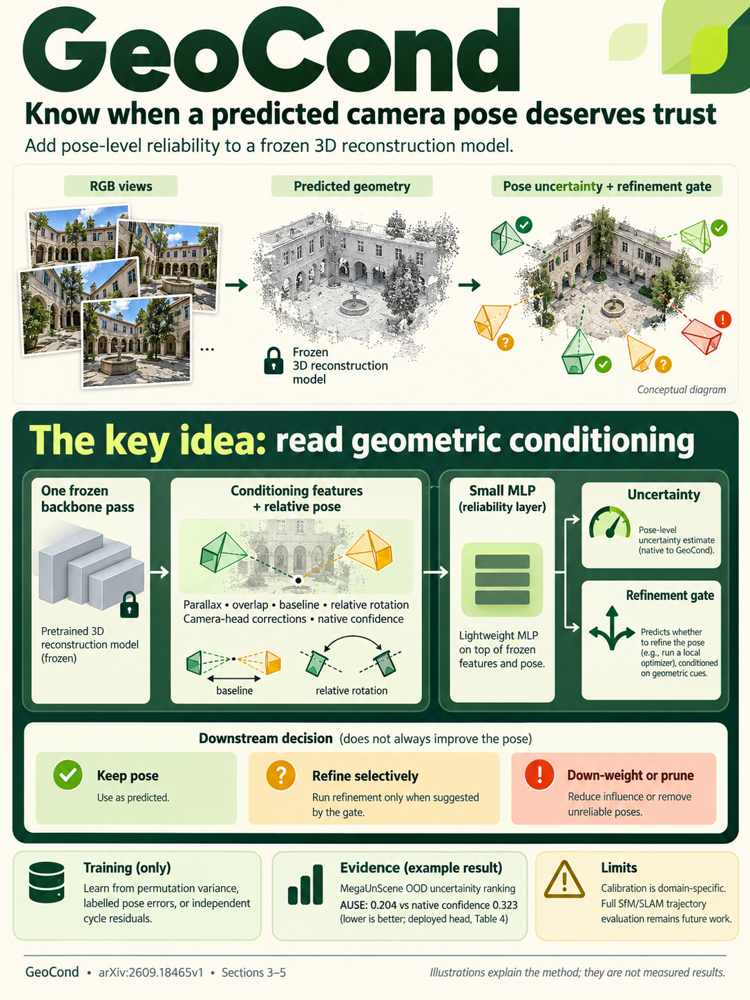

# GeoCond: A Conditioning-Aware Reliability Adapter for Feed-Forward 3D Reconstruction (arXiv 2026)

<!-- PAPER-CARD:en -->

[Original paper](https://arxiv.org/abs/2609.18465v1) · [Full-size English card](../../assets/paper-cards/en/foundation/geocond.png)
<!-- /PAPER-CARD -->

## 📋 Overview

- **Authors**: David Ahmedt-Aristizabal, Mohammad Ali Armin, Russell Tsuchida, Lars Petersson
- **Institution**: CSIRO, Monash University
- **Venue**: arXiv preprint (2026-09)
- **Links**: [Paper](https://arxiv.org/abs/2609.18465)
- **Verification**: UNKNOWN (2026-10-15; source 2609.18465v1 content reviewed; publication venue not independently confirmed)
- **TL;DR**: Read geometric conditioning, including parallax and overlap, from frozen FF3D predictions to learn pose reliability and a refinement gate. High confidence does not always make BA beneficial.

## 🎯 Key Contributions

1. **Pose-Level Reliability**: Distinguish pixel confidence from how well relative pose is constrained.
2. **Supervision Choices**: Train heads with frame-order orbit variance, GT pose errors or independent pose-graph cycle residuals.
3. **Selective Refinement**: Use reliability to retain, refine or reject predictions rather than applying BA universally.

## 🔧 Technical Details

### Input, Output, and Problem

- **Input**: Cameras, depth, pointmaps and geometric relationships predicted by a frozen backbone.
- **Output**: Relative-pose uncertainty and a refinement gate. The default head reads one backbone execution at inference.
- **Problem**: Low parallax, low overlap and large relative rotations weakly constrain pose. Pixel confidence does not capture this sufficiently, and incorrect BA can worsen initial poses.

### Method

1. Construct scalar conditioning features from predicted geometry.
2. Train with orbit-variance teachers across frame permutations, or choose GT/cycle supervision.
3. Predict uncertainty with a small head and learn a gate between feed-forward results and refinement.
4. Distinguish the deployed default head from multi-backbone-execution teachers and GT-selecting oracles.

Source §3–4. Freezing the backbone does not determine whether GT is used; head supervision does. Table 3 below trains on 7-Scenes+MegaUnScene and tests on scene-disjoint indoor/OOD data.

## 📊 Results

**Source**: [Source PDF](https://arxiv.org/pdf/2609.18465v1), Table 3, PDF p.6.

AUSE measures uncertainty's error-ranking quality; lower is better. Final AUC@30 measures pose quality after refinement decisions. Values share the same split; dashes mean the row does not report that metric.

| Method                 | Indoor AUSE ↓ | Outdoor/OOD AUSE ↓ | Indoor AUC@30 ↑ | Outdoor/OOD AUC@30 ↑ |
| ---------------------- | ------------- | ------------------ | --------------- | -------------------- |
| Native VGGT confidence | 0.19          | 0.32               | —               | —                    |
| GeoCond one-pass       | 0.17          | 0.20               | 53.5            | 58.4                 |
| Feed-forward always    | —             | —                  | 51.6            | 60.3                 |
| BA always              | —             | —                  | 53.6            | 38.4                 |
| Orbit teacher          | 0.17          | 0.16               | —               | —                    |

The gate reduces severe BA-always degradation on OOD data but reaches 58.4, below FF-always's 60.3. It therefore does not always improve the initial prediction. Uncertainty ranking can also worsen in Table 2's very-low-overlap, large-rotation indoor bins.

## 💡 Insights & Impact

High confidence, low pose error and likely BA success are different concepts. Predicting whether to run post-processing is a practical separate task.

- Supervision, splits and teachers change the meaning of results. Do not merge different experiments into one result.
- Domain shift and incorrect predicted conditioning affect the gate. Better uncertainty ranking guarantees neither metric calibration nor better final pose.

## 🔗 Related Work

- [VGGT](../reconstruction/vggt.md): the principal frozen backbone.
- [Trust3R](trust3r.md), [ReVar3R](../reconstruction/revar3r.md): learned and repeated-inference uncertainty methods.

## 📚 Key Takeaways

1. Distinguish geometric pose conditioning from pixel confidence.
2. Separate head-inference cost from teacher-generation cost.
3. Report benefits of avoiding BA together with losses relative to the feed-forward baseline.
