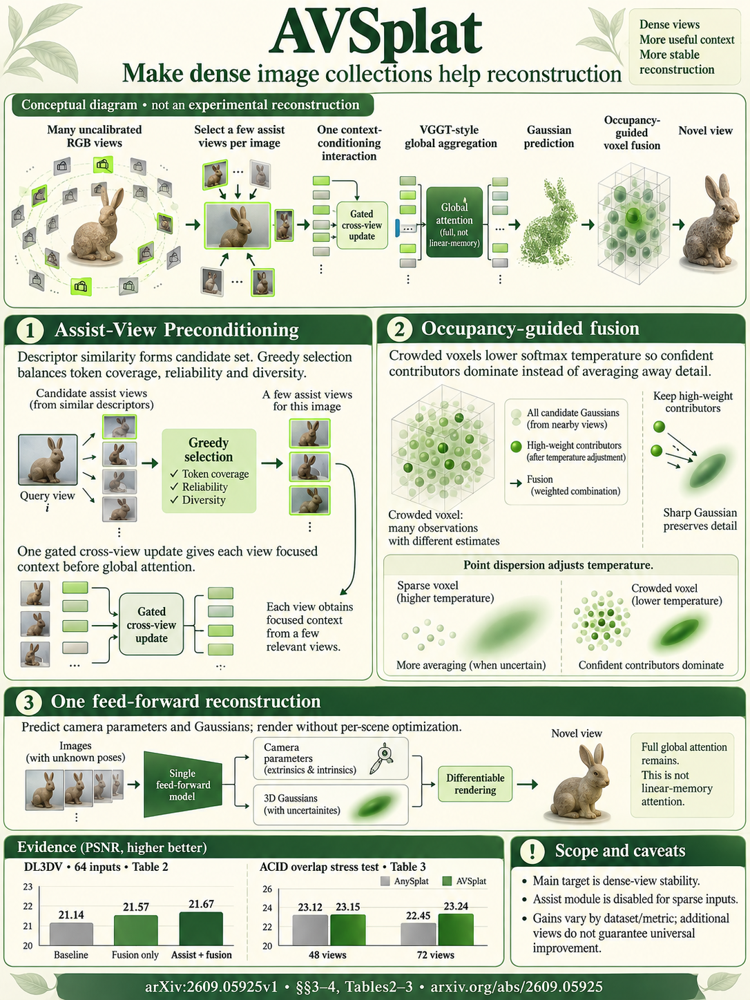

# AVSplat: Dense-View Feed-Forward 3D Gaussian Splatting with Assist-View Preconditioning (arXiv 2026)

<!-- PAPER-CARD:en -->

[Original paper](https://arxiv.org/abs/2609.05925v1) · [Full-size English card](../../assets/paper-cards/en/gaussian-splatting/avsplat.png)
<!-- /PAPER-CARD -->

## 📋 Overview

- **Authors**: Muyu Xu, Fangneng Zhan, Yu Wei, Hanspeter Pfister, Shijian Lu
- **Institution**: Nanyang Technological University, Harvard University
- **Venue**: arXiv preprint (2026-09)
- **Links**: [Paper](https://arxiv.org/abs/2609.05925)
- **Verification**: UNKNOWN (2026-10-15; source 2609.05925v1 content reviewed; publication venue not independently confirmed)
- **TL;DR**: Counter attention dilution with assist-view context, then fuse crowded-voxel Gaussian features with temperature-aware weights.

## 🎯 Key Contributions

1. Choose assist views for relevance and diversity.
2. Precondition views with cached scene features before global aggregation.
3. Adjust voxel-fusion attribution using occupancy and confidence.

## 🔧 Technical Details

### Input, Output, and Problem

- **Input**: Many unposed RGB views.
- **Output**: Cameras, a fused Gaussian scene and novel-view images.
- **Problem**: Adding views can blur rendering through irrelevant tokens and voxel averaging.

### Method

1. Cache features from a small assist-view set.
2. Let each input view read this context first to stabilize correspondence.
3. Predict geometry and Gaussian features with VGGT-style global aggregation.
4. Set fusion temperatures according to voxel occupancy and point confidence.

Extend the AnySplat family and train on DL3DV. Assist views are selected input context, not newly generated images.

## 📊 Results

**Source**: [Source PDF](https://arxiv.org/pdf/2609.05925v1), Table 1, PDF p.10.

DL3DV dense-input NVS. Higher PSNR/SSIM is better; compare rows with identical view counts.

| Views | Method   | PSNR ↑ | SSIM ↑ |
| ----- | -------- | ------ | ------ |
| 32    | AnySplat | 21.05  | 0.680  |
| 32    | AVSplat  | 21.54  | 0.710  |
| 64    | AnySplat | 21.14  | 0.684  |
| 64    | AVSplat  | 21.67  | 0.717  |

AVSplat has lower sparse 3-view DL3DV PSNR, and not every metric improves on other datasets. Positive view scaling describes a trend in the specified experiments.

## 💡 Insights & Impact

Increasing input views differs from preserving relevant context for each view.

- Incorrect assist-view selection can misguide correspondences.
- Include the computation and memory costs of additional views.

## 🔗 Related Work

- [VGGT](../foundation/vggt.md): geometry aggregation background.
- [DensiTok](densitok.md): generates unseen tokens rather than using real input-view context.

## 📚 Key Takeaways

1. Read useful input views as context first.
2. Make dense-voxel averaging adaptive.
3. Distinguish view scaling from best scores under one condition.
