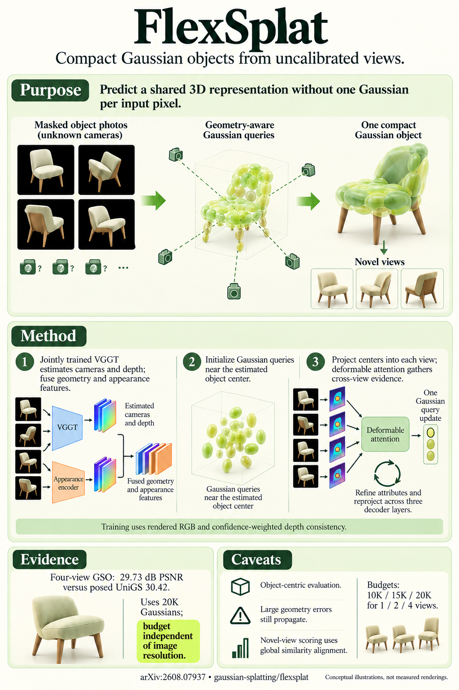

# FlexSplat: Flexible Feed-Forward 3D Gaussian Splatting without Point Cloud Correspondence (arXiv 2026)

<!-- PAPER-CARD:en -->

[Original paper](https://arxiv.org/abs/2608.07937v1) · [Full-size English card](../../assets/paper-cards/en/gaussian-splatting/flexsplat.png)
<!-- /PAPER-CARD -->

## 📋 Overview

- **Authors**: Amir Sabbaghziarani, Hanting Ye, Maria Gorlatova, Yi Ding
- **Institution**: Georgia Institute of Technology/Georgia State University/Emory University TReNDS, Georgia State University, Duke University, University of Tennessee Knoxville
- **Venue**: arXiv preprint (2026-08)
- **Links**: [Paper](https://arxiv.org/abs/2608.07937)
- **Verification**: UNKNOWN (2026-10-15; source 2608.07937v1 content reviewed; publication venue not independently confirmed)
- **TL;DR**: Jointly train a camera/depth geometry frontend and query Gaussian decoder for uncalibrated object-centric NVS.

## 🎯 Key Contributions

1. Extend query-based Gaussian decoders that require input camera poses.
2. Combine depth-guided primitives with multi-view deformable attention.
3. Decouple primitive count from image resolution.

## 🔧 Technical Details

### Input, Output, and Problem

- **Input**: One or multiple object-centric RGB views, without input camera poses or GT depth.
- **Output**: Cameras, depth, a compact Gaussian set and held-out-view renderings.
- **Problem**: Compact query Gaussians normally need known cameras to locate attention observations.

### Method

1. Predict per-view cameras and depth with a geometry transformer.
2. Guide Gaussian-query 3D locations with predicted depth.
3. Aggregate evidence into one Gaussian set with multi-view deformable attention.
4. Train jointly using uncertainty-weighted depth consistency and rendering supervision.

Distinguish Objaverse-LVIS multi-view from ShapeNet-SRN single-view settings. Global similarity alignment matches evaluation rendering cameras.

## 📊 Results

**Source**: [Source PDF](https://arxiv.org/pdf/2608.07937v1), Table 1, PDF p.8.

Mean Cars-category single-view NVS on ShapeNet-SRN. This differs from the four-view GSO experiment.

| Method       | PSNR ↑ | SSIM ↑ | LPIPS ↓ |
| ------------ | ------ | ------ | ------- |
| LeanGaussian | 25.00  | 0.930  | 0.075   |
| FlexSplat    | 25.09  | 0.920  | 0.079   |

PSNR is slightly higher, but SSIM/LPIPS are not better than LeanGaussian. Camera inputs also differ; do not claim matched-condition superiority on every metric.

## 💡 Insights & Impact

Jointly adapt the geometry frontend and Gaussian decoder to rendering instead of fixing cameras beforehand.

- Object-centric results do not guarantee performance in broad, unstructured scenes.
- Camera errors can propagate to attention and geometry.

## 🔗 Related Work

- [VGGT](../foundation/vggt.md): geometry-transformer background.
- [Splatt3R](splatt3r.md): pointmap-based Gaussian prediction.

## 📚 Key Takeaways

1. Cameras are estimated, not given inputs.
2. Gaussian budgets are independent of pixel counts.
3. Read single-/multi-view protocols and metric trade-offs separately.
