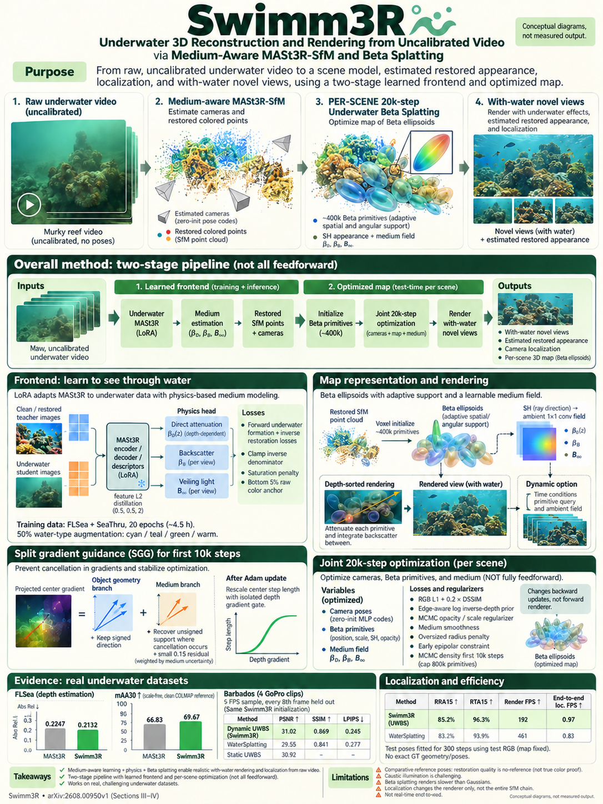

# Swimm3R: Splatting with Medium-aware SfM for Underwater 3D Reconstruction (arXiv 2026)

<!-- PAPER-CARD:en -->

[Original paper](https://arxiv.org/abs/2608.00950v1) · [Full-size English card](../../assets/paper-cards/en/gaussian-splatting/swimm3r.png)
<!-- /PAPER-CARD -->

## 📋 Overview

- **Authors**: Minseong Kweon, Junaed Sattar
- **Institution**: University of Minnesota–Twin Cities
- **Venue**: arXiv preprint (2026-08)
- **Links**: [Paper](https://arxiv.org/abs/2608.00950)
- **Verification**: UNKNOWN (2026-10-15; source 2608.00950v1 content reviewed; publication venue not independently confirmed)
- **TL;DR**: Distill MASt3R's terrestrial geometry prior underwater, then optimize mapping/rendering with attenuation- and scattering-aware Beta Splatting.

## 🎯 Key Contributions

1. Distill geometry and descriptors into an underwater LoRA student.
2. Predict attenuation, backscatter and veiling light with a physics head.
3. Optimize underwater scenes with Beta primitives and scattering-aware gradients.

## 🔧 Technical Details

### Input, Output, and Problem

- **Input**: Uncalibrated underwater RGB video.
- **Output**: Poses, reconstructed point clouds, medium parameters and an optimized Beta-primitive scene.
- **Problem**: Underwater optical effects disrupt SfM initialization and distort splatting geometry gradients.

### Method

1. Distill clean-image teacher MASt3R features into a raw-underwater student.
2. Connect observed underwater and restored images through a physics head.
3. Initialize Beta primitives with predicted geometry.
4. Optimize scattering-aware geometric gradients and medium fields per scene.

Underwater adaptation training and per-scene splatting optimization are separate. The whole system is not a single feed-forward pass.

## 📊 Results

**Source**: [Source PDF](https://arxiv.org/pdf/2608.00950v1), Table II, PDF p.5.

FLSea test-sequence depth/pose evaluation. RRA/RTA@15 and mAA(30) are percentages; higher is better.

| Method     | AbsRel ↓ | RRA@15 ↑ | RTA@15 ↑ | mAA(30) ↑ |
| ---------- | -------- | -------- | -------- | --------- |
| MASt3R-SfM | 0.2247   | 77.47    | 86.81    | 66.83     |
| Swimm3R    | 0.2132   | 79.19    | 88.43    | 69.67     |

Barbados lacks geometry GT, and some pose references come from GLUEMAP. More points do not directly prove better surface accuracy.

## 💡 Insights & Impact

Connect geometry adaptation and medium-aware rendering sequentially while separating their supervision and evaluation.

- Optical-model and restoration-teacher errors can both propagate.
- Small underwater-video benchmarks do not cover all underwater conditions.

## 🔗 Related Work

- [MASt3R](../foundation/mast3r.md): feature·matching prior.
- [WAT3R](../reconstruction/wat3r-feedforward.md): separate underwater feed-forward adaptation.

## 📚 Key Takeaways

1. SfM priors and splatting optimization are separate stages.
2. Adapt geometry and optics together.
3. Distinguish sensor GT from substitute references.
