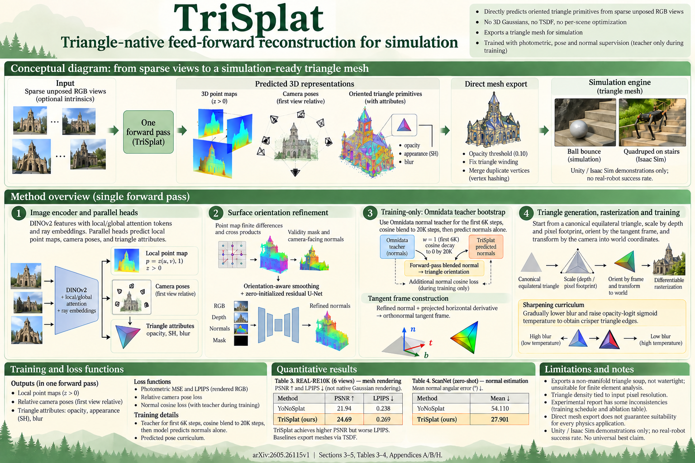

# TriSplat: Simulation-Ready Feed-Forward 3D Scene Reconstruction (arXiv preprint (2026-05))

<!-- PAPER-CARD:en -->

[Original paper](https://arxiv.org/abs/2605.26115v1) · [Full-size English card](../../assets/paper-cards/en/gaussian-splatting/trisplat.png)
<!-- /PAPER-CARD -->

_Overview of TriSplat (원논문 Fig. 2)_

## 📋 Overview

- **Authors**: Weijie Wang, Zimu Li, Jinchuan Shi, Zeyu Zhang, Botao Ye, Marc Pollefeys, Donny Y. Chen, Bohan Zhuang
- **Institution**: Zhejiang University; ETH Zurich; ETH AI Center; Microsoft; Monash University
- **Venue**: arXiv preprint (2026-05)
- **Links**: [Paper](https://arxiv.org/abs/2605.26115) | [Project Page](https://lhmd.top/trisplat)
- **Verification**: PREPRINT (2026-07-21)
- **TL;DR**: A feed-forward, pose-free reconstruction network whose native representation is oriented triangle primitives, so a single forward pass exports a simulation-ready triangle mesh with no post-hoc TSDF fusion or Poisson reconstruction.

## 🎯 Key Contributions

1. **Triangle-native feed-forward reconstruction**: Jointly predicts local 3D point maps, per-pixel triangle attributes, camera poses, and optional intrinsics from sparse unposed images in one pass; the rendering primitives are themselves surface triangles, so the output is directly a mesh.
2. **Normal-anchored triangle construction**: Rather than regressing triangle orientation as an unconstrained latent, it derives geometry normals from predicted point maps, refines them with an image-conditioned U-Net, and converts them into local tangent frames.
3. **Mono-normal bootstrap + progressive sharpening**: A three-phase teacher-normal bootstrap schedule stabilizes early training, while opacity and blur scheduling transition soft, forgiving primitives into crisp, mesh-ready surface elements.
4. **Simulation readiness by construction**: The exported meshes load directly into physics engines (Unity, NVIDIA Isaac Sim) with no conversion or cleanup.

## 🔧 Technical Details

### Pipeline

- **Backbone**: DINOv2 encoder followed by Local-Global Attention decoder blocks (alternating intra-view self-attention and cross-view joint attention, with 2D rotary and per-pixel ray-direction embeddings).
- **Three parallel heads**: a point head (dense local 3D point map, depth via z = exp(z′)), a camera head (one SE(3) camera-to-world pose per view via SVD orthogonalization, poses relative to the first view), and a primitive head (density logit, scale logits, quaternion, spherical-harmonic appearance, blur).
- **Triangle construction**: Each triangle is instantiated from a canonical equilateral template, scaled by predicted depth/pixel footprint and oriented by the geometry-derived tangent-frame rotation Rn, then rendered by a differentiable triangle rasterizer.

### Geometry-Anchored Orientation

Geometry normals come from finite differences of the point map (n = normalize(∆x × ∆y)), with a validity mask excluding border/degenerate pixels. A zero-initialized U-Net refines them using RGB, depth, and normal cues. A mono-normal bootstrap blends a pretrained monocular teacher normal via a coefficient α(t) that follows a takeover→cosine-blend→release schedule, operating on the forward-pass representation (not just a loss).

### Training and Mesh Extraction

The loss is L = Lphoto + Lcam + Lnormal (photometric + LPIPS, pairwise relative-pose, and cosine normal terms). Mesh extraction is trivial: discard low-opacity triangles, fix winding order against per-pixel normals, and merge duplicate vertices — no TSDF fusion or marching cubes.

## 📊 Results

Trained on RealEstate10K (RE10K) and DL3DV; ScanNet evaluated zero-shot. Baselines use TSDF-fused meshes; TriSplat exports primitives directly. Rendering metrics are under **mesh rendering**.

### Surface Quality on DL3DV (CD↓, F1↑)

원논문 Table 1 (CD·F1 컬럼만 발췌).

| Method              | CD↓ 6v    | F1↑ 6v    | CD↓ 12v   | F1↑ 12v   | CD↓ 24v   | F1↑ 24v   |
| ------------------- | --------- | --------- | --------- | --------- | --------- | --------- |
| MVSplat             | 1.143     | 0.118     | 0.802     | 0.135     | 0.695     | 0.156     |
| DepthSplat          | 1.116     | 0.145     | 0.907     | 0.152     | 0.786     | 0.152     |
| AnySplat            | 1.012     | 0.093     | 0.731     | 0.096     | 0.699     | 0.100     |
| YoNoSplat           | 0.920     | 0.106     | 0.664     | 0.092     | 0.687     | 0.088     |
| **TriSplat (Ours)** | **0.613** | **0.287** | **0.323** | **0.279** | **0.310** | **0.277** |

### NVS Quality on DL3DV under Mesh Rendering

원논문 Table 2.

| Method              | PSNR↑ 6v  | SSIM↑ 6v  | LPIPS↓ 6v | PSNR↑ 12v | SSIM↑ 12v | LPIPS↓ 12v | PSNR↑ 24v | SSIM↑ 24v | LPIPS↓ 24v |
| ------------------- | --------- | --------- | --------- | --------- | --------- | ---------- | --------- | --------- | ---------- |
| MVSplat             | 14.75     | 0.450     | 0.509     | 15.16     | 0.431     | 0.525      | 15.72     | 0.439     | 0.526      |
| DepthSplat          | 14.86     | 0.481     | 0.490     | 14.82     | 0.426     | 0.536      | 15.13     | 0.422     | 0.541      |
| AnySplat            | 18.58     | 0.551     | 0.397     | 16.58     | 0.485     | 0.462      | 16.42     | 0.442     | 0.475      |
| YoNoSplat           | 18.88     | 0.548     | 0.414     | 16.90     | 0.459     | 0.485      | 16.71     | 0.452     | 0.499      |
| **TriSplat (Ours)** | **20.84** | **0.615** | **0.335** | **18.71** | **0.493** | **0.400**  | **18.06** | **0.455** | **0.425**  |

### RE10K (6 views) and Zero-Shot ScanNet

원논문 Table 3 (RE10K, surface + NVS) · Table 4 (ScanNet, depth + normal).

| Method              | RE10K CD↓ | RE10K F1↑ | RE10K PSNR↑ | RE10K LPIPS↓ | ScanNet Rel↓ | ScanNet Mean↓ | ScanNet <30°↑ |
| ------------------- | --------- | --------- | ----------- | ------------ | ------------ | ------------- | ------------- |
| DepthSplat          | 0.294     | 0.429     | 21.23       | 0.271        | 0.279        | 54.861        | 29.403        |
| AnySplat            | 0.540     | 0.110     | 18.23       | 0.365        | 0.453        | 55.557        | 25.375        |
| YoNoSplat           | 0.267     | 0.443     | 21.94       | 0.238        | 0.270        | 54.110        | 41.047        |
| MeshSplat           | 0.349     | 0.340     | 19.97       | 0.294        | 0.534        | 59.803        | 31.862        |
| SurfelSplat         | 0.747     | 0.154     | 11.18       | 0.738        | 0.716        | 75.300        | 16.484        |
| **TriSplat (Ours)** | **0.190** | **0.622** | **24.69**   | **0.269**    | **0.188**    | **27.901**    | **71.708**    |

### Ablation on RE10K (6 views)

원논문 Table 5. 각 행은 full model에서 한 컴포넌트를 제거.

| Configuration              | CD↓   | F1↑   | PSNR↑ | LPIPS↓ |
| -------------------------- | ----- | ----- | ----- | ------ |
| Full model                 | 0.190 | 0.708 | 23.25 | 0.318  |
| w/o normal anchoring       | 0.190 | 0.651 | 22.14 | 0.396  |
| w/o mono-normal bootstrap  | 0.198 | 0.643 | 22.17 | 0.397  |
| w/o normal refinement      | 0.193 | 0.649 | 21.67 | 0.429  |
| w/o progressive sharpening | 0.191 | 0.646 | 21.81 | 0.416  |

## 💡 Insights & Impact

- **The mesh IS the primitive**: Gaussian baselines lose quality when their TSDF-fused meshes are rasterized as triangles; TriSplat has no such degradation because its rendering primitives are already the exported mesh. On RE10K it reaches 24.69 dB under mesh rendering vs. 21.94 dB for the strongest Gaussian baseline (+2.75 dB).
- **Runtime advantage is structural**: End-to-end time-to-mesh on DL3DV (single H100) is 0.57 s / 0.62 s / 1.23 s at 6/12/24 views, since no separate mesh-export stage is needed. The paper states TriSplat is 33× faster than the fastest Gaussian baseline at 6 views (AnySplat 18.7 s) and up to 249× faster than the slowest baseline at 24 views (DepthSplat 306 s).
- **Every component matters**: Removing normal refinement causes the largest rendering drop (PSNR −1.58 dB), while removing the mono-normal bootstrap causes the largest surface degradation (F1 −0.065).
- **Honest limits**: Direct export yields a non-manifold "triangle soup" — adequate for rendering and physics but not for watertight-mesh applications like FEA — and triangle density is tied to input resolution.

## 🔗 Related Work

- **[DUSt3R](../foundation/dust3r.md)**: Foundational dense-geometry prediction that enabled joint structure-and-pose recovery, cited as the origin of the pose-free feed-forward line.
- **[MASt3R](../foundation/mast3r.md)**: Matching-grounded extension of the same family.
- **[VGGT](../foundation/vggt.md)**: Transformer-based pose-free geometry model in the same lineage of baselines.

## 📚 Key Takeaways

1. TriSplat makes simulation readiness a property of the representation: oriented triangle primitives are predicted feed-forward and exported as a mesh with no TSDF fusion or marching cubes.
2. Anchoring triangle orientation to predicted point-map geometry (refined normals + mono-normal bootstrap) is essential because triangles are far more sensitive to orientation error than Gaussian splats.
3. It leads all four surface metrics on RE10K and DL3DV, wins zero-shot depth/normal on ScanNet, and produces the best mesh-rendering PSNR while running in well under 1.3 s for up to 24 views.
