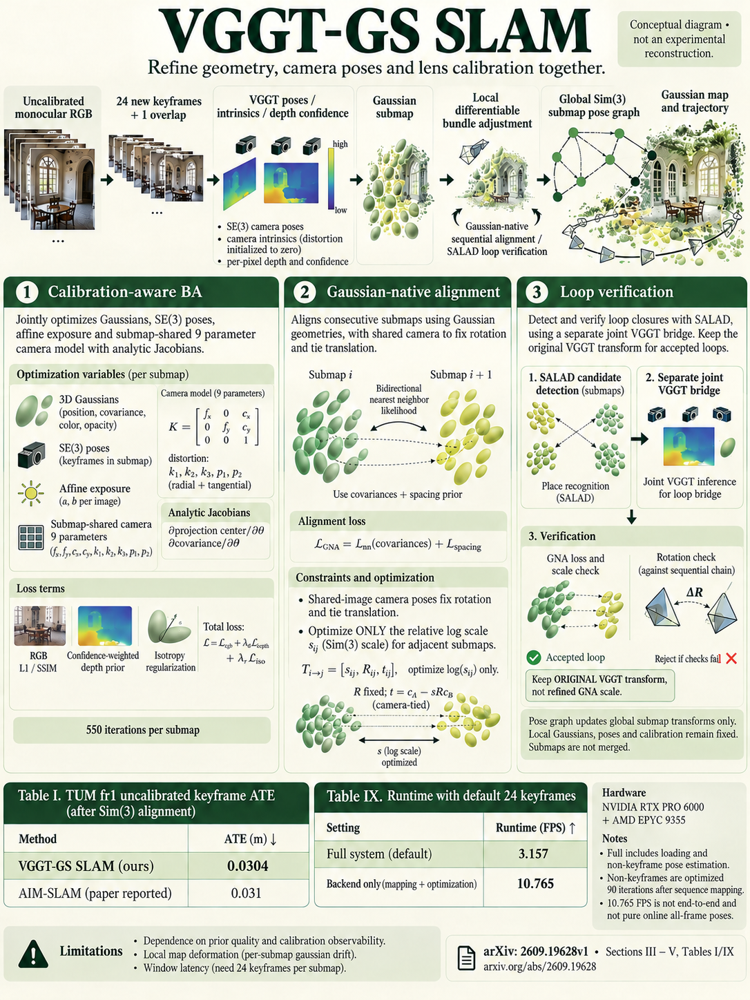

# VGGT-GS SLAM: Uncalibrated Monocular Gaussian Splatting SLAM with Feed-Forward Priors (arXiv 2026)

<!-- PAPER-CARD:en -->

[Original paper](https://arxiv.org/abs/2609.19628v1) · [Full-size English card](../../assets/paper-cards/en/gaussian-splatting/vggt-gs-slam.png)
<!-- /PAPER-CARD -->

## 📋 Overview

- **Authors**: Yuhang Han, Hao Wang, Jiaxi Cao, Xingyu Liu
- **Institution**: National University of Singapore
- **Venue**: arXiv preprint (2026-09)
- **Links**: [Paper](https://arxiv.org/abs/2609.19628)
- **Verification**: UNKNOWN (2026-10-15; source 2609.19628v1 content reviewed; publication venue not independently confirmed)
- **TL;DR**: Initialize Gaussian submaps from VGGT poses/depth, then jointly refine camera calibration, distortion and geometry through rendering-based BA.

## 🎯 Key Contributions

1. Jointly optimize poses, Gaussians, shared intrinsics and distortion.
2. Adjust neighboring-submap scales using Gaussian covariances.
3. Verify loop candidates with Gaussian matching before global-graph insertion.

## 🔧 Technical Details

### Input, Output, and Problem

- **Input**: Uncalibrated monocular RGB video without sensor depth.
- **Output**: Camera trajectories/calibration, Gaussian submaps and novel-view renderings.
- **Problem**: Fixing inaccurate calibration pushes errors into geometry and produces inconsistent submap scales.

### Method

1. Predict window cameras, depth and confidence with VGGT.
2. Initialize Gaussians from depth and estimate submap-shared intrinsics.
3. Jointly BA radial–tangential distortion, poses and Gaussians with analytic calibration Jacobians.
4. Align scales through Gaussian-native matching, verify loops and optimize a Sim(3) graph.

Combine geometric priors with per-scene optimization. Non-keyframe poses are also optimized against fixed local maps, so keyframe-only time is not full throughput.

## 📊 Results

**Source**: [Source PDF](https://arxiv.org/pdf/2609.19628v1), Tables I–II, PDF p.5.

Uncalibrated RGB-only mean ATE RMSE (m). TUM uses the specified 9 sequences; 7-Scenes uses sequence 01 configurations.

| Dataset              | VGGT-SLAM 2.0 | VGGT-GS SLAM |
| -------------------- | ------------- | ------------ |
| TUM RGB-D            | 0.041         | 0.030        |
| 7-Scenes sequence 01 | 0.067         | 0.055        |

RGB-D names the dataset, not depth inputs. Some baselines are published values and others reruns, not one-hardware controlled comparisons.

## 💡 Insights & Impact

Feed-forward priors initialize the system; photometric evidence refines both cameras and maps.

- BA and Gaussian refinement add costs; the system is not optimization-free.
- Assume static scenes and sufficient photometric observations; camera motion affects calibration observability.

## 🔗 Related Work

- [VGGT](../foundation/vggt.md): initial geometry priors.
- [VGGT-SLAM](../reconstruction/vggt-slam.md): submap-structure background.

## 📚 Key Takeaways

1. Predict depth priors from RGB-only inputs.
2. Refine calibration and geometry jointly.
3. Loop verification differs from replacing loop transforms.
