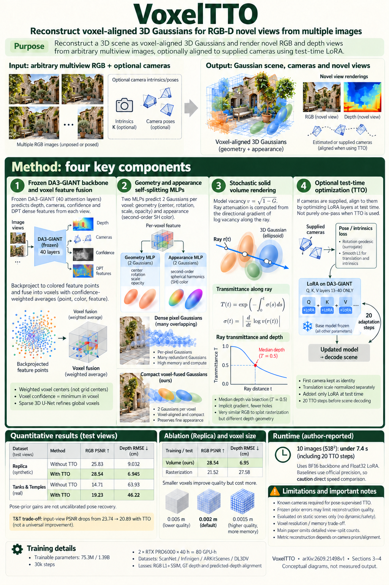

# VoxelTTO: Voxel-Aligned Feed-Forward 3D Gaussian Splatting with Test-Time Optimization (arXiv 2026)

<!-- PAPER-CARD:en -->

[Original paper](https://arxiv.org/abs/2609.21498v1) · [Full-size English card](../../assets/paper-cards/en/gaussian-splatting/voxeltto.png)
<!-- /PAPER-CARD -->

## 📋 Overview

- **Authors**: Yibin Zhao, Yihan Pan, Yangwen Li, Jun Nan, Jianjun Yi
- **Institution**: East China University of Science and Technology, Shanghai Open University
- **Venue**: arXiv preprint (2026-09)
- **Links**: [Paper](https://arxiv.org/abs/2609.21498)
- **Verification**: UNKNOWN (2026-10-15; source 2609.21498v1 content reviewed; publication venue not independently confirmed)
- **TL;DR**: Aggregate geometry features into voxels to predict Gaussians, optionally optimizing LoRA against camera priors at test time to reduce rendering-camera mismatch.

## 🎯 Key Contributions

1. Decouple Gaussian primitives from individual pixels.
2. Refine voxel features with a sparse 3D U-Net.
3. Apply pose-supervised TTO to LoRA on a frozen backbone.

## 🔧 Technical Details

### Input, Output, and Problem

- **Input**: RGB images and optional camera parameters.
- **Output**: Voxel-aligned Gaussian scene, camera·RGB-D rendering.
- **Problem**: Excessive pixel-aligned primitive overlap and camera errors degrade held-out rendering.

### Method

1. Extract depth, cameras, confidence and dense features from a frozen VFM.
2. Aggregate confidence-weighted centers and features into voxels.
3. Decode multiple primitives through geometry/appearance branches after a sparse 3D U-Net.
4. When cameras are supplied, refine LoRA through pose supervision and use stochastic solid-volume rendering.

Offline reconstruction-module training differs from per-scene LoRA TTO. Camera-free settings are not identical to camera-supervised TTO.

## 📊 Results

**Source**: [Source PDF](https://arxiv.org/pdf/2609.21498v1), Table 1, PDF p.7.

Replica test-view RGB NVS, not input-view reproduction. These rows ablate the proposed method's TTO.

| Configuration | PSNR ↑ | SSIM ↑ | LPIPS ↓ |
| ------------- | ------ | ------ | ------- |
| Without TTO   | 25.83  | 0.827  | 0.196   |
| With TTO      | 28.54  | 0.876  | 0.172   |

TTO also lowers PSNR on TAT input views. Do not describe test-view improvements as universal across all views/datasets.

## 💡 Insights & Impact

Separate voxel-representation improvements from camera-prior adaptation through optimization.

- Depend on pose-supervision or camera-prior quality.
- TTO adds computation and must not be confused with optimization-free performance.

## 🔗 Related Work

- [VGGT](../foundation/vggt.md): frozen visual-geometric-model background.
- [AVSplat](avsplat.md): another voxel-fusion improvement.

## 📚 Key Takeaways

1. Decode Gaussians from voxel features.
2. TTO supplies camera supervision to LoRA.
3. Separate input-view and test-view scores.
