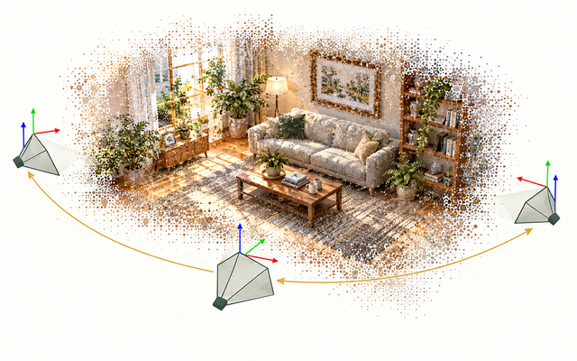

# Pose Estimation

_Conceptual illustration, not a paper result._

## 📍 Overview

Estimate camera or object position and orientation, either relative to another view or in a reference map. The primary task is pose, registration, localization or visual odometry; full SfM and joint map-and-trajectory SLAM belong in [3D Reconstruction](../reconstruction/). Compare scale assumptions, available reference information and the trajectory-alignment protocol before comparing errors.

**Reading tags:** localization · relative pose · object pose · odometry.

These tags are reading cues; the generated list below records the primary folder. Notes may contain Korean.

<!-- GENERATED:featured -->

## ⭐ Featured Papers

> **Curated for recency and representative methods; reviewed 2026-10-19.** [Selection settings](../../data/category-featured.json) record the reason for each choice. This is a reading route, not a performance ranking. Preprint labels mean no independently confirmed conference/journal publication is stored; other unconfirmed venues are marked. See All Papers in This Category for every entry.

- [**Pixel-wise Geo-registration of Drone and Satellite Images (arXiv 2026)**](skyreg.md) (arXiv preprint (2026-08)) — **Preprint** — **Recent:** Drone-to-satellite geo-registration.
- [**Topometric Autonomous Vehicle Localization by Combining Visual Embeddings and Feed-Forward 3D Models (arXiv 2026)**](topometric-ff3d.md) (arXiv preprint (2026-08)) — **Preprint** — **Recent:** Topometric vehicle localization with geometry models.
- [**FUSER**](fuser.md) (CVPR 2026) — **Venue unconfirmed** — **Representative:** Multi-view registration and diffusion refinement.
- [**ViPE**](vipe.md) (arXiv preprint (2025-08)) — **Preprint** — **Representative:** General-video intrinsics, camera trajectories and depth annotation.
- [**C3Po**](c3po.md) (NeurIPS 2025) — **Venue unconfirmed** — **Representative:** Photo-to-floor-plan correspondence and localization.
- [**Reloc3r**](reloc3r.md) (CVPR 2025) — **Representative:** Relative camera pose regression for localization.
- [**Pos3R**](pos3r.md) (CVPR 2025) — **Representative:** 6D pose estimation for unseen objects.

<!-- /GENERATED:featured -->

<!-- GENERATED:paper-index -->

## 📄 All Papers in This Category (12)

> Generated by `tools/build_papers_list.py`. Years use the recorded Overview Venue or preprint year, newest first; verification dates are not publication dates. Topics, where present, are nested below each year; entries within each year/topic are ordered by slug. Links open notes and their English summary cards.

### 2026

- [**FFVO**](ffvo.md) (arXiv preprint (2026-09)) — A Feedforward Pose Decoder for Long-Horizon Visual Odometry
- [**FUSER**](fuser.md) (CVPR 2026) — Feed-Forward Multiview 3D Registration Transformer and SE(3)N Diffusion Refinement
- [**HyVGGT-VO**](hyvggt-vo.md) (arXiv preprint (2026-04)) — Tightly Coupled Hybrid Dense Visual Odometry with Feed-Forward Models
- [**Keyframe-Based Feed-Forward VO**](keyframe-based.md) (arXiv preprint (2026-01)) — RL-Driven Keyframe Selection for VGGT
- [**Pixel-wise Geo-registration of Drone and Satellite Images (arXiv 2026)**](skyreg.md) (arXiv preprint (2026-08))
- [**Topometric Autonomous Vehicle Localization by Combining Visual Embeddings and Feed-Forward 3D Models (arXiv 2026)**](topometric-ff3d.md) (arXiv preprint (2026-08))

### 2025

- [**C3Po**](c3po.md) (NeurIPS 2025) — Cross-View Cross-Modality Correspondence by Pointmap Prediction
- [**FVO**](fvo.md) (arXiv preprint (2025-10)) — Fast Visual Odometry with Transformers
- [**GRLoc**](grloc.md) (arXiv preprint (2025-11)) — Geometric Representation Regression for Visual Localization
- [**Pos3R**](pos3r.md) (CVPR 2025) — 6D Pose Estimation for Unseen Objects Made Easy
- [**Reloc3r**](reloc3r.md) (CVPR 2025) — Large-Scale Training of Relative Camera Pose Regression for Generalizable, Fast, and Accurate Visual Localization
- [**ViPE**](vipe.md) (arXiv preprint (2025-08)) — Video Pose Engine for 3D Geometric Perception

<!-- /GENERATED -->
