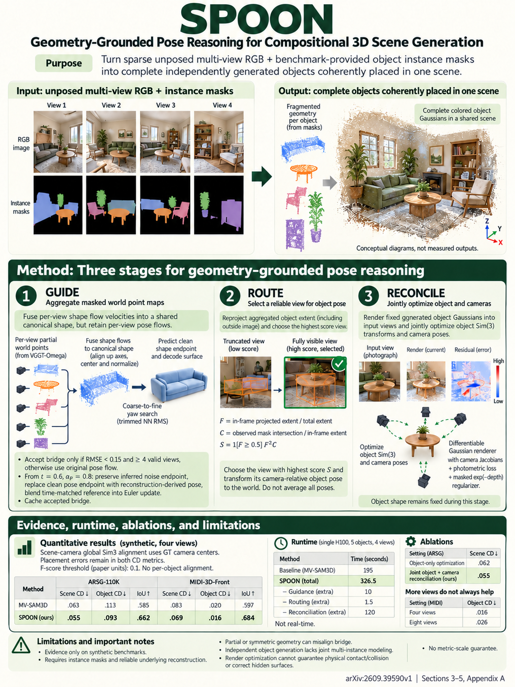

# SPOON: Towards Coherent Compositional 3D Scene Generation from Uncalibrated Multi-view Images (arXiv 2026)

<!-- PAPER-CARD:en -->

[Original paper](https://arxiv.org/abs/2609.39590v1) · [Full-size English card](../../assets/paper-cards/en/reasoning/spoon.png)
<!-- /PAPER-CARD -->

## 📋 Overview

- **Authors**: Guibiao Liao, Mochu Xiang, Heng Li, Ken Deng, Zijie Wang, Guanbin Li, Ping Tan, Shenghua Gao, Yizhou Yu
- **Institution**: University of Hong Kong, Shenzhen Loop Area Institute, Hong Kong University of Science and Technology, Sun Yat-sen University, TranscEngram
- **Venue**: arXiv preprint (2026-09)
- **Links**: [Paper](https://arxiv.org/abs/2609.39590)
- **Verification**: UNKNOWN (2026-10-15; source 2609.39590v1 content reviewed; publication venue not independently confirmed)
- **TL;DR**: Guide and select object-generator pose hypotheses using VGGT-Ω scene geometry, then jointly optimize cameras/object layouts for compositional scenes.

## 🎯 Key Contributions

1. Guide pose flow with geometry-derived surface bridges.
2. Route per-view pose hypotheses using geometric criteria.
3. Optimize global object/camera rendering consistency.

## 🔧 Technical Details

### Input, Output, and Problem

- **Input**: Uncalibrated RGB images and object-instance masks.
- **Output**: Completed object assets and object/camera layouts in a shared scene.
- **Problem**: Individually plausible per-view objects form inconsistent scenes when their pose hypotheses are placed independently.

### Method

1. Estimate scene pointmaps and cameras with VGGT-Ω.
2. Connect SAM3D multi-view-flow canonical surfaces with masked scene surfaces.
3. Guide pose generation with flow-time-dependent geometric endpoints.
4. Select hypotheses through geometry-aware routing and adjust object Sim(3)/camera poses with joint rendering losses.

This inference framework reuses existing geometry/object generators. Final joint optimization means the whole pipeline is neither optimization-free nor a single forward pass.

## 📊 Results

**Source**: [Source PDF](https://arxiv.org/pdf/2609.39590v1), Table 1, PDF p.7.

ARSG-110K, 4 input views. CDS/CDO measure scene/object Chamfer distance; box IoU measures layout. Source-normalized values are not converted into metric distances.

| Method   | Scene CD ↓ | Object CD ↓ | Box IoU ↑ |
| -------- | ---------- | ----------- | --------- |
| MV-SAM3D | 0.063      | 0.113       | 0.585     |
| SPOON    | 0.055      | 0.093       | 0.662     |

Evaluation preserves object poses, so shape and placement errors both contribute. Retain the information difference between single-view baselines and multi-view inputs.

## 💡 Insights & Impact

Composing strong object generators into scenes requires shared object–camera pose reasoning, not merely new shape generation.

- Instance-mask, reconstructed-surface and generator errors interact.
- Unobserved shape/texture comes from generative priors and need not match the actual scene.

## 🔗 Related Work

- [VGGT-Ω](../reconstruction/vggt-omega.md): scene geometry guide.
- [FIRE3D](../reconstruction/fire3d.md): another object-compositional reconstruction method.

## 📚 Key Takeaways

1. Input instance masks are required.
2. Guide, route and reconcile connect the layout.
3. Distinguish generated assets from observed geometry.
