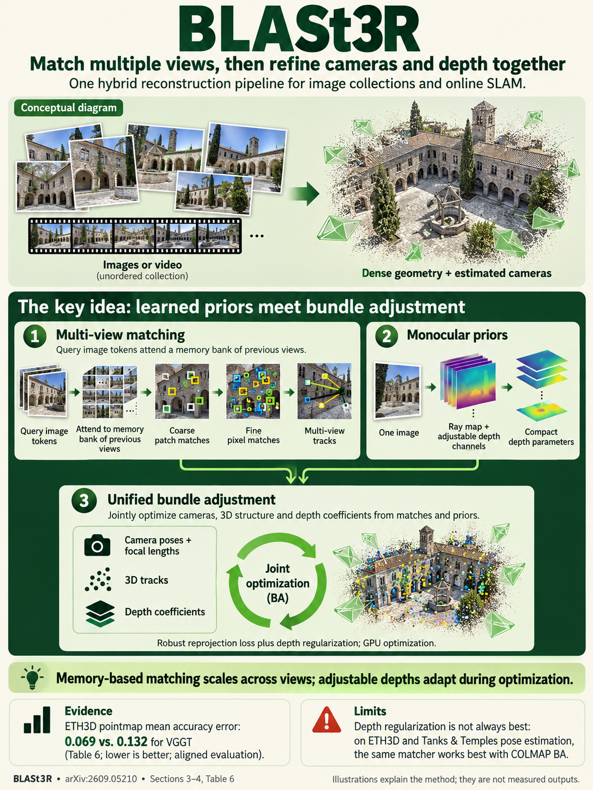

# BLASt3R: Bundle Adjustment of Any Image Set with Multi-View Matching and Monocular Priors (arXiv 2026)

<!-- PAPER-CARD:en -->

[Original paper](https://arxiv.org/abs/2609.05210v1) · [Full-size English card](../../assets/paper-cards/en/reconstruction/blast3r.png)
<!-- /PAPER-CARD -->

## 📋 Overview

- **Authors**: Vincent Leroy, Philippe Weinzaepfel, Lojze Zust, Yohann Cabon, Jérome Revaud
- **Institution**: NAVER LABS Europe
- **Venue**: arXiv preprint (2026-09)
- **Links**: [Paper](https://arxiv.org/abs/2609.05210)
- **Verification**: UNKNOWN (2026-10-15; source 2609.05210v1 content reviewed; publication venue not independently confirmed)
- **TL;DR**: Combine learned multi-view correspondences and adjustable depth priors in bundle adjustment for unordered reconstruction and online SLAM.

## 🎯 Key Contributions

1. Learn memory-reusing multi-view dense matching.
2. Adjust monocular pointmap priors through affine log-depth parameters.
3. Build an efficient BA solver without materializing large dense matrices.

## 🔧 Technical Details

### Input, Output, and Problem

- **Input**: Unordered RGB images or time-ordered video.
- **Output**: Camera poses and aligned dense geometry.
- **Problem**: Reduce both learned-geometry generalization errors and classical matching/BA costs.

### Method

1. A CroCo-initialized matcher predicts dense flows from queries to stored views.
2. Link correspondences into tracks and use monocular pointmaps as geometry priors.
3. Adjust log-depth scales/shifts to fit scene observations.
4. Optimize pose/geometry variables through a CUDA implicit-Schur approach.

Both matcher training and inference-time optimization are required; the full method is not one feed-forward pass.

## 📊 Results

**Source**: [Source PDF](https://arxiv.org/pdf/2609.05210v1), Table 2, PDF p.8.

Mean Sim(3)-aligned ATE (cm) on an 8-sequence ETH3D SLAM subset. This differs from ETH3D MVS mAA.

| Method       | Mean ATE (cm) ↓ |
| ------------ | --------------- |
| Spann3R      | 16.8            |
| MUSt3R (224) | 10.0            |
| MUSt3R (512) | 4.2             |
| VIPE         | 1.8             |
| BLASt3R      | 1.2             |

Preserve resolution and sequence-subset conditions with this mean. It is not directly comparable to MVS quality or arbitrary-length video throughput.

## 💡 Insights & Impact

Use pointmaps as adjustable priors fitted to matching observations, not fixed GT.

- A dedicated matcher requires training, and BA adds computation.
- Memory and correspondences affect quality; an 8-sequence mean does not establish full-benchmark SLAM performance.

## 🔗 Related Work

- [DUSt3R](../foundation/dust3r.md): pointmap-prior background.
- [MUSt3R](must3r.md): multi-view prediction and comparisons.

## 📚 Key Takeaways

1. Combine correspondences and geometry priors in BA.
2. Support online and unordered reconstruction while retaining optimization.
3. Distinguish SLAM ATE from MVS metrics.
