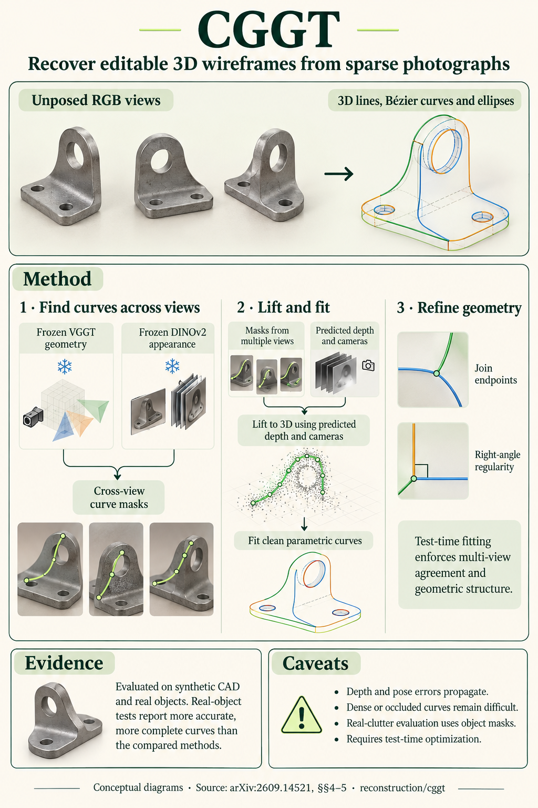

# CGGT: Curve-Grounded Geometry Transformer for 3D Parametric Curve Reconstruction (arXiv 2026)

<!-- PAPER-CARD:en -->

[Original paper](https://arxiv.org/abs/2609.14521v1) · [Full-size English card](../../assets/paper-cards/en/reconstruction/cggt.png)
<!-- /PAPER-CARD -->

## 📋 Overview

- **Authors**: Zhirui Gao, Renjiao Yi, Yunfan Ye, Ruizhen Hu, Chenyang Zhu, Wei Chen, Kai Xu
- **Institution**: National University of Defense Technology, Hunan University, Shenzhen University, Institute of AI for Industries Chinese Academy of Sciences
- **Venue**: arXiv preprint (2026-09)
- **Links**: [Paper](https://arxiv.org/abs/2609.14521)
- **Verification**: UNKNOWN (2026-10-15; source 2609.14521v1 content reviewed; publication venue not independently confirmed)
- **TL;DR**: Match curves across views with VGGT/DINO features, predict 2D masks and fit them as 3D parametric wireframes.

## 🎯 Key Contributions

1. Ground curve instances in sparse views without cameras or edge maps.
2. Use curve-aware masked attention and depth enhancement.
3. Optimize lines, Bézier curves and ellipses as compact primitives.

## 🔧 Technical Details

### Input, Output, and Problem

- **Input**: Sparse unposed RGB images.
- **Output**: Editable 3D parametric curves and wireframes.
- **Problem**: Dense-surface reconstruction differs from recovering CAD-editable structural curves.

### Method

1. Let VGGT geometry tokens read DINO appearance features through cross-attention.
2. Predict cross-view curve masks/classes with depth-aware pixel decoders and curve queries.
3. Lift curve pixels into 3D using predicted poses/depth.
4. After RANSAC initialization, optimize 3D/2D consistency, endpoints and regularity.

Train curve grounding on Wireframe-100K; final curve fitting is inference-time optimization. Feed-forward in the title applies to grounding.

## 📊 Results

**Source**: [Source PDF](https://arxiv.org/pdf/2609.14521v1), Table 1, PDF p.8.

ABC-NEF, 15 input images. F10/F20/F30 are curve F-scores under source thresholds; their units are not arbitrarily converted to cm.

| Method        | Edge preprocessing | F10 ↑ | F20 ↑ | F30 ↑ |
| ------------- | ------------------ | ----- | ----- | ----- |
| CurveGaussian | Required           | 71.5  | 76.6  | 79.0  |
| CGGT          | Not required       | 74.5  | 93.8  | 96.2  |

Sensitive to geometry/pose noise; sparse-view and real-object results use separate tables. Curve accuracy does not establish dense-surface accuracy.

## 💡 Insights & Impact

Use foundation geometry as intermediate coordinate/depth priors for CAD-style outputs.

- VGGT pose/depth errors propagate to curve lifting and fitting.
- Parametric assumptions limit which curves/scenes can be represented.

## 🔗 Related Work

- [VGGT](../foundation/vggt.md): geometry encoder.
- [DUSt3R](../foundation/dust3r.md): contrast with dense-pointmap outputs.

## 📚 Key Takeaways

1. Output editable curves rather than surface point clouds.
2. Parametric fitting follows learned grounding.
3. Preserve source thresholds for curve metrics.
