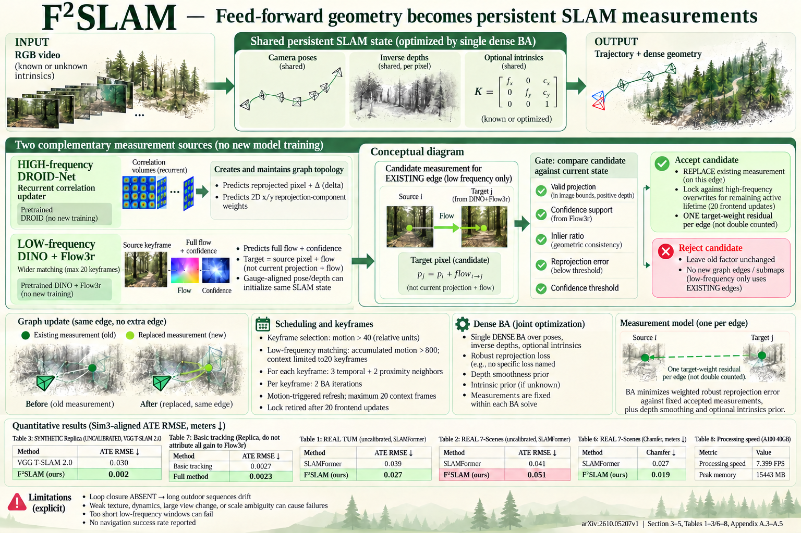

# F$^2$ SLAM: Turning Feed-Forward Geometry into Persistent Factors for SLAM (arXiv 2026)

<!-- PAPER-CARD:en -->

[Original paper](https://arxiv.org/abs/2610.05207v1) · [Full-size English card](../../assets/paper-cards/en/reconstruction/f2slam.png)
<!-- /PAPER-CARD -->

## 📋 Overview

- **Authors**: Zhisong Xu, Fan Zhu, Jiawei Qian, Ziyu Chen, Zhenjun Zhao, Javier Civera
- **Institution**: University of Tokyo, Tohoku University, University of Science and Technology of China, University of Zaragoza
- **Venue**: arXiv preprint (2026-10)
- **Links**: [Paper](https://arxiv.org/abs/2610.05207)
- **Verification**: UNKNOWN (2026-10-15; source 2610.05207v1 content reviewed; publication venue not independently confirmed)
- **TL;DR**: Validate slow Flow3r geometry predictions before injecting them into a fast DROID tracking graph to refine shared pose/depth states.

## 🎯 Key Contributions

1. Combine inference streams running at different rates.
2. Update a persistent factor graph rather than separate submaps.
3. Change targets/weights after support-state consistency checks.

## 🔧 Technical Details

### Input, Output, and Problem

- **Input**: Monocular RGB video and optional supplied camera intrinsics.
- **Output**: Camera trajectories, inverse-depth maps and optionally estimated intrinsics.
- **Problem**: Fast local tracking drifts; unvalidated slow geometry predictions can conflict with current states.

### Method

1. Maintain high-frequency tracking and factor graphs with DROID-Net.
2. Predict pose, depth and displacement confidence from DINO features/Flow3r in a low-frequency stream.
3. Select predictions through support-state consistency checks.
4. Update existing graph targets/weights and run dense BA on the same pose/inverse-depth variables.

Combine pretrained predictions with graph optimization. State-validation thresholds and objective weights serve different roles.

## 📊 Results

**Source**: [Source PDF](https://arxiv.org/pdf/2610.05207v1), Table 1, PDF p.6; Table 2, PDF p.7.

Mean ATE (m). Calibrated uses GT intrinsics; uncalibrated receives no intrinsics.

| Dataset  | Intrinsics   | DROID-SLAM | F2SLAM |
| -------- | ------------ | ---------- | ------ |
| TUM      | Calibrated   | 0.038      | 0.029  |
| TUM      | Uncalibrated | 0.163      | 0.027  |
| 7-Scenes | Calibrated   | 0.050      | 0.053  |
| 7-Scenes | Uncalibrated | 0.078      | 0.051  |

Calibrated 7-Scenes mean ATE actually increases. Distinguish rows to avoid attributing camera-input differences to large method gains.

## 💡 Insights & Impact

Integrating new geometry consistently with tracker states matters alongside predicting it.

- BA means the full system is not optimization-free feed-forward inference.
- Consistency gates can reject good constraints or accept bad predictions.

## 🔗 Related Work

- [MASt3R in the DROID-related family](../foundation/mast3r.md): learned matching/geometry background.
- [VGGT](../foundation/vggt.md): comparisons connecting geometry models to SLAM.

## 📚 Key Takeaways

1. Share states between fast trackers and slow geometry streams.
2. Validate predictions before graph insertion.
3. Separate calibrated and uncalibrated results.
