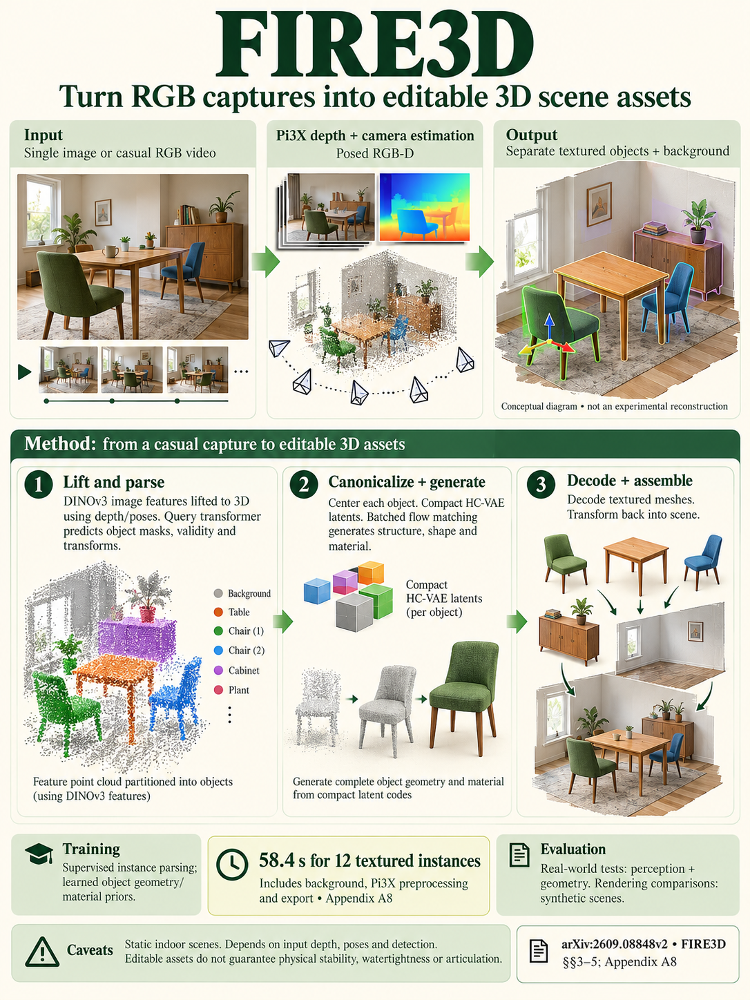

# FIRE3D: Feed-forward Interactive 3D Scene Reconstruction Within A Minute (arXiv 2026)

<!-- PAPER-CARD:en -->

[Original paper](https://arxiv.org/abs/2609.08848v2) · [Full-size English card](../../assets/paper-cards/en/reconstruction/fire3d.png)
<!-- /PAPER-CARD -->

## 📋 Overview

- **Authors**: Hongchi Xia, Tianhang Cheng, Wei-Chiu Ma, Shenlong Wang
- **Institution**: University of Illinois Urbana-Champaign, Cornell University
- **Venue**: arXiv preprint (2026-09)
- **Links**: [Paper](https://arxiv.org/abs/2609.08848)
- **Verification**: UNKNOWN (2026-10-15; source 2609.08848v2 content reviewed; publication venue not independently confirmed)
- **TL;DR**: Parse estimated posed RGB-D into instances and use compact flow generators to create editable object meshes/textures and scene layouts.

## 🎯 Key Contributions

1. Parse objects internally without external instance masks.
2. Generate objects in parallel with compact hierarchical latents.
3. Output compositional scenes with geometry, materials and placement.

## 🔧 Technical Details

### Input, Output, and Problem

- **Input**: User RGB images/video. The core network receives posed RGB-D observations estimated by Pi3X.
- **Output**: Per-object poses, bounding boxes, amodal meshes/textures and background scenes.
- **Problem**: Visible-surface point clouds differ from completed assets that can be moved and edited independently.

### Method

1. Estimate cameras and pointmaps with Pi3X.
2. Lift observation features into 3D and predict instance validity, poses and masks.
3. Canonicalize each instance.
4. Generate structure, shape and material latents with cascaded flow matching, then decode object assets.

Train scene parsers and generative models separately. Feed-forward means no per-scene optimization; generative sampling and preprocessing still cost time.

## 📊 Results

**Source**: [Source PDF](https://arxiv.org/pdf/2609.08848v2), Table 4, PDF p.8.

Held-out 3D-Front single-image scene-aligned reconstruction. CD is in cm; F1 uses a 1cm threshold.

| Method   | CD (cm) ↓ | F1 ↑ | Normal consistency ↑ |
| -------- | --------- | ---- | -------------------- |
| SceneGen | 14.90     | 0.06 | 0.58                 |
| FIRE3D   | 11.24     | 0.10 | 0.66                 |

The title's 1 minute refers to a specified RGB-video, instance-count, hardware and preprocessing-inclusive timing protocol. Do not mix this with network-only or per-object time. GT versus inferred instances also differ substantially.

## 💡 Insights & Impact

Connect observed-surface reconstruction to object completion and material generation for interactable assets.

- Hidden geometry and texture depend on generative priors.
- Incorrect instance parsing and Pi3X geometry propagate downstream.

## 🔗 Related Work

- [π3](pi3.md): the Pi3X preprocessing family.
- [Amodal3R](../reasoning/amodal3r.md): hidden-shape completion comparisons.

## 📚 Key Takeaways

1. Distinguish RGB preprocessing from the core posed RGB-D input.
2. Output independently editable object assets.
3. Do not treat generated hidden surfaces as actual observations.
