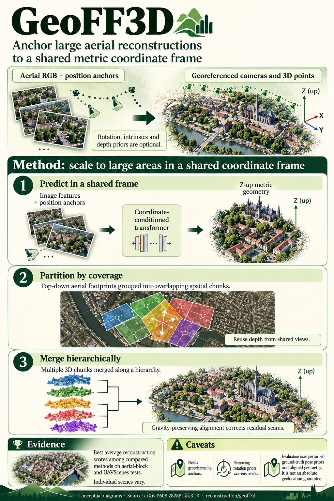

# GeoFF3D: Coordinate-Anchored Feed-Forward Reconstruction for Large-Scale UAV Mapping (arXiv 2026)

<!-- PAPER-CARD:en -->

[Original paper](https://arxiv.org/abs/2608.28288v2) · [Full-size English card](../../assets/paper-cards/en/reconstruction/geoff3d.png)
<!-- /PAPER-CARD -->

## 📋 Overview

- **Authors**: Xiang Yang, Yongli Wang, Yunsheng Zhang, Jun Li, Hao Chen, Haifeng Li
- **Institution**: Central South University, National University of Defense Technology
- **Venue**: arXiv preprint (2026-08)
- **Links**: [Paper](https://arxiv.org/abs/2608.28288)
- **Verification**: UNKNOWN (2026-10-15; source 2608.28288v1 content reviewed; publication venue not independently confirmed)
- **TL;DR**: Predict gravity-aligned metric pointmaps from aerial images and geographic priors, then hierarchically merge spatial chunks.

## 🎯 Key Contributions

1. Embed GNSS translation anchors in predicted coordinates.
2. Chunk by ground footprints rather than capture order.
3. Reduce seams through shared-view depth priors and gravity-preserving alignment.

## 🔧 Technical Details

### Input, Output, and Problem

- **Input**: UAV RGB images, georeferenced camera translations, position/orientation information for spatial partitioning, and optional geometry priors.
- **Output**: Camera poses and dense pointmaps in a shared Z-up metric frame.
- **Problem**: Nearly straight UAV trajectories inadequately constrain tilt in post-hoc Sim(3) alignment.

### Method

1. Add translation anchors to a Pi3X-initialized model and learn world-frame geometry.
2. Group images with nearby ground footprints into overlapping chunks.
3. Process outward from the scene center, caching shared-view depth and available intrinsics.
4. Merge chunks hierarchically with gravity-preserving transformations.

Use local/world/pose/gravity supervision on UAVFF3D and BlendedMVS. Evaluation priors are noisy GT positions/orientations, not RGB-only inputs.

## 📊 Results

**Source**: [Source PDF](https://arxiv.org/pdf/2608.28288v1), Tables 1–2, PDF p.6.

Mean F@5 over 9 aerial blocks and long UAVScenes sequences. F@5 is reconstruction F-score at a 5m threshold; higher is better.

| Evaluation         | Pi3X + SLRF | GeoFF3D |
| ------------------ | ----------- | ------- |
| Nine aerial blocks | 0.829       | 0.877   |
| UAVScenes          | 0.687       | 0.848   |

Both methods use identical noisy pose priors. UAVScenes accuracy/completeness (m): Pi3X+SLRF 6.05/4.40, GeoFF3D 4.14/2.28.

## 💡 Insights & Impact

Coordinate frames can be defined through prediction targets and training losses, not only final alignment.

- Depend on GNSS/IMU prior errors and spatial overlap.
- Perturbed-GT priors do not represent every real-sensor error distribution.

## 🔗 Related Work

- [π3](pi3.md): permutation-equivariant geometry background.
- [On-the-Fly3R](on-the-fly3r.md): another UAV scaling strategy.

## 📚 Key Takeaways

1. Position priors are inputs; this is not RGB-only.
2. Encode gravity direction and metric scale during prediction.
3. Scale through spatial chunking and shared priors.
