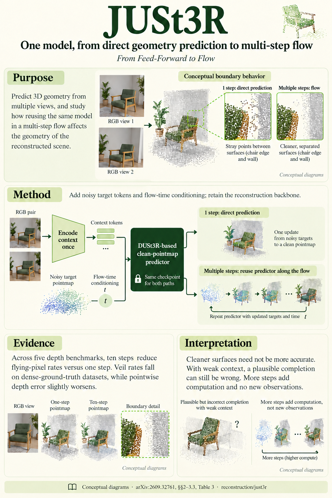

# From Feed-Forward to Flow: Unifying Reconstruction and Generation Is Easier Than You Think (arXiv 2026)

<!-- PAPER-CARD:en -->

[Original paper](https://arxiv.org/abs/2609.32761v1) · [Full-size English card](../../assets/paper-cards/en/reconstruction/just3r.png)
<!-- /PAPER-CARD -->

## 📋 Overview

- **Authors**: Haoru Wang, Qianfan Shen, Kai Ye, Wenzheng Chen, Baoquan Chen
- **Institution**: Peking University
- **Venue**: arXiv preprint (2026-09)
- **Links**: [Paper](https://arxiv.org/abs/2609.32761)
- **Verification**: UNKNOWN (2026-10-15; source 2609.32761v1 content reviewed; publication venue not independently confirmed)
- **TL;DR**: Add noisy pointmaps and flow time to DUSt3R so one checkpoint supports one-step reconstruction and multi-step geometry generation.

## 🎯 Key Contributions

1. Unify reconstruction and flow generation through clean-target prediction.
2. Analyze veils/flying pixels caused by averaged predictions at ambiguous boundaries.
3. Evaluate geometry with JUSt3R and appearance with the NVS model JiT-LVSM separately.

## 🔧 Technical Details

### Input, Output, and Problem

- **Input**: Two RGB images and a noisy target pointmap at a flow step.
- **Output**: Shared-frame pointmaps; multi-step inference samples one plausible surface.
- **Problem**: Regression at ambiguous foreground/background boundaries can predict average depth between real surfaces.

### Method

1. Retain DUSt3R and add noisy-target embeddings and time-conditioned adaLN.
2. Predict clean targets with confidence-weighted pointmap-regression training.
3. Use direct predicted endpoints in one-step inference.
4. Reuse context encodings and integrate noise-to-data flows in multi-step inference.

Compare with controlled DUSt3R retraining under matched data/schedules. Released checkpoints are separate reference rows.

## 📊 Results

**Source**: [Source PDF](https://arxiv.org/pdf/2609.32761v1), Table 3, PDF p.7.

NYU-v2 zero-shot depth. Lower AbsRel, veil and flying rates are better. Veil measures predictions falling between GT depth discontinuities.

| Method            | AbsRel ↓ | Veil ↓ | Flying ↓ |
| ----------------- | -------- | ------ | -------- |
| Retrained DUSt3R  | 0.075    | 0.215  | 0.047    |
| JUSt3R, one step  | 0.070    | 0.219  | 0.037    |
| JUSt3R, ten steps | 0.071    | 0.186  | 0.023    |

Multiple steps reduce surface artifacts without lowering AbsRel relative to one step. Larger depth errors on TUM/Bonn show that sharper generation is not equivalent to GT agreement.

## 💡 Insights & Impact

Low mean surface error can differ from a surface that looks physically plausible. Evaluate both kinds of metrics.

- Ambiguous inputs can yield sharp geometry inconsistent with the real scene.
- Multi-step inference adds computation; fewer veils do not guarantee selecting the correct surface.

## 🔗 Related Work

- [DUSt3R](../foundation/dust3r.md): the geometry backbone and controlled baseline.
- [VGGT](../foundation/vggt.md): direct geometry-regression comparisons.

## 📚 Key Takeaways

1. Change behavior through inference-step counts in one model.
2. Measure pointwise depth and boundary structure separately.
3. Sharp generated content is not always observed GT.
