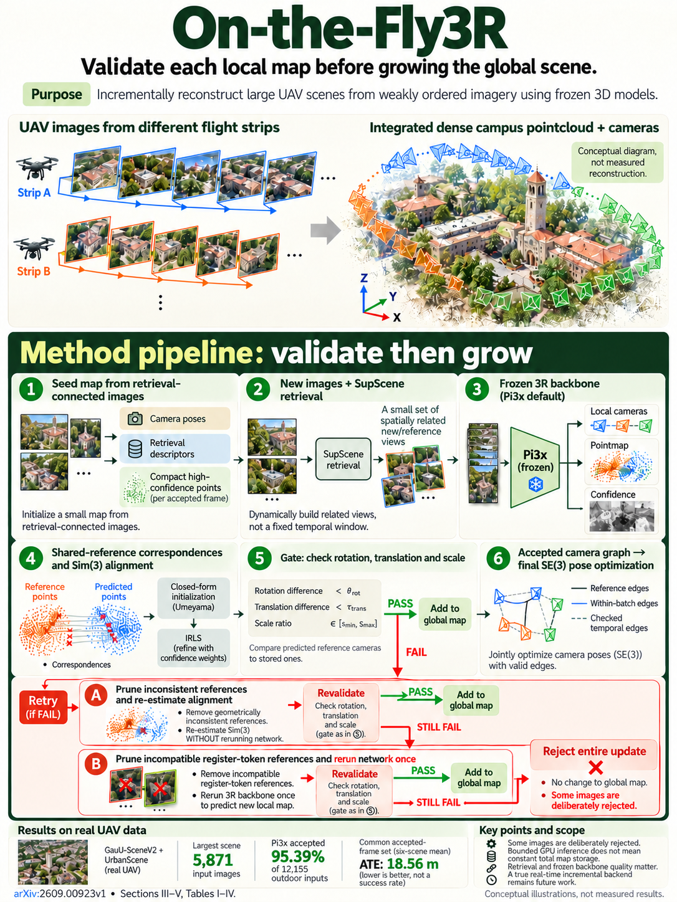

# On-the-Fly3R: Towards Robust Online 3D Reconstruction with Feed-Forward 3R Models for Large-Scale UAV Scenarios (arXiv 2026)

<!-- PAPER-CARD:en -->

[Original paper](https://arxiv.org/abs/2609.00923v1) · [Full-size English card](../../assets/paper-cards/en/reconstruction/on-the-fly3r.png)
<!-- /PAPER-CARD -->

## 📋 Overview

- **Authors**: Zhe Shen, Liyuan Lou, Yifei Yu, Guanbo Wang, Quanjian Ji, Xin Wang, Zongqian Zhan
- **Institution**: Wuhan University
- **Venue**: arXiv preprint (2026-09)
- **Links**: [Paper](https://arxiv.org/abs/2609.00923)
- **Verification**: UNKNOWN (2026-10-15; source 2609.00923v1 content reviewed; publication venue not independently confirmed)
- **TL;DR**: Retrieve related UAV images for repeated small-batch 3D inference, then validate, reject or retry alignment before global-map fusion.

## 🎯 Key Contributions

1. Form subsets dynamically from weakly ordered or unordered images.
2. Combine confidence-weighted Sim(3) with validation/retry.
3. Correct long-range drift through retrieval loop closure and pose graphs.

## 🔧 Technical Details

### Input, Output, and Problem

- **Input**: UAV RGB image streams, without requiring strong temporal continuity.
- **Output**: Camera poses for accepted images, dense maps and coverage.
- **Problem**: Unrelated chunk views can propagate incorrect geometry throughout subsequent maps.

### Method

1. Retrieve historical references using SupScene descriptors.
2. Batch only queries meeting reference-overlap and visual-similarity requirements.
3. Align shared-reference pointmaps through confidence-weighted robust Sim(3).
4. Reject inconsistent updates and retry different subsets.
5. Add retrieved loop edges to a GTSAM pose graph.

A system wrapping existing 3R models including Pi3, Pi3X and VGGT-Omega. Report coverage alongside error because some frames are not accepted.

## 📊 Results

**Source**: [Source PDF](https://arxiv.org/pdf/2609.00923v1), Table II, PDF p.6.

Macro-average over common frames accepted by the Pi3X configuration in 6 UAV scenes. ATE is in m; ARE/RTE/RRE follow the source's angular-error definitions. Only ATE is excerpted here.

| Method              | Common-frame ATE (m) ↓ |
| ------------------- | ---------------------- |
| LingBot-Map         | 205.62                 |
| MERG3R              | 124.42                 |
| On-the-Fly3R (Pi3X) | 18.56                  |

The common set covers 95.39% of all inputs, not complete frame success. It also differs from Table I's returned-pose evaluation.

## 💡 Insights & Impact

Deciding not to fuse unreliable local predictions matters alongside geometry-model accuracy.

- Coverage can decrease, and retrieval failures remain possible.
- Retries, alignment and PGO add costs beyond one network forward pass.

## 🔗 Related Work

- [GeoFF3D](geoff3d.md): UAV reconstruction using location priors and spatial partitioning.
- [VGGT](../foundation/vggt.md): a supported backbone family.

## 📚 Key Takeaways

1. Localize unordered inputs through retrieval.
2. Reject updates that cannot be validated.
3. Always read error and coverage together.
