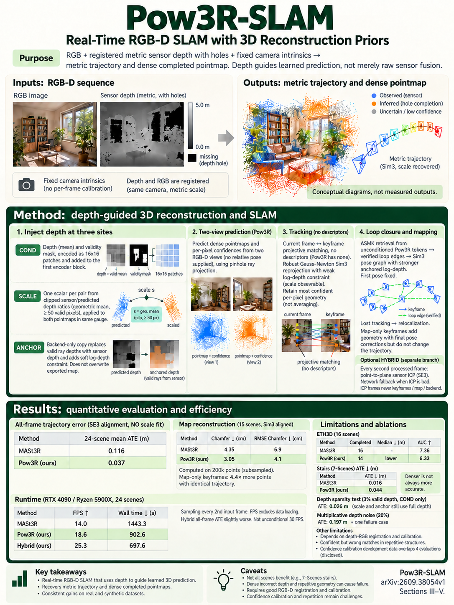

# Pow3R-SLAM: Real-Time RGB-D SLAM with 3D Reconstruction Priors (arXiv 2026)

<!-- PAPER-CARD:en -->

[Original paper](https://arxiv.org/abs/2609.38054v1) · [Full-size English card](../../assets/paper-cards/en/reconstruction/pow3r-slam.png)
<!-- /PAPER-CARD -->

## 📋 Overview

- **Authors**: Christopher Kolios, Ishaan Mehta, Sasa Janjic, Yeganeh Bahoo, Sajad Saeedi
- **Institution**: Toronto Metropolitan University, University of Windsor, University College London
- **Venue**: arXiv preprint (2026-09)
- **Links**: [Paper](https://arxiv.org/abs/2609.38054)
- **Verification**: UNKNOWN (2026-10-15; source 2609.38054v1 content reviewed; publication venue not independently confirmed)
- **TL;DR**: Connect Pow3R depth-conditioned pointmaps to MASt3R-SLAM-family optimization, optionally alternating with sensor-depth ICP.

## 🎯 Key Contributions

1. Guide metric pointmap scale/geometry with sensor depth.
2. Rebuild retrieval/loop connections using encoder tokens and confidence.
3. Compare hybrid point-to-plane ICP between neural keyframes.

## 🔧 Technical Details

### Input, Output, and Problem

- **Input**: RGB, aligned depth images and camera calibration.
- **Output**: Camera trajectories and keyframe-based dense maps.
- **Problem**: RGB-estimated pointmaps can have unstable scales/surfaces, while per-frame neural inference is costly.

### Method

1. Predict pointmaps with RGB/depth-conditioned Pow3R, rather than simply accumulating sensor depth.
2. Use MASt3R-SLAM projective matching and second-order backends with depth anchors.
3. Build encoder-token/confidence retrieval because Pow3R lacks a matching head.
4. Alternate depth-ICP frames in the hybrid; those frames neither become keyframes nor expand maps.

Use pretrained Pow3R with inference-time tracking/optimization. Evaluation 7-Scenes inputs realign color/depth and differ from original misregistered inputs.

## 📊 Results

**Source**: [Source PDF](https://arxiv.org/pdf/2609.38054v1), Table I, PDF p.5; Table II, PDF p.6.

Mean keyframe ATE (m), Sim(3)-aligned, compared with MASt3R-SLAM rerun in the same paper.

| Dataset             | MASt3R-SLAM | Pow3R-SLAM | Hybrid |
| ------------------- | ----------- | ---------- | ------ |
| TUM fr1             | 0.030       | 0.027      | 0.025  |
| Registered 7-Scenes | 0.048       | 0.044      | 0.048  |
| Replica             | 0.0153      | 0.0087     | 0.0096 |

The baseline is better on 7-Scenes stairs: 0.016/0.044/0.062m. ETH3D averages cover baseline 16 versus proposed 14 completed sequences; disclose this difference.

## 💡 Insights & Impact

Depth serves as network conditioning, scale and backend anchoring. Hybrid speed gains do not update dense maps at every frame.

- Require reliable sensor depth and color–depth alignment.
- Read tracking failures and completed-sequence counts alongside mean errors.

## 🔗 Related Work

- [MASt3R](../foundation/mast3r.md): the base SLAM matching family.
- [Pow3R](pow3r.md): depth-conditioned geometry.

## 📚 Key Takeaways

1. Maps use model-predicted pointmaps.
2. ICP frames differ from mapping keyframes.
3. Input alignment and completion counts change interpretation.
