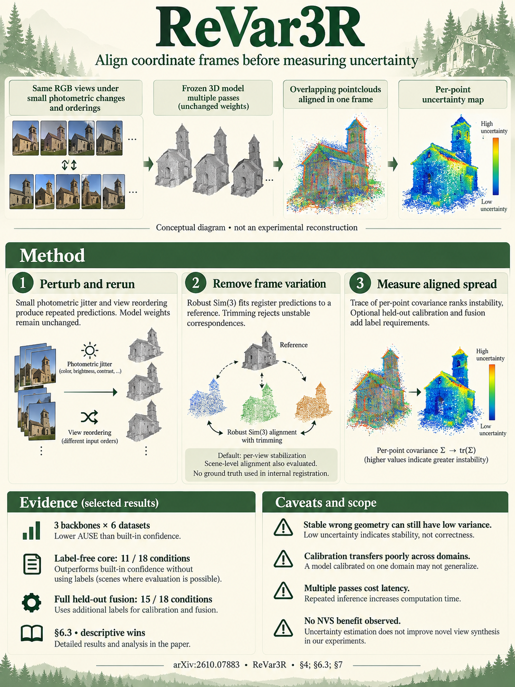

# ReVar3R: Gauge-Aware Perturbation Uncertainty for Feed-Forward 3D Reconstruction (arXiv 2026)

<!-- PAPER-CARD:en -->

[](../../assets/paper-cards/en/reconstruction/revar3r.png)

[Original paper](https://arxiv.org/abs/2610.07883v1) · [Full-size English card](../../assets/paper-cards/en/reconstruction/revar3r.png)
<!-- /PAPER-CARD -->

## 📋 Overview

- **Authors**: Sammam Mahdi, Fariha Binta Salim, Rakin Bin Rabbani, Aniqua Nusrat Zereen
- **Institution**: BRAC University, Mahidol University
- **Venue**: arXiv preprint (2026-10)
- **Links**: [Paper](https://arxiv.org/abs/2610.07883)
- **Verification**: UNKNOWN (2026-10-15; arXiv v1 source reviewed; conference publication unconfirmed)
- **TL;DR**: Align pointmaps from repeated perturbed-input inference before computing variance, separating coordinate changes from actual prediction instability.

## 🎯 Key Contributions

1. **Gauge Contamination**: Derive how small rotational/scale differences inflate variance farther from the coordinate origin.
2. **Align Before Variance**: Align repeated outputs from fixed reconstruction models, without training network weights or extra uncertainty heads.
3. **Separate Supervision Levels**: Distinguish GT-free Core estimates from fusion/calibration fitted on held-out labeled data.
4. **Explicit Failure Cases**: Report consistently wrong predictions and failed cross-domain calibration.

## 🔧 Technical Details

### Input, Output, and Problem

- **Input**: Overlapping multi-view images of one scene and frozen VGGT, π³ or MASt3R.
- **Output**: Per-predicted-3D-point uncertainty scores. Calibrating scores into error magnitudes requires additional GT data.
- **Gauge**: Freedom to represent the same scene under different rotations, translations and scales; Sim(3) combines these transformations.

For example, two runs may correctly predict the same wall while slight frame rotations create large coordinate differences for distant points.
Treating those differences directly as variance obscures genuinely unstable points.

### Alignment and Aggregation

```text
Original multi-view images
  → brightness or view-order perturbations → repeated inference with the same frozen model
  → robust Sim(3) alignment between predictions → trace of per-point covariance
  → uncertainty ranking → optional fusion and error-magnitude calibration
```

§4 initializes alignment with an Umeyama similarity fit.
Iteratively remove high-residual correspondences and recompute alignment.
This internal alignment compares predictions without GT pointmaps.
GT-based evaluation alignment is separate. Default per-view alignment allows more freedom than scene-wide alignment (§6.2).

The default predicts 5 times per perturbation family, sharing the reference for 9 total model executions (§5).
Core is aligned variance from a single perturbation family.
Full fuses scores and can also use built-in confidence.
Fit Full weights and error-magnitude calibration on held-out GT. No retraining does not mean every stage is GT-free.

## 📊 Results

### Ranking Error and Label Use

[arXiv v1 PDF](https://arxiv.org/pdf/2610.07883v1), §6.3, PDF p.7 and Appendix C, Table 4.
Evaluate VGGT, π³ and MASt3R on combinations of 7-Scenes, DTU, ETH3D, BlendedMVS, TUM and KITTI.
Each condition uses overlapping 5-view sets (§5).
AUSE summarizes the gap between uncertainty-ranked point removal and GT-error ranking; lower is better.

| Variant                             | Held-Out Labels | Conditions with Lower AUSE than Built-In Confidence |
| ----------------------------------- | --------------- | --------------------------------------------------- |
| Aligned single-family Core          | Not required    | 11/18                                               |
| Equal-weight fusion                 | Not required    | 12/18                                               |
| Fitted fusion weights               | Required        | 14/18                                               |
| Full, including built-in confidence | Required        | 15/18                                               |

These win counts are descriptive statistics, not significance tests (§5).
Do not attribute Full's results to Core alone.

Selected condition-specific AUSE results from Appendix C, Table 5 (PDF p.16).
Full is not always better than Core, and some conditions remain worse than built-in confidence.

| Backbone / Dataset  | Built-In AUSE ↓ | Core AUSE ↓ | Full AUSE ↓ |
| ------------------- | --------------- | ----------- | ----------- |
| VGGT / 7-Scenes     | 0.712           | 0.536       | 0.491       |
| VGGT / BlendedMVS   | 0.786           | 0.276       | 0.407       |
| π³ / ETH3D          | 0.528           | 0.522       | 0.593       |
| MASt3R / BlendedMVS | 0.282           | 0.659       | 0.367       |

### Cost and Limitations

The paper reports approximately 10 times the latency of single-inference heads (§7, Appendix D.9).
The comparison with learned Trust3R uses 224 px MASt3R and identical valid points (§6.5).
Do not combine it with all conditions evaluated at each backbone's native resolution.

AUSE exceeds built-in confidence for π³/MASt3R on BlendedMVS and π³ on ETH3D (§6.3).
GT-dependent calibration transfers poorly between domains.
No fixed-budget novel-view-synthesis gain was established (§7).

## 💡 Insights & Impact

High variance and incorrect predictions are different concepts.
Reduce variation caused by coordinate representations and measure the remaining instability.
If all runs predict the same incorrect shape, variance stays low; the score does not guarantee accuracy.

Aligned generic input-noise ensembles are also strong comparisons (§6.2, Table 8).
Do not attribute gains solely to perturbation type.
Multiple view sets from one scene are correlated, affecting independence and significance interpretations (§5).

## 🔗 Related Work

- **[VGGT](../foundation/vggt.md), [π³](pi3.md), [MASt3R](../foundation/mast3r.md)**: fixed reconstruction backbones receiving the same procedure.
- **[Trust3R](../extensions/trust3r.md)**: a GT-trained uncertainty head; compare inference cost, calibration and domain-transfer trade-offs.
- **[DUSt3R](../foundation/dust3r.md)**: the pointmap/confidence family foundation; built-in confidence still needs error-relation analysis.

## 📚 Key Takeaways

1. Align frames before computing variance across pointmaps.
2. Separate Core from GT-fitted Full results.
3. Instability scores miss consistently repeated errors.
4. Include inference costs and domain-specific failures.
