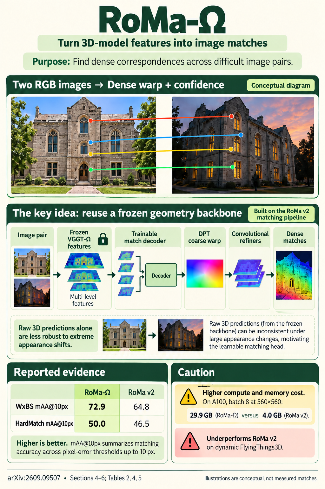

# RoMa-Ω: What Feed-Forward 3D Models Know About Image Matching (arXiv 2026)

<!-- PAPER-CARD:en -->

[Original paper](https://arxiv.org/abs/2609.09507v1) · [Full-size English card](../../assets/paper-cards/en/reconstruction/roma-omega.png)
<!-- /PAPER-CARD -->

## 📋 Overview

- **Authors**: David Nordström, Xinyue Zhang, Thibaut Loiseau, Vincent Lepetit, Fredrik Kahl
- **Institution**: Chalmers University of Technology, ShanghaiTech University, LIGM / École des Ponts / Université Gustave Eiffel / CNRS
- **Venue**: arXiv preprint (2026-09)
- **Links**: [Paper](https://arxiv.org/abs/2609.09507)
- **Verification**: UNKNOWN (2026-10-15; source 2609.09507v1 content reviewed; publication venue not independently confirmed)
- **TL;DR**: Analyze how FF3D features, pointmaps and cameras support matching separately. Training a RoMa-style matcher on selected VGGT-Ω features yields stronger correspondences than naive zero-shot matching.

## 🎯 Key Contributions

1. **Three Matching Probes**: Evaluate patch features, raw 3D predictions and trained full matchers separately.
2. **Feature Selection**: Analyze why the final reconstruction layer is not always a good correspondence descriptor.
3. **RoMa-Ω**: Replace RoMa v2's DINO features with selected VGGT-Ω representations.

## 🔧 Technical Details

### Input, Output, and Problem

- **Input**: Image pairs and frozen FF3D representations, with either a trained matching head or a raw geometric-matching path.
- **Output**: Dense correspondences and confidence. Pose/localization evaluations combine them with geometric solvers.
- **Problem**: An accurate pointmap predictor is not automatically a good zero-shot image matcher; deeper features may distinguish correspondences less well.

### Method

1. Probe layerwise FF3D patch features through zero-shot matching.
2. Evaluate depth warping, 3D mutual nearest neighbors and direct camera poses separately.
3. Select useful representation layers to replace RoMa v2's feature backbone.
4. Evaluate trained matchers under varied imaging conditions for dense matching, pose and map-free localization.

Source §3–5. RoMa-Ω trains a new matching head and differs from zero-shot results. Some map-free-localization settings additionally use separate DA3 metric depth.

## 📊 Results

**Source**: [Source PDF](https://arxiv.org/pdf/2609.09507v1), Table 2, PDF p.12.

WxBS and HardMatch use mAA@10px; RUBIK uses relative-pose AUC@20°. The columns differ in units and tasks and cannot be compared numerically with each other. VGGT-Ω is the raw-model comparison row.

| Method  | WxBS mAA@10px ↑ | HardMatch mAA@10px ↑ | RUBIK AUC@20° ↑ |
| ------- | --------------- | -------------------- | --------------- |
| VGGT-Ω  | 29.0            | 20.2                 | 84.3            |
| RoMa    | 72.6            | 48.1                 | 75.4            |
| RoMa v2 | 64.8            | 46.5                 | 85.6            |
| RoMa-Ω  | 72.9            | 50.0                 | 88.0            |

Good raw FF3D camera poses alone do not explain extreme-pair matching performance. In §5.6, RoMa-Ω improves most compared dense datasets but underperforms RoMa v2 on dynamic FlyingThings3D.

## 💡 Insights & Impact

3D representations complement correspondence supervision. Different geometric-model layers and outputs are not equally suitable for matching.

- Do not mix trained-matcher accuracy/cost with untrained 3D correspondence accuracy/cost.
- Generalization can be limited for dynamic scenes and rare extreme conditions. Localization results include depth and robust solvers.

## 🔗 Related Work

- [MASt3R](../foundation/mast3r.md): earlier joint geometry and descriptor learning.
- [VGGT-Ω](vggt-omega.md): the representation underlying RoMa-Ω.
- [VGGT](../foundation/vggt.md): distinguish camera, pointmap and tracking outputs.

## 📚 Key Takeaways

1. Reconstruction accuracy differs from zero-shot matching accuracy.
2. Select feature layers and matching heads together.
3. Read raw-geometry and trained-matcher results separately.
