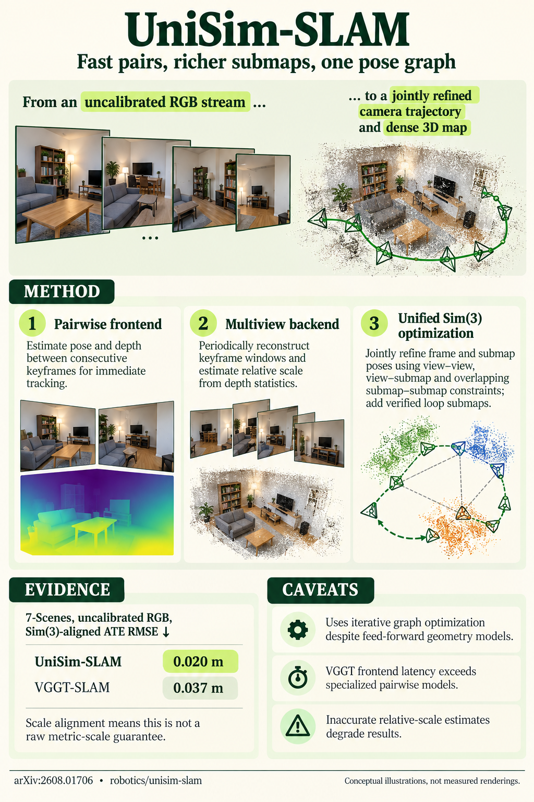

# UniSim-SLAM: Feed-Forward SLAM with Unified Sim(3) Optimization (arXiv 2026)

<!-- PAPER-CARD:en -->

[Original paper](https://arxiv.org/abs/2608.01706v1) · [Full-size English card](../../assets/paper-cards/en/reconstruction/unisim-slam.png)
<!-- /PAPER-CARD -->

## 📋 Overview

- **Authors**: Inha Lee, Dongjae Jeong, Junhee Lee, Kyungdon Joo
- **Institution**: Ulsan National Institute of Science and Technology (UNIST)
- **Venue**: arXiv preprint (2026-08)
- **Links**: [Paper](https://arxiv.org/abs/2608.01706)
- **Verification**: UNKNOWN (2026-10-15; source 2608.01706v1 content reviewed; publication venue not independently confirmed)
- **TL;DR**: Combine fast pairwise tracking and periodic multi-view submaps in one Sim(3) graph to reduce local scale differences without supplied calibration.

## 🎯 Key Contributions

1. Run pairwise frontends and multi-view backends at different rates.
2. Jointly optimize keyframe/submap poses and scales.
3. Connect both levels with bridges and depth-statistic scale anchors.

## 🔧 Technical Details

### Input, Output, and Problem

- **Input**: Uncalibrated monocular RGB video, without depth-sensor inputs in evaluation.
- **Output**: Camera trajectories and mutually aligned dense submaps.
- **Problem**: Independently predicted pointmaps differ in frames/scales; per-frame multi-view inference adds latency.

### Method

1. Quickly estimate adjacent-keyframe local geometry/motion through pairwise models.
2. Periodically predict multi-view geometry over overlapping-keyframe submaps.
3. Put view–view, view–submap bridges and inter-submap constraints into one graph.
4. Reconcile gauges with depth statistics/scale constraints and optimize Sim(3) states.

Inference combines pretrained geometry and graph optimization. Experimental submap size is 16 with overlap 2; keyframe strides vary by dataset.

## 📊 Results

**Source**: [Source PDF](https://arxiv.org/pdf/2608.01706v1), Tables 1–2, PDF p.11.

Mean ATE (m) without GT intrinsics, using Evo and Umeyama Sim(3) alignment. Do not mix with calibrated-camera rows.

| Dataset   | VGGT-SLAM | ViSTA-SLAM | UniSim-SLAM |
| --------- | --------- | ---------- | ----------- |
| TUM RGB-D | 0.061     | 0.052      | 0.032       |
| 7-Scenes  | 0.037     | 0.049      | 0.020       |

Means decrease, but TUM plant reverses the trend: UniSim 0.029m versus VGGT-SLAM 0.023m. The full pipeline includes optimization costs.

## 💡 Insights & Impact

Strong local predictions do not solve inter-local coordinate connections; the contribution jointly reconciles both levels.

- Mean gains do not hold on every sequence.
- Depend on submap overlap/geometry quality, with possible loop-closure failure.

## 🔗 Related Work

- [VGGT](../foundation/vggt.md): multi-view geometry background.
- [MASt3R](../foundation/mast3r.md): pairwise geometry/matching background.

## 📚 Key Takeaways

1. RGB inputs produce trajectories and maps.
2. Bridges connect fast tracking with slower multi-view correction.
3. Read ATE alignment and camera conditions together.
