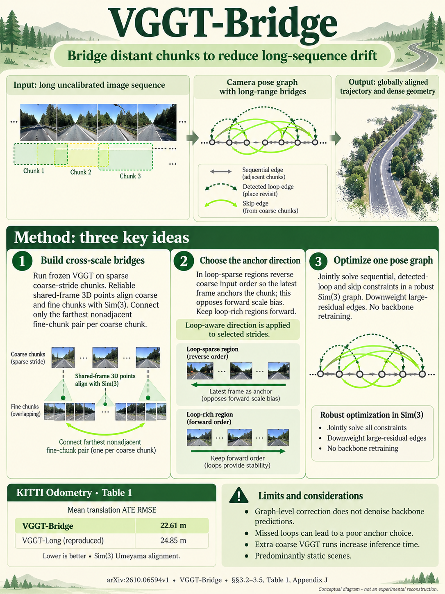

# VGGT-Bridge: Beyond Sequential Pose Graphs via Coarse-Stride Skip Edges (ACCV 2026)

<!-- PAPER-CARD:en -->

[](../../assets/paper-cards/en/reconstruction/vggt-bridge.png)

[Original paper](https://arxiv.org/abs/2610.06594v1) · [Full-size English card](../../assets/paper-cards/en/reconstruction/vggt-bridge.png)
<!-- /PAPER-CARD -->

## 📋 Overview

- **Authors**: Sungjae Choi, Hanna Bae, Sunghyun Baek, Junmo Kim
- **Institution**: KAIST
- **Venue**: ACCV 2026
- **Links**: [Paper](https://arxiv.org/abs/2610.06594)
- **Verification**: LIKELY (2026-10-15; arXiv comment says Accepted to ACCV 2026; independent proceedings unconfirmed)
- **TL;DR**: Reconstruct long-video chunks with frozen VGGT, connect distant chunks through coarsely sampled frames and reverse selected chunks to counter accumulated scale bias.

## 🎯 Key Contributions

1. **Coarse-Stride Skip Edges**: Constrain distant as well as neighboring chunks.
2. **Reverse Anchoring**: Reverse selected coarse chunks to invert first-frame-reference scale bias.
3. **Loop-Aware Policy**: Choose directions to avoid conflicts between reverse constraints and existing revisit connections.
4. **Training-Free Graph Extension**: Do not retrain VGGT; retain post-processing pose-graph optimization.

## 🔧 Technical Details

### Input, Output, and Problem

- **Input**: Long RGB video, evaluated without supplied camera intrinsics.
- **Output**: Shared-frame camera trajectories and dense 3D reconstructions.
- **Chunk**: Frames processed together by VGGT. Fine chunks are consecutive; coarse chunks sample at intervals.
- **Problem**: Neighbor-only alignment errors accumulate along long trajectories, while unrevisited regions lack loop closures.

### Graph Construction

```text
Consecutive frame chunks → VGGT → neighboring connections
Wide-span sampled chunks → the same VGGT → distant skip edges
Existing loop + neighboring + skip edges → Sim(3) pose-graph optimization
```

§3 proceeds as follows.

1. Align shared-frame point clouds between fine/coarse chunks with Sim(3). Sim(3) includes rotation, translation and scale.
2. Directly connect the two farthest fine chunks overlapping one coarse chunk.
3. Infer selected coarse chunks in reverse where loops are sparse; restore chronological outputs before alignment.
4. Keep loop-rich regions chronological and optimize all connections with Cauchy-weighted pose-graph residuals.

KITTI/Virtual KITTI use chunk size 75 with overlap 30; Waymo uses 60 and 24 (§4.1).
Coarse strides are 3 and 5; adaptive ordering is applied at stride 3.
Reverse inference and full-graph optimization rule out classification as causal streaming.

## 📊 Results

### Trajectory Accuracy

[arXiv v1 PDF](https://arxiv.org/pdf/2610.06594v1), Tables 1–3, PDF pp.9–10.
The metric is **translation ATE RMSE (m)** after Sim(3) Umeyama alignment to GT trajectories.
Do not mix it with SwiftVGGT's separate full-transformation metric (§4.1).
SwiftVGGT and VGGT-Bridge share VGGT checkpoints and chunk configurations.

| Dataset / Evaluation Set                          | SwiftVGGT ATE ↓ | VGGT-Bridge ATE ↓ | Source  |
| ------------------------------------------------- | --------------- | ----------------- | ------- |
| KITTI Odometry, mean over 00–10                   | 31.53           | 22.61             | Table 1 |
| Waymo Open, mean over selected 9 segments         | 1.557           | 1.401             | Table 2 |
| Virtual KITTI, 5 scenes and 6 appearance variants | 2.495           | 2.027             | Table 3 |

Mean improvements do not hold for every sequence.
KITTI 00 gives SwiftVGGT 9.92 m and VGGT-Bridge 13.74 m (Table 1).
Do not extrapolate these results to the full Waymo dataset.

### Efficiency

Table 6, PDF p.13. Compare total KITTI Odometry processing time on one RTX 4090 (§4.1).

| Method      | Total Time (s) ↓ | FPS ↑ | Mean ATE (m) ↓ |
| ----------- | ---------------- | ----- | -------------- |
| VGGT-Long   | 7,611            | 3.0   | 24.85          |
| SwiftVGGT   | 2,583            | 9.0   | 31.53          |
| VGGT-Bridge | 3,883            | 6.0   | 22.61          |

Extra coarse inference makes this slower than SwiftVGGT. Time covers reconstruction/alignment, not retraining.

## 💡 Insights & Impact

Change the structure connecting local predictions rather than the network's visual understanding.
Wide-span overlapping observations constrain distant regions without actual revisits.

Correction depends on VGGT first-frame scale bias and coarse/fine alignment quality.
Appendix J notes that large VGGT errors and loop-detection failures can propagate to skip edges.
Primarily assumes static scenes and evaluates driving; results do not guarantee other sensors, indoor scenes or dynamic scenes.

## 🔗 Related Work

- **[VGGT](../foundation/vggt.md)**: frozen local camera/depth/point-cloud predictions.
- **[VGGT-Long](vggt-long.md)**: earlier overlapping-chunk reconstruction with loop-closure alignment.
- **SwiftVGGT**: direct baseline with single-SVD alignment and internal-feature loop detection; no separate note yet.
- **[VGGT-SLAM](vggt-slam.md)**: related learned geometry plus graph constraints.
- **[Slot3R](slot3r.md)**: changes inference memory, whereas VGGT-Bridge changes inter-chunk graphs.

## 📚 Key Takeaways

1. Connection graphs affect accumulated error alongside local reconstruction.
2. Input-order bias can provide correction signals, applied according to loop conditions.
3. Extra connections add costs; compare accuracy with runtime.
4. Training-free application still requires graph optimization.
