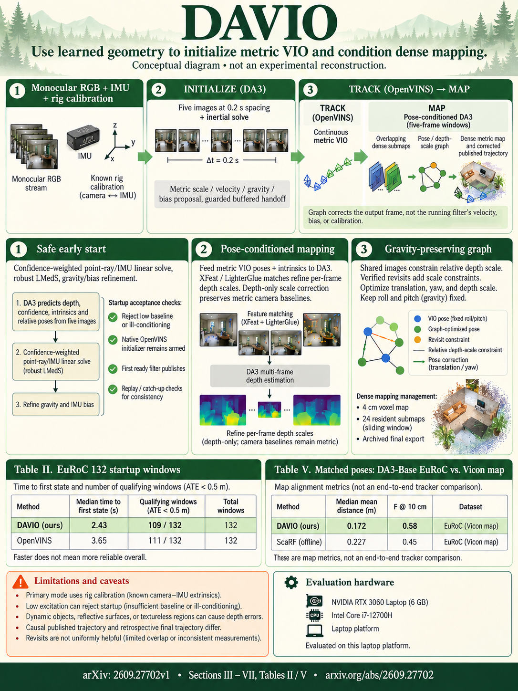

# DAVIO: Dense Monocular-Inertial SLAM with Feed-Forward Initialization and Pose-Conditioned Mapping (arXiv 2026)

<!-- PAPER-CARD:en -->

[Original paper](https://arxiv.org/abs/2609.27702v1) · [Full-size English card](../../assets/paper-cards/en/robotics/davio.png)
<!-- /PAPER-CARD -->

## 📋 Overview

- **Authors**: Jaafar Mahmoud, Arthur Movsesyan, Mikhail Iumanov, Sergey Kolyubin
- **Institution**: ITMO University
- **Venue**: arXiv preprint (2026-09)
- **Links**: [Paper](https://arxiv.org/abs/2609.27702)
- **Verification**: UNKNOWN (2026-10-15; source 2609.27702v1 content reviewed; publication venue not independently confirmed)
- **TL;DR**: Initialize VIO quickly from DA3 geometry and IMU, then condition DA3 on metric VIO poses for gravity-consistent dense mapping.

## 🎯 Key Contributions

1. Build feature-free initialization from small image windows and preintegrated IMU.
2. Pass initial states to OpenVINS through buffered replay.
3. Refine viewing-ray depth scales and gravity-preserving submap graphs.

## 🔧 Technical Details

### Input, Output, and Problem

- **Input**: Monocular RGB cameras, IMU and camera–IMU calibration.
- **Output**: Metric VIO state·camera trajectory, gravity-aligned dense map.
- **Problem**: Initial VIO needs sufficient parallax; geometry-foundation models alone do not establish metric scale/gravity.

### Method

1. Solve scale, velocity, gravity and biases from initial DA3 cameras/geometry and IMU preintegration.
2. Replay conditioning-checked, robustly solved states into OpenVINS.
3. Condition DA3 mapping windows on metric poses during tracking.
4. Keep camera baselines fixed and refine only ray-direction depth scales and gravity-preserving graphs.

Combine pretrained DA3 with visual–inertial estimation. Map graphs change output-map frames and differ from the running VIO filter itself.

## 📊 Results

**Source**: [Source PDF](https://arxiv.org/pdf/2609.27702v1), Table II, PDF p.6.

EuRoC, 132 ten-second initialization windows. Success counts windows publishing trajectories below 0.5m ATE; Tq is median time including failure penalties.

| Initializer | Success | Tq (s) ↓ | ATE (m) ↓ |
| ----------- | ------- | -------- | --------- |
| OpenVINS    | 111/132 | 3.87     | 0.042     |
| DAVIO       | 109/132 | 2.66     | 0.044     |

Initial publication is faster, but success count and median ATE are not better than the baseline. Separate same-pose mapping, own-odometry and GT-pose comparisons.

## 💡 Insights & Impact

Inferred geometry aids inertial initialization; subsequent metric inertial poses aid geometry prediction in return.

- Depend on IMU calibration, motion excitation and conditioning.
- Early initialization and high success rates are different objectives.

## 🔗 Related Work

- [Depth Anything 3](../reconstruction/depth-anything-3.md): used for both initialization and mapping.
- [MASt3R-Fusion](mast3r-fusion.md): visual–inertial mapping comparisons.

## 📚 Key Takeaways

1. IMU is supplied; this is not RGB-only.
2. Initial geometry and metric VIO interact bidirectionally.
3. Separate startup, tracking and mapping results.
