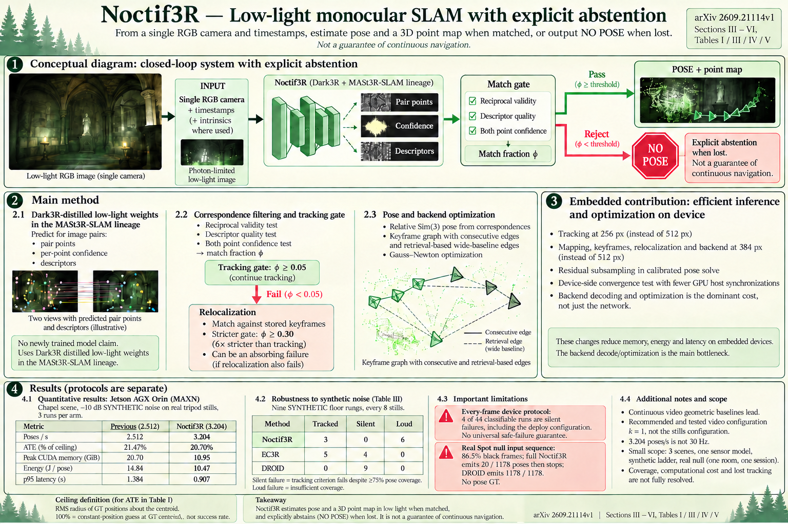

# Noctif3R: Feed-Forward Monocular Real-Time SLAM for Photon-Limited Scenes on Embedded Hardware (arXiv 2026)

<!-- PAPER-CARD:en -->

[Original paper](https://arxiv.org/abs/2609.21114v1) · [Full-size English card](../../assets/paper-cards/en/robotics/noctif3r.png)
<!-- /PAPER-CARD -->

## 📋 Overview

- **Authors**: Mihir Chauhan, Aditya Uday Abhang, Kevin Biju Mathew, Aniket Bera
- **Institution**: Purdue University
- **Venue**: arXiv preprint (2026-09)
- **Links**: [Paper](https://arxiv.org/abs/2609.21114)
- **Verification**: UNKNOWN (2026-10-15; source 2609.21114v1 content reviewed; publication venue not independently confirmed)
- **TL;DR**: Gate low-light pointmap matches and reduce embedded-backend costs, measuring lost coverage when unreliable trajectories are stopped rather than continuously published.

## 🎯 Key Contributions

1. Distinguish complete trajectories from trajectories carrying actual motion information.
2. Separate tracking/mapping resolutions to reduce embedded costs.
3. Explicitly report stops/failures under near-zero light.

## 🔧 Technical Details

### Input, Output, and Problem

- **Input**: Monocular low-light RGB frames and timestamps, without depth, stereo or IMU.
- **Output**: Poses/pointmap maps over trackable intervals, with possible gate-triggered termination.
- **Problem**: Very dark imagery can produce plausible full-length trajectories without motion information.

### Method

1. Predict correspondences through a MASt3R-SLAM-family low-light pointmap frontend.
2. Solve relative Sim(3) only for match-gated observations.
3. Refine pose graphs/retrieval edges with Gauss–Newton.
4. Separate mapping/tracking resolutions and backend computation to lower memory/latency.

A deployment/measurement study using low-light geometry weights. The real-time title does not guarantee fixed FPS for general videos.

## 📊 Results

**Source**: [Source PDF](https://arxiv.org/pdf/2609.21114v1), Table I, PDF p.3.

Synthetic tripod-still chapel at −10dB, Jetson AGX Orin MAXN, 3 runs per arm. ATE is percentage of a no-information ceiling, not m.

| Measure              | Previous deployment | NOCTIF3R |
| -------------------- | ------------------- | -------- |
| Poses/s ↑            | 2.512               | 3.204    |
| ATE (% of ceiling) ↓ | 21.47               | 20.70    |
| Peak CUDA (GiB) ↓    | 20.70               | 10.95    |
| Energy/pose (J) ↓    | 14.84               | 10.47    |

Report low errors with narrow coverage. On actual robot video with mostly black frames, every proposed configuration stopped after a bright start; darkness is not solved.

## 💡 Insights & Impact

Continuously publishing incorrect estimates and stopping output are different robotic failures.

- Some tracking-loss intervals effectively never recover, and coverage is narrow.
- Distinguish synthetic noise ladders, display gain and actually delivered frames.

## 🔗 Related Work

- [MASt3R](../foundation/mast3r.md): pointmap-matching background.
- [VGGT-SLAM](../reconstruction/vggt-slam.md): a low-light comparison system.

## 📚 Key Takeaways

1. Gates change coverage as well as errors.
2. Backend costs limit embedded speed.
3. Fully dark real-video failures are results too.
