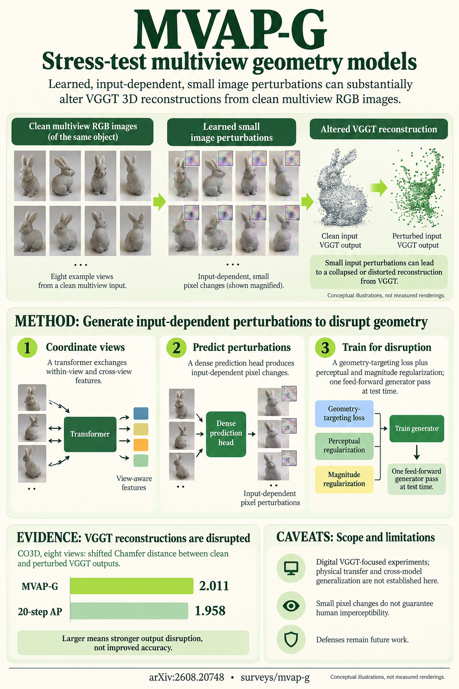

# Generating Multi-view Adversarial Examples for Visual Geometry Grounded Transformer (arXiv 2026)

<!-- PAPER-CARD:en -->

[Original paper](https://arxiv.org/abs/2608.20748v1) · [Full-size English card](../../assets/paper-cards/en/surveys/mvap-g.png)
<!-- /PAPER-CARD -->

## 📋 Overview

- **Authors**: Qi Song, Ziyuan Luo, Haoliang Han, Renjie Wan
- **Institution**: Hong Kong Baptist University
- **Venue**: arXiv preprint (2026-08)
- **Links**: [Paper](https://arxiv.org/abs/2608.20748)
- **Verification**: UNKNOWN (2026-10-15; source 2608.20748v1 content reviewed; publication venue not independently confirmed)
- **TL;DR**: Analyze multi-view perturbations on VGGT and evaluate reconstruction changes using generators trained on cross-view relationships.

## 🎯 Key Contributions

1. Compare fixed single-image perturbations with iterative scene-specific optimization.
2. Study generators using cross-view attention.
3. Measure clean/perturbed geometry differences across view counts.

## 🔧 Technical Details

### Input, Output, and Problem

- **Input**: Multiple RGB views and pretrained VGGT.
- **Output**: Perturbed images and evaluated geometry changes.
- **Problem**: Single-image robustness alone cannot explain multi-view geometry-model vulnerabilities.

### Method

1. Read multiple views jointly with a generator.
2. Exchange information through within-view and cross-view attention.
3. Predict per-image perturbations with dense heads and transfer trained generators to new scenes.
4. Compare shifted Chamfer distance between clean/perturbed VGGT clouds.

Generator training is supervised by VGGT-output changes. One-step describes generation after training, excluding training costs.

## 📊 Results

**Source**: [Source PDF](https://arxiv.org/pdf/2608.20748v1), Table 1, PDF p.10.

CO3D, 4 input views. Higher shifted CD means larger clean-to-perturbed output changes, not GT reconstruction error or attack-success percentage.

| Perturbation      | Shifted CD ↑ |
| ----------------- | ------------ |
| Gaussian noise    | 0.666        |
| UAP               | 0.675        |
| AP, 20 iterations | 1.892        |
| MVAP-G            | 2.016        |

This table does not establish physical-capture vulnerability or transfer to every geometry backbone. Numbers apply to the specified VGGT/data/perturbation conditions.

## 💡 Insights & Impact

Apparently consistent geometry does not guarantee input-perturbation robustness.

- Shifted CD does not directly measure GT-accuracy loss.
- Transfer and physical reproducibility outside tested models/data require separate checks.

## 🔗 Related Work

- [VGGT](../foundation/vggt.md): the evaluated model.
- [Confidence Audit](confidence-audit.md): a different reliability analysis.

## 📚 Key Takeaways

1. Evaluate robustness with multi-view relationships.
2. Measure clean/perturbed output differences.
3. Do not convert these values into real-world failure probabilities.
