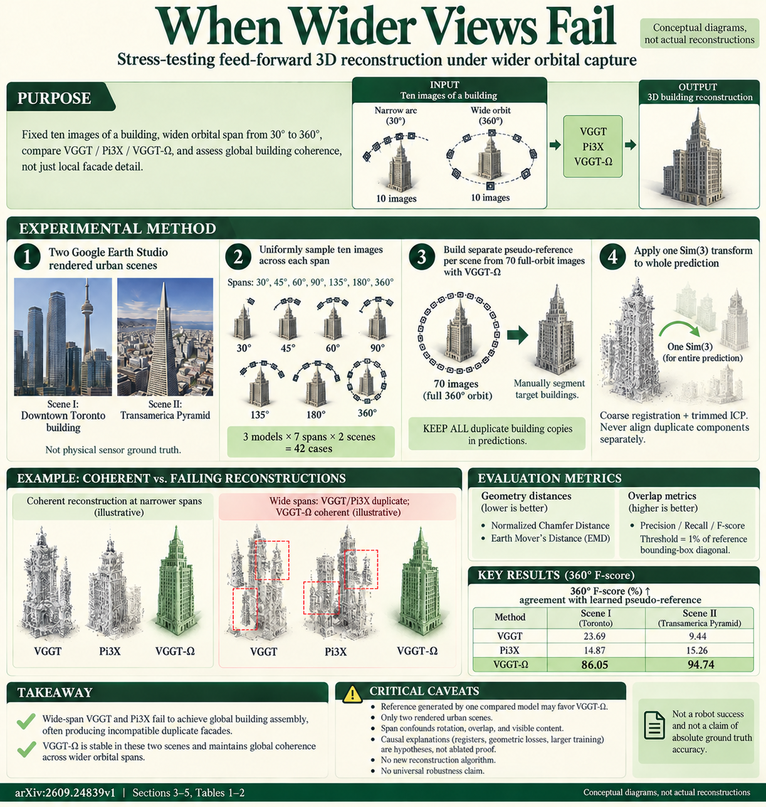

# When Wider Views Fail: Stress-Testing Feed-Forward 3D Reconstruction (arXiv 2026)

<!-- PAPER-CARD:en -->

[Original paper](https://arxiv.org/abs/2609.24839v1) · [Full-size English card](../../assets/paper-cards/en/surveys/wider-views-fail.png)
<!-- /PAPER-CARD -->

## 📋 Overview

- **Authors**: Daisy Li, Kyle Gao, Quanyun Wu, Hanna Chomko, John S. Zelek, Jonathan Li
- **Institution**: University of Waterloo, Aalto University
- **Venue**: arXiv preprint (2026-09)
- **Links**: [Paper](https://arxiv.org/abs/2609.24839)
- **Verification**: UNKNOWN (2026-10-15; source 2609.24839v1 content reviewed; publication venue not independently confirmed)
- **TL;DR**: FF3D at wider camera spans can produce duplicate buildings instead of coherent geometry at fixed image counts. Measure failure by aligning whole predictions without removing duplicates.

## 🎯 Key Contributions

1. **Controlled View Span**: Fix image counts and vary viewing spans across two urban scenes.
2. **Failure-Aware Alignment**: Apply one Sim(3) to all predictions without separately aligning/removing building replicas.
3. **Reference-Bias Disclosure**: State that VGGT-Ω generates the pseudo-reference.

## 🔧 Technical Details

### Input, Output, and Problem

- **Input**: Google Earth Studio orbit images of two buildings and evaluated VGGT, π3X or VGGT-Ω models.
- **Output**: Per-span point clouds and reference-relative distance, precision, recall and F-scores.
- **Problem**: Strong local short-trajectory alignment can coexist with global collapse over wider viewpoints. Piecewise alignment hides this failure.

### Method

1. Construct varied-angular-span orbits with identical sampled image counts per scene.
2. Build VGGT-Ω pseudo-references from denser full orbits and manually isolate central buildings.
3. Retain all replicas and estimate one similarity transform through coarse registration and trimmed ICP.
4. Normalize distances by reference bounding-box diagonals and compute surface precision/recall at matched thresholds.

A stress test of three released models, not a retrained reconstructor. §3 uses 10 images per orbit, 70 pseudo-reference images and 42 reconstruction cases.

## 📊 Results

**Source**: [Source PDF](https://arxiv.org/pdf/2609.24839v1), Table 1 and §3, PDF pp.2–3.

Toronto Scene I F-scores (%). Surface threshold is 0.01 of pseudo-reference bounding-box diagonal. This measures learned-reference agreement, not laser-GT accuracy.

| Model  | 30° Span F-score ↑ | 360° Span F-score ↑ |
| ------ | ------------------ | ------------------- |
| VGGT   | 77.47              | 23.69               |
| π3X    | 85.59              | 14.87               |
| VGGT-Ω | 81.03              | 86.05               |

π3X performs well at narrow spans but degrades strongly at wider spans. VGGT-Ω's advantage may reflect same-model reference bias. Do not combine with Table 2's other scene as identical real-GT evaluation.

## 💡 Insights & Impact

Changing image counts alone cannot explain view-span failure; include duplicates and global cloud collapse in evaluation.

- Limited to two scenes and synthetic capture, not a ranking for all real buildings/sensors/scenes.
- Manual segmentation and pseudo-references affect results. VGGT-Ω is not absolute GT.

## 🔗 Related Work

- [VGGT](../foundation/vggt.md), [VGGT-Ω](../reconstruction/vggt-omega.md), [π³](../reconstruction/pi3.md): related reconstruction families.
- [E3D-Bench](e3d-bench.md): controlled-condition model comparisons.

## 📚 Key Takeaways

1. View span changes difficulty even at identical image counts.
2. Removing detached replicas can understate failure.
3. Distinguish pseudo-reference agreement from actual geometric accuracy.
