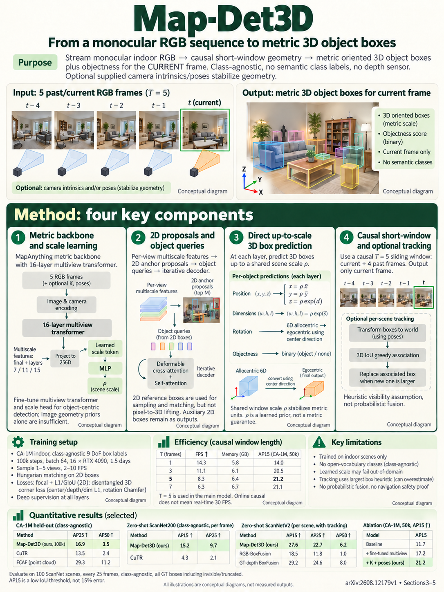

# Map-Det3D: Metric Feed-Forward 3D Reconstruction Prior for Multi-view 3D Object Detection from Streaming Inputs (arXiv 2026)

<!-- PAPER-CARD:en -->

[Original paper](https://arxiv.org/abs/2608.12179v1) · [Full-size English card](../../assets/paper-cards/en/understanding/map-det3d.png)
<!-- /PAPER-CARD -->

## 📋 Overview

- **Authors**: Yung-Hsu Yang, Luigi Piccinelli, Samuel Rota Bulò, Sunghwan Hong, Denis Rozumny, Johannes Schönberger, Zuria Bauer, Hermann Blum, Peter Kontschieder, Marc Pollefeys
- **Institution**: ETH Zürich, Meta Reality Labs Zürich, University of Bonn
- **Venue**: arXiv preprint (2026-08)
- **Links**: [Paper](https://arxiv.org/abs/2608.12179)
- **Verification**: UNKNOWN (2026-10-15; source 2608.12179v1 content reviewed; publication venue not independently confirmed)
- **TL;DR**: Convert short RGB temporal windows into MapAnything metric 3D features and directly decode object boxes in 3D with DETR-style queries.

## 🎯 Key Contributions

1. Apply metric reconstruction priors to streaming detection.
2. Fine-tune object-aware multi-view features.
3. Separate intrinsics/pose-conditioning effects.

## 🔧 Technical Details

### Input, Output, and Problem

- **Input**: Causal windows of current/past RGB frames, optionally camera intrinsics/poses.
- **Output**: Metric 3D object boxes.
- **Problem**: Lifting 2D detections through depth amplifies small distance errors into 3D box-placement errors.

### Method

1. Treat temporally separated frames as different views.
2. Build shared metric representations with MapAnything geometry/scale encoders.
3. Adapt multi-view Transformers through object-centric feature learning.
4. Regress 3D boxes directly with DETR-style queries, without 2D-box lifting.

Fine-tune with detection supervision. Separate camera-conditioned results from unconditioned ones.

## 📊 Results

**Source**: [Source PDF](https://arxiv.org/pdf/2608.12179v1), Table 1, PDF p.10.

CA-1M validation AP15 ablation. Both rows train multi-view/scale-head/Transformer components; only K/Pose inputs differ.

| Configuration           | K/Pose input | AP15 ↑ |
| ----------------------- | ------------ | ------ |
| Adapted metric backbone | Neither      | 17.2   |
| Adapted metric backbone | Both         | 21.2   |

Adding views to frozen priors alone yields little gain. Pose-input benefits are not RGB-only learning effects.

## 💡 Insights & Impact

Strong dense geometry does not automatically provide detection features; task adaptation is needed.

- Metric-scale priors and camera-domain shifts affect performance.
- Extra poses/intrinsics materially affect comparisons.

## 🔗 Related Work

- [MapAnything](../reconstruction/mapanything.md): metric backbone.
- [MV2GF](mv2gf.md): a separate pedestrian-BEV task using pointmaps.

## 📚 Key Takeaways

1. Decode boxes directly in metric 3D.
2. Separate training targets from temporal-context effects.
3. Disclose camera inputs beside tables.
