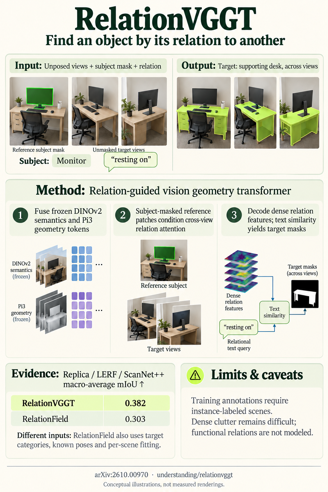

# RelationVGGT: Visual Geometry Transformers for 3D Spatial Relation Segmentation (arXiv 2026)

<!-- PAPER-CARD:en -->

[Original paper](https://arxiv.org/abs/2610.00970v2) · [Full-size English card](../../assets/paper-cards/en/understanding/relationvggt.png)
<!-- /PAPER-CARD -->

## 📋 Overview

- **Authors**: Minsu Kim, Jaesung Choe, Jiwoo Lee, Yu-Chiang Frank Wang, Seon Joo Kim
- **Institution**: Yonsei University, NVIDIA
- **Venue**: arXiv preprint (2026-10)
- **Links**: [Paper](https://arxiv.org/abs/2610.00970)
- **Verification**: UNKNOWN (2026-10-15; source 2610.00970v2 content reviewed; publication venue not independently confirmed)
- **TL;DR**: Find relation-specified targets across images from subject masks and relational text, combining Pi3 geometry tokens with DINOv2 semantics.

## 🎯 Key Contributions

1. Define spatial-relation segmentation without target categories.
2. Train subject-conditioned cross-view relation Transformers.
3. Produce relation labels through VLM/LLM annotation pipelines.

## 🔧 Technical Details

### Input, Output, and Problem

- **Input**: Unposed RGB views, reference-subject masks and relational text queries, without target-category names.
- **Output**: Per-view target masks and 3D visualizations.
- **Problem**: Category retrieval alone cannot identify objects above, beside or below a specific subject.

### Method

1. Extract frozen DINOv2 and Pi3 encoder tokens. Despite the name, Pi3 supplies the actual geometry features.
2. Combine semantic/geometric features with input mixers.
3. Produce target-specific relation embeddings with subject-mask-conditioned Transformers.
4. Obtain masks through similarity between BERT queries and dense features.

Train on automatic ScanNet++ relation annotations. Predict masks without per-scene NeRF/Gaussian optimization.

## 📊 Results

**Source**: [Source PDF](https://arxiv.org/pdf/2610.00970v2), Table 1, PDF p.8.

Replica/LERF/ScanNet++ relation-segmentation mIoU. RelationField receives target-category retrieval information; its † variant uses relations only.

| Method        | Replica ↑ | LERF ↑ | ScanNet++ ↑ |
| ------------- | --------- | ------ | ----------- |
| RelationField | 0.326     | 0.276  | 0.307       |
| RelationVGGT  | 0.446     | 0.254  | 0.445       |

Performance is below RelationField on LERF. Supplied subject masks and relational queries do not imply unconditional scene-understanding accuracy.

## 💡 Insights & Impact

3D-foundation features provide priors for view-consistent relation masks without explicit scene-representation optimization.

- Automatic relation annotations and language ambiguity affect performance.
- Performance decreases in scenes crowded with small nearby objects.

## 🔗 Related Work

- [π3](../reconstruction/pi3.md): the actual geometry encoder.
- [GroupForward](groupforward.md): another relation approach using instance scene graphs.

## 📚 Key Takeaways

1. Check the actual backbone rather than inferring it from the name.
2. Specify targets with subjects/relations rather than categories.
3. Disclose different target information supplied to baselines.
