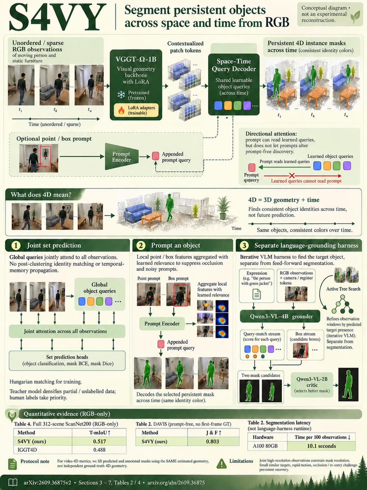

# S4VY: Segment Anything in Feed-Forward 4D Visual Geometry (arXiv 2026)

<!-- PAPER-CARD:en -->

[Original paper](https://arxiv.org/abs/2609.36875v2) · [Full-size English card](../../assets/paper-cards/en/understanding/s4vy.png)
<!-- /PAPER-CARD -->

## 📋 Overview

- **Authors**: Jingdong Zhang, Xin Li, Jan Kautz, Wenping Wang, Chris Choy
- **Institution**: Texas A&M University, NVIDIA
- **Venue**: arXiv preprint (2026-09)
- **Links**: [Paper](https://arxiv.org/abs/2609.36875)
- **Verification**: UNKNOWN (2026-10-15; source 2609.36875v2 content reviewed; publication venue not independently confirmed)
- **TL;DR**: Persistent object queries over VGGT-Ω geometry associate instance masks across observations; separate language grounders/critics select requested instances.

## 🎯 Key Contributions

1. Discover class-agnostic instances before prompting.
2. Link identities across time/views through space-time queries.
3. Select language targets through active tree search, dual-stream grounders and critics.

## 🔧 Technical Details

### Input, Output, and Problem

- **Input**: RGB observations, optionally points, boxes or natural-language queries.
- **Output**: Persistent instance masks across observations and selected target masks.
- **Problem**: Sequential memory-based propagation struggles with large view changes and long 4D observation spaces.

### Method

1. Attach space-time query decoders to VGGT-Ω features.
2. Let each object query predict the same entity's masks across observations.
3. Select discovered queries through point/box encoders.
4. Search relevant frames with a language harness and compare candidate streams using independent critics.

Train segmenters, prompt encoders, language grounders and critics separately. A single geometry network does not perform every language-inference step.

## 📊 Results

**Source**: [Source PDF](https://arxiv.org/pdf/2609.36875v2), Table 2, PDF p.10.

Class-agnostic segmentation without target prompts or first-frame GT. DAVIS 4D metrics lift GT/predictions using the same estimated depth/cameras, not actual 3D GT.

| Method | DAVIS 4D-IoU ↑ | DAVIS 4D-SR ↑ | DAVIS J&F ↑ |
| ------ | -------------- | ------------- | ----------- |
| IGGT4D | 0.543          | 0.667         | 0.604       |
| S4VY   | 0.715          | 0.914         | 0.803       |

Table latency is clip processing for specified observation counts on A100, not all language-harness calls.

## 💡 Insights & Impact

Separating consistent instance discovery from prompt selection reduces dependence on observation order.

- Estimated-geometry 4D metrics do not directly validate geometric errors.
- Agentic language selection depends on VLM judgments and frame-search failures.

## 🔗 Related Work

- [VGGT-Ω](../reconstruction/vggt-omega.md): geometry backbone.
- [IGGT4D](iggt4d.md): streaming geometry/instance comparisons.

## 📚 Key Takeaways

1. Discover instances first, then select through prompts.
2. Persistent queries connect views and time.
3. Distinguish pseudo-3D evaluation from actual geometry GT.
