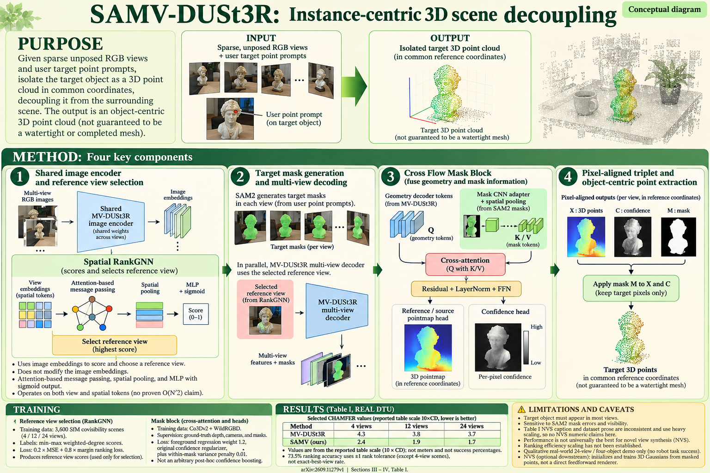

# SAMV-DUSt3R: Instance-Centric 3D Scene Decoupling from Sparse Multi-Views (arXiv 2026)

<!-- PAPER-CARD:en -->

[Original paper](https://arxiv.org/abs/2609.11279v1) · [Full-size English card](../../assets/paper-cards/en/understanding/samv-dust3r.png)
**Card source correction:** The supplied image footer prints `2610.12971v1`. The paper summarized here is [SAMV-DUSt3R, arXiv:2609.11279v1](https://arxiv.org/abs/2609.11279v1). Its Table I contains the displayed DTU Chamfer values (reported at 10× scale). The supplied image is preserved unchanged; use this corrected paper link.

<!-- /PAPER-CARD -->

## 📋 Overview

- **Authors**: Langxu Zhao, Zuan Gu, Yingdan Zhang, Pengfei Zhao, Tianhan Gao
- **Institution**: Northeastern University, Shenyang
- **Venue**: arXiv preprint (2026-09)
- **Links**: [Paper](https://arxiv.org/abs/2609.11279)
- **Verification**: UNKNOWN (2026-10-15; source 2609.11279v1 content reviewed; publication venue not independently confirmed)
- **TL;DR**: Inject SAM2 target masks into MV-DUSt3R attention and learn reference selection to isolate a requested object's 3D geometry.

## 🎯 Key Contributions

1. Guide reconstruction tokens with mask features.
2. Select references through Spatial RankGNN.
3. Learn target pointmaps with object-centric confidence losses.

## 🔧 Technical Details

### Input, Output, and Problem

- **Input**: Sparse RGB views and prompted SAM2 object masks, without required camera calibration.
- **Output**: Selected-instance pointmaps and 3D reconstruction.
- **Problem**: Cropping targets after whole-scene reconstruction underuses object boundaries and view-specific information.

### Method

1. Convert mask-CNN features into token-compatible forms.
2. Attend geometry tokens to mask features through Cross Flow Mask Blocks.
3. Predict good references from SfM-covisibility ranking supervision.
4. Learn target-region pointmaps/confidence and use isolated objects for subsequent rendering.

Train RankGNN and mask-guided geometry separately. NVS trains 3DGS on output clouds, adding costs beyond one geometry-network pass.

## 📊 Results

**Source**: [Source PDF](https://arxiv.org/pdf/2609.11279v1), Table I, PDF p.5.

DTU, 4 input views at 224×224. The source displays CD/accuracy/completeness scaled by 10; preserve these displayed values without conversion to native DTU units.

| Method      | Displayed CD ↓ | Displayed Acc. ↓ | Displayed Comp. ↓ |
| ----------- | -------------- | ---------------- | ----------------- |
| MV-DUSt3R   | 4.3            | 9.9              | 9.4               |
| SAMV-DUSt3R | 2.4            | 6.2              | 6.3               |

Source SSIM/LPIPS also use separate scaling and are not directly comparable to standard 0–1 tables. Full-image NVS includes non-target errors, unlike masked results.

## 💡 Insights & Impact

Use object masks as conditions during geometry creation, not only post-hoc filters.

- Depend on SAM2-mask quality and targets being visible in most views.
- Preserve ranking-accuracy tolerances and transformed metric scales.

## 🔗 Related Work

- [DUSt3R](../foundation/dust3r.md): pointmap background.
- [IGGT](iggt.md): another instance-geometry approach.

## 📚 Key Takeaways

1. Target masks guide reconstruction attention.
2. Reference selection is learned too.
3. Separate table scaling from subsequent 3DGS costs.
